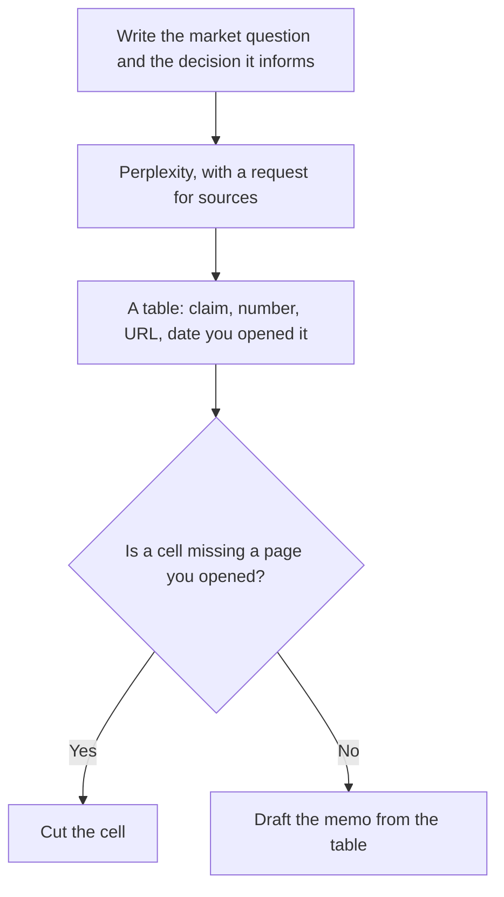

**Use Perplexity to collect public claims with links, then keep only the claims whose pages you opened.** It is an answer engine for the web. It is not a panel of your customers, and it is not a substitute for the sales calls already in your CRM. Market research that ships from an unopened citation is a blog post with a footnote costume.

Pro is $17 a month billed annually and adds higher limits, model choice, files, Computer, and premium data such as PitchBook and Statista. Free is enough for a single question if you stay inside 3 Pro Searches a day. The bill is [Perplexity pricing explained](/blog/perplexity-pricing-explained-2026/). The desk habits are [Perplexity review](/blog/perplexity-review-2026/). Prices below are from the October 24, 2026 read of Perplexity's pages, unless another tool's price is tagged with its own date.

## What this workflow will and will not answer

| Question type | Use Perplexity? | Use instead |
|---|---|---|
| What do these companies say in public about price, warranty, or positioning? | Yes | Open the manufacturer or pricing page, not only the summary |
| What do peer-reviewed papers say? | No | [Consensus](/tools/consensus/) or [Elicit](/tools/elicit/). The method is [how to research papers with Elicit and Consensus](/blog/how-to-research-with-elicit-and-consensus-2026/) |
| How do our customers describe the problem? | No | Your interviews, tickets, and CRM |
| Which keywords have volume? | No | [Semrush](/tools/semrush/). The SEO plan is $117.33/month on yearly billing, or $139 monthly, recorded October 16, 2026 |
| A first draft of a memo from notes you already checked | Optional, after the table | [Claude](/tools/claude/) is the writing seat. See [how to write a blog post with Claude](/blog/how-to-write-a-blog-post-with-claude-2026/) |

## Step 1: Name the decision

"Should we price the starter tier at $29 or $49?" is a decision. "Tell me about the market" is a tour. Write the decision, the geography, and the set of competitors you already know. Ask Perplexity to add competitors only with a source, and to say when it cannot find a public price.

US dollars, and the pages a US buyer would see, are the default for this site. If a vendor shows a local currency, record the currency. Do not convert it yourself and call the conversion official.

## Step 2: Ask for a table, then throw away the cells you cannot open

A prompt that fits this workflow:

> Compare these three companies on public list price, who the product is for, and what the pricing page says is excluded. Cite the page for each cell. If a cell is not on a page you can link, leave it blank.

Put your competitor list in the prompt. Read the answer. Open every link. Copy into your own table only what the page says, with the date you opened it. Perplexity's summary can merge a 2024 blog with a 2026 pricing page. The date on the page wins.

Free allows 3 Pro Searches a day and 1 research query a month in the help-center table. Spend Pro Search on the comparison, not on "what is market research?" If you do this most workdays, Pro at $17 annual is the plan. Max at $167 annual is for Computer and research limits you have already hit. The worth-it test is [is Perplexity Pro worth it](/blog/is-perplexity-pro-worth-it-2026/).

## Step 3: Use premium data only if you will cite it

Pro lists premium sources such as PitchBook and Statista. If a figure comes from one of them, say so in the memo and keep the export. If your Pro account is not actually showing those sources, you do not have the figure. Do not fill the gap with a model estimate. Market size numbers are where unsourced research goes to sound precise.

Computer, the agent on Pro and Max, can carry out a longer task. It still owes you links. A task that returns a polished report without URLs is a draft you cannot defend. Send it back for sources, or discard it.

## Step 4: Separate the web from your own evidence

Add a second block to the memo that Perplexity cannot write: what your last ten sales calls said, what the support queue repeats, what the CRM shows for win rate. [Fathom](/tools/fathom/) can search recorded calls if you already record them. Business, at $25 a user a month billed annually, is the CRM sync tier. That stack is [best AI tools for sales teams](/blog/best-ai-tools-for-sales-teams-2026/).

Keyword demand is Semrush or a similar suite, not an answer engine. [Writesonic](/tools/writesonic/) tracks AI-answer visibility if that chart is a deliverable. Starter there is $79 a month on yearly billing, recorded October 16, 2026. The marketer's map is [best AI tools for marketers](/blog/best-ai-tools-for-marketers-2026/).

## Step 5: Publish a memo a skeptical teammate can audit

Lead with the decision and the recommendation. Then the table. Then what you could not find. Then what would change your mind. [Gamma](/tools/gamma/) Plus at $9 a seat a month can turn the finished table into a leave-behind. It should not invent a row. [Claude](/tools/claude/) Pro at $20 a month, or $17 annual, can tighten the prose from the table you paste.

Keep the research log. A later quarter will ask where a number came from. "Perplexity said so" is not a source. The URL and the date are the source.

## FAQ

### Is Perplexity Pro required for market research?

No. Free covers a limited number of stronger searches a day. Pro is the plan if this is a weekly habit, or if you need Computer, files, and the premium data sources. Max is a capacity upgrade after you have evidence Pro is too small.

### Can Perplexity estimate a TAM?

It can find public estimates and link them. An estimate it produces without a source is not a TAM. Label sourced figures as someone else's number, with the publisher and date.

### How is this different from Consensus?

Consensus searches peer-reviewed papers. Perplexity searches the web. A clinical or scientific claim belongs in Consensus or Elicit. A pricing-page claim belongs here.

### Can I hand Perplexity our internal strategy doc?

Only if your plan and your company policy allow that upload. Enterprise is the tier with admin controls and the contractual data stance, at $40 a user a month or $400 a year. A personal Pro seat is not that contract.

## Last verified

October 24, 2026 for Perplexity plan prices and the help-center limits. October 16, 2026 for Semrush, Writesonic, Fathom, Gamma, and Claude prices cited above. Published October 24, 2026.

**Sources:** [Perplexity Pro](https://www.perplexity.ai/pro), [Perplexity help center](https://www.perplexity.ai/hub/helpcenter).

[Perplexity](/tools/perplexity/) is in the [research directory](/tools/category/research-search/). Directory pages may use affiliate links. A purchase through them may earn us a commission at no extra cost to you.
