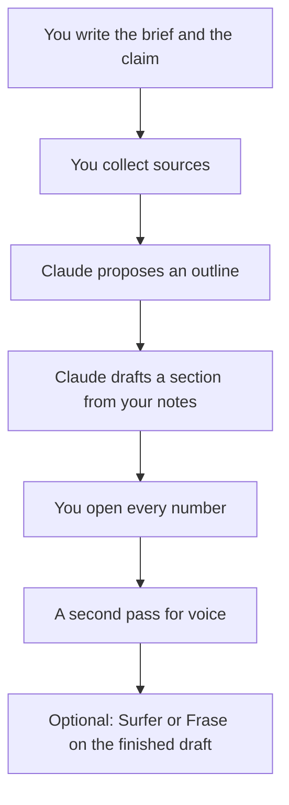

**Have Claude write the section you can check, after you have written the claim.** The useful workflow is a brief, an outline that answers the question in the first screen, a draft built from notes you supply, and a pass where every number has a page you opened. The useless workflow is "write a 2,000-word post about X" and a publish button.

This is a method, not a score of Claude against other models. The writing comparison is [ChatGPT vs Claude for writing](/blog/chatgpt-vs-claude-for-writing-2026/). Plan choice above Pro is [Claude Pro vs Max](/blog/claude-pro-vs-max-2026/).

Prices below are US list prices excluding tax, from vendor pages checked October 16, 2026, published here on October 24, 2026. A live refetch of the pricing URLs that day did not return numbers.

## Which Claude plan this workflow needs

| Plan | Price | Use it for this job when |
|---|---|---|
| Free | $0 | You are drafting one post and you can paste sources yourself. Chat, files, and artifacts are on the free plan |
| Pro | $20/month, or $17 billed annually | You publish every week and you hit the free cap, or you want the longer working sessions |
| Max | From $100/month | You already live in Pro and the limit, not the quality of one paragraph, is the problem |
| Team and Enterprise | Sales or the team price on Claude's page | A company knowledge setup. Not required to publish a blog |

[Claude](/tools/claude/) Pro is the plan this workflow assumes once it is a habit. Do not buy Max to "write better." Max is a usage tier.

## Step 1: Write the brief yourself

One short note, before any prompt:

- Who the reader is, and what they will do after the post.
- The question, in their words.
- The answer, in one or two sentences you are willing to defend.
- What the post will not cover.
- The sources you will accept: a vendor pricing page, a paper, your own data. "The model knows" is not a source.

If you cannot write the answer sentence, you are not ready for a draft. You are ready for research. [Perplexity](/tools/perplexity/) is the cited-web pass. Pro is $17/month billed annually if you do this daily. Free is enough for a single post. Academic claims go to [Consensus](/tools/consensus/) or [Elicit](/tools/elicit/), not to a chatbot's memory. That split is [Perplexity alternatives](/blog/perplexity-alternatives-2026/).

## Step 2: Ask for an outline that starts with the answer

Paste the brief. Ask for a structure that puts the answer in the opening, then the evidence, then the exceptions. Ask it to mark any section that would require a source you did not provide.

Reject an outline that adds a tool roundup, a history of AI, or a conclusion that repeats the intro. Those are how posts get long without getting more useful.

## Step 3: Draft one section at a time, from notes

Paste the notes for that section: a quote, a price, a date, a constraint. Tell Claude to use only those notes for factual claims, and to say "not in the notes" instead of filling a gap.

Do the whole post this way. A single "write it all" prompt throws away the outline and invents the connective facts. Section prompts are slower and they are the point.

A prompt that works, with your notes underneath it:

> Draft the pricing section. Use only the figures in the notes. If a plan is missing a price, say it is missing. Do not estimate usage. Keep the opening sentence as the decision.

Then you edit. The model is not the author of the claim. You are. The byline should match that.

## Step 4: Fact pass, out loud

For every number, name, and plan limit, open the source. If the source does not say it, cut it or mark it as unknown. This is the step people skip because the prose already sounds finished. Finished prose is not a citation.

Common cuts:

- A credit converted into minutes when the vendor did not publish the rate.
- A "most popular" or "best score" with no method.
- A yearly discount applied to a vendor that did not print one.
- A competitor feature you did not look up, added for balance.

## Step 5: Voice, then optional SEO

Ask for a second pass that shortens sentences and removes filler. Give it a paragraph of your own writing as the voice sample. Do not ask it to sound like a generic expert.

[Grammarly](/tools/grammarly/) is the mechanical pass if you want it in the browser. Pro is $12 per member per month billed annually, or $30 monthly. The free plan covers grammar. It does not replace the fact pass. Whether Pro is worth it is [is Grammarly Pro worth it](/blog/is-grammarly-pro-worth-it-2026/).

SEO tools come after the draft has a claim. [Surfer SEO](/tools/surfer-seo/) Standard is $99/month on yearly billing and will suggest terms. [Frase](/tools/frase/) Starter is $39/month on yearly billing and will also draft, which you should not let overwrite the sourced sections. How to choose between them is [Surfer SEO vs Frase](/blog/surfer-seo-vs-frase-2026/). Use the score to find a missing subheading. Do not use it to add a claim you cannot source.

## What to keep out of the prompt

- Customer data, unpublished financials, and anything under an NDA.
- A request to imitate a living writer's article. Summary and original structure are the lawful, useful version.
- "Make up a case study." If you do not have one, the post does not have one.

The wider writing list, including tools that are not a chatbot, is [best AI writing assistants](/blog/best-ai-writing-assistants/).

## FAQ

### Is Claude free enough to write a blog post?

Yes, for one post, if you paste the sources and you stay inside the free usage limits. Pro is the plan for a weekly cadence. The free plan already includes chat and file uploads.

### Should I use ChatGPT instead?

Use the one you will actually edit against your sources. The writing comparison linked above is about the draft. Neither model may invent the prices. [ChatGPT](/tools/chatgpt/) Plus is $20/month if that is the assistant you already keep open.

### Can Claude research the post for me?

It can help you read sources you provide. A web answer with citations is Perplexity's job, and a paper is a literature tool's job. Publish only the claims you opened.

### How long should the post be?

Long enough to answer the question and show the evidence. A short post with a sourced table is more useful than a long post that repeats the opening. Let the outline decide. Do not ask for a word count to satisfy a myth about ranking.

## Last verified

October 16, 2026 for the plan prices. The workflow itself does not depend on a price change. Published October 24, 2026.

**Sources:** [Claude pricing](https://claude.com/pricing), [Grammarly Pro cost](https://support.grammarly.com/hc/en-us/articles/115000090011-How-much-does-Grammarly-Pro-cost), [Surfer pricing](https://get.surferseo.com/surfer-pricing), [Frase pricing](https://www.frase.io/pricing).

[Claude](/tools/claude/) is in the [writing directory](/tools/category/writing/). Directory pages may use affiliate links. A purchase through them may earn us a commission at no extra cost to you.
