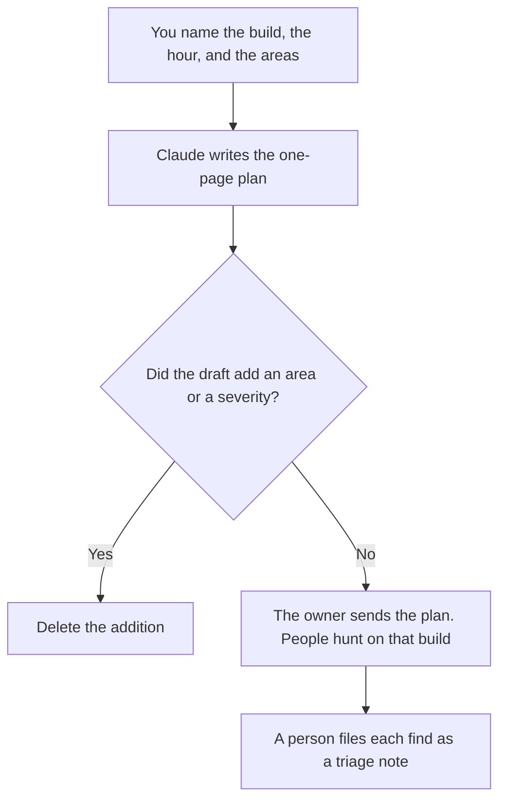

**A bug bash plan written with AI is a time box, a build, and a list of areas a person already chose, formatted so the room hunts instead of wandering.** The model may turn your notes into a one-page plan. It may not invent a feature to test, a severity scale, or a bug. The bash is not the release. It is a scheduled look at a build you can name.

The cases that should already exist are [how to create a QA test plan with AI](/blog/how-to-create-a-qa-test-plan-with-ai-2026/). The note after someone finds a defect is [how to write a bug triage note with AI](/blog/how-to-write-a-bug-triage-note-with-ai-2026/). The gates that decide whether you ship anyway are [how to write a release checklist with AI](/blog/how-to-write-a-release-checklist-with-ai-2026/).

Prices are US list prices excluding tax from directory pages checked October 16, 2026. Published October 24, 2026. We did not score how many bugs a bash should find. The model does not file the tickets.

## The lines that have to be real

| Line | Who owns it | The model may |
|---|---|---|
| Build | The version, environment, and URL you pasted | Copy them. It may not pick "latest" |
| Clock | The start, the stop, and the time zone you named | Format them. It may not extend the hour |
| Areas | The surfaces you listed, and the ones you marked out | Order the list. It may not add a surface |
| Severity | The scale your triage already uses | Paste it. It may not invent P0 |
| Who files | The person or rotation you named | Copy it. A find without a ticket owner is a chat message |
| Out of scope | Payments, production data, or anything you excluded | Keep those lines in the plan |

If the plan needs an area that is not in the build you will point people at, the build is the wrong build. Fix that before you invite the room. A test plan is the standing set of cases. A bug bash is a clock on top of a build. Do not merge them into one document that pretends to be both.

## Where the plan is written

**The draft.** [Claude](/tools/claude/) Pro is $20 a month, or $17 billed annually, when the area list and the severity scale sit in a Project. Free can format one plan from a paste. The review is [Claude review](/blog/claude-review-2026/).

**The page people open.** [Notion AI](/tools/notion-ai/) Business is $20 a seat a month if the plan should live next to the build notes. The sent page is the plan. A chat draft is not.

**The board.** [ClickUp Brain](/tools/clickup-brain/) starts at $9 a user a month, on a ClickUp plan. Unlimited is $7 a user a month billed yearly, or $10 monthly. Brain does not set severity. The board holds the tickets people file during the hour.

**A check in the repo.** [Cursor](/tools/cursor/) Plus is $8 a month, or $80 a year, if the plan links to a commit or a tag. The editor does not decide what to bash. The pair for writing tests, which is a different hour, is [Cursor vs GitHub Copilot for tests](/blog/cursor-vs-github-copilot-for-tests-2026/).

A prompt that holds the line:

"Write a one-page bug bash plan from the build, the start and stop, the areas, the out-of-scope list, and the severity scale I pasted. Do not add an area. Do not invent a bug. Do not change the scale. If a field is missing, write Missing."

## What not to delegate

Do not ask the model what to test. Do not let it file "bugs" from a screenshot it imagined. Do not bash production with customer data because the plan forgot the environment line. The environment is a field you fill. A risk list for the release, which is a different document, is [how to create a risk register with AI](/blog/how-to-create-a-risk-register-with-ai-2026/).

## FAQ

### Is a bug bash the QA test plan?

The test plan is the set of cases you mean to keep. The bash is a time box where people, often outside the QA rotation, hunt on one build. Use the test-plan article for the cases. Use this one for the hour.

### Can AI find the bugs for us?

It can format the plan. Finding is the people in the room, on the build you named. A model that "already checked the app" did not. File what a person saw.

### How long should the bash be?

As long as you wrote down. This page does not recommend a duration. A plan with no stop time becomes a week of unowned notes. Put the stop in the first line.

### What do we do with the list afterward?

Triage it with the scale you already use. The triage-note article is the next page. A bash that produces a chat thread and no tickets did not finish.

## Last verified

October 16, 2026 for Claude, Notion AI, ClickUp, and Cursor. Published October 24, 2026.

**Sources:** [Claude pricing](https://claude.com/pricing), [Notion pricing](https://www.notion.com/pricing), [ClickUp Brain pricing](https://clickup.com/brain/pricing), [Cursor pricing](https://cursor.com/help/account-and-billing/pricing).

*Published by Andrew for [AI Tools Optimizer](https://aitoolsoptimizer.com).*

[Cursor](/tools/cursor/) is in the [coding directory](/tools/category/coding/). Directory pages may use affiliate links. A purchase through them may earn us a commission at no extra cost to you.
