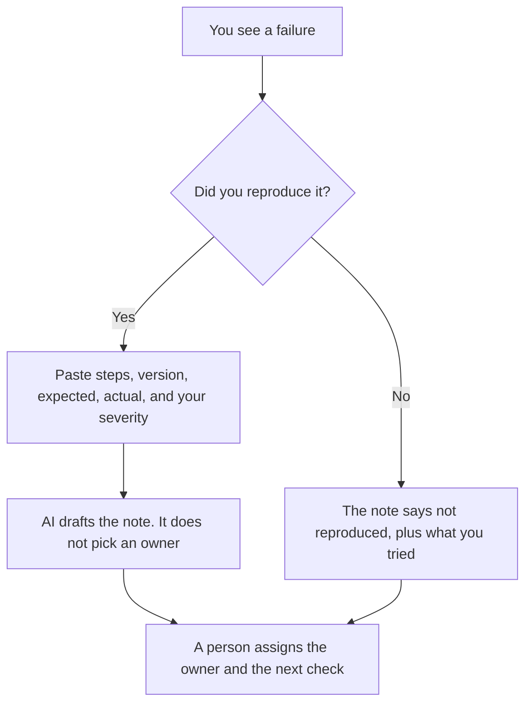

**A bug triage note written with AI is a short record: what broke, how you reproduced it, how bad you say it is, who owns the next step, and what you do not know yet.** The model can tighten the sentences you paste. It cannot assign severity, name a root cause, or promise a ship date. If the repro is missing, the note says it was not reproduced. A tidy theory is not a ticket.

The public version, if customers can see the failure, is [how to write a status page update with AI](/blog/how-to-write-a-status-page-update-with-ai-2026/). The write-up after you know the cause is [how to write a postmortem with AI](/blog/how-to-write-a-postmortem-with-ai-2026/). Reading one Python traceback, before this note exists, is [ChatGPT vs Claude for Python debugging](/blog/chatgpt-vs-claude-for-python-debugging-2026/).

Prices are US list prices excluding tax from directory pages checked October 16, 2026. Published October 24, 2026. We did not score bug-finding. This page does not set your severity scale.

## What the note is allowed to say

| Line | Who owns the fact | The model may |
|---|---|---|
| Symptom | What you observed: the error, the screen, the wrong number | Describe it. It may not rename it as a deeper failure |
| Repro | The steps you actually ran, including the version | Format the steps. It may not add a step you did not take |
| Severity | You, from your scale | Repeat the level you wrote. It may not escalate it |
| Scope | Who is affected, if you measured it | Not a percentage you did not paste |
| Owner and next step | The person you named, and the action | Not a fix, and not a date you did not commit |
| Unknowns | The cause, until someone proves it | Leave the cause as unknown |

A root cause the model guessed will be copied into the postmortem later if you are not careful. Keep the word "unknown" until a change in the code or the config explains the symptom. That discipline is the same one incident notes use. The hour of a customer-facing failure is [what AI incident response is](/blog/what-is-ai-incident-response-2026/).

## Where the note is drafted

**The paragraph.** [Claude](/tools/claude/) Pro is $20 a month, or $17 billed annually. Put the severity scale in a Project so the model stops inventing P0. The review is [Claude review](/blog/claude-review-2026/).

**The chat next to the ticket.** [ChatGPT](/tools/chatgpt/) Plus is $20 a month. Business is $20 a user a month billed annually, minimum two, when the paste includes a customer name. Strip the name if the ticket does not need it. The ladder is [ChatGPT Go vs Plus vs Pro](/blog/chatgpt-go-vs-plus-vs-pro-2026/).

**The ticket itself.** [Notion AI](/tools/notion-ai/) Business is $20 a seat a month if the board lives in Notion. The note is a row with an owner field a person fills. Plus at $10 is not the full AI tier. The invoice is [Notion AI pricing explained](/blog/notion-ai-pricing-explained-2026/).

**The repro in the editor.** [Cursor](/tools/cursor/) Plus is $8 a month, or $80 a year, when the next step is a failing test you will run. The note does not replace the test. The invoice is [Cursor pricing explained](/blog/cursor-pricing-explained-2026/).

A prompt that holds the line:

"Draft a bug triage note from these facts only. Include symptom, environment, repro steps I listed, expected versus actual, the severity I assigned, and unknowns. If I did not name an owner, write Owner missing. Do not propose a root cause. Do not invent log lines. Do not set a ship date."

The person who sets severity is [what human-in-the-loop AI is](/blog/what-is-human-in-the-loop-ai-2026/).

## Severity is a decision, not a mood

Write the scale where the team can see it: what "high" means in your product, in one sentence each. The model may format examples you provide. It may not decide that a typo is high because the prose sounds urgent, or that a data loss is low because the ticket is short.

If you did not reproduce the bug, say what you tried and what you need from the reporter. Do not let the draft imply you saw it. Duplicate tickets should point at the original note, not grow a second theory.

Customer impact stays numeric only when you counted it. "Some users" is honest. "40 percent" is a measurement. The log that would support a count is [what structured logging for AI is](/blog/what-is-structured-logging-for-ai-2026/), when the bug is in a model path. A model bug and a button bug can share this note shape. They should not share a guessed cause.

## FAQ

### Is this a postmortem?

No. A triage note is the open ticket. A postmortem is what you write after the cause and the fix are known. Using this workflow for the later document will hide the unknowns you still have. Use the postmortem guide when you are done.

### Can AI set priority from the traceback?

It can restate the traceback. Priority is impact and urgency on your scale. A scary stack trace in a script nobody runs is not automatically the top of the queue. You rank it.

### What if there are no repro steps?

Then that is the note. "Not reproduced. Need the account type and the time." Shipping a hypothetical fix for an unreproduced bug is how you change the wrong line. The debugging session comes after you can see the failure.

### Should the note include a patch?

Only a patch a person has run. A suggested diff in the ticket, labeled as untested, is optional and easy to mistake for a fix. Prefer a link to the test you ran. The model does not merge.

## Last verified

October 16, 2026 for Claude, ChatGPT, Notion AI, and Cursor. Published October 24, 2026.

**Sources:** [Claude pricing](https://claude.com/pricing), [ChatGPT pricing](https://chatgpt.com/pricing/), [Notion pricing](https://www.notion.com/pricing).

*Published by Andrew for [AI Tools Optimizer](https://aitoolsoptimizer.com).*

[Cursor](/tools/cursor/) is in the [coding directory](/tools/category/coding/). Directory pages may use affiliate links. A purchase through them may earn us a commission at no extra cost to you.
