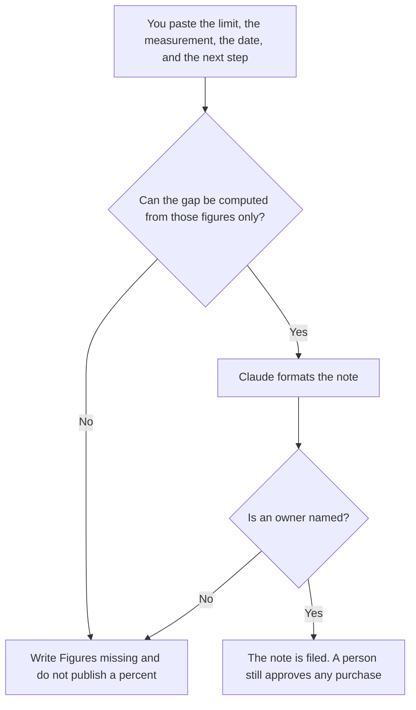

**A capacity plan note written with AI is a short page that says what limit you are near, the number you measured, the date you measured it, and what you will do before you hit it.** The model may format the note. It may not invent headroom, a growth rate, or a purchase. The cap on model calls, which is one kind of limit, is [what an AI request budget is](/blog/what-is-ai-request-budget-2026/). The vendor's speed limit, which is another, is [what AI rate limiting is](/blog/what-is-ai-rate-limiting-2026/).

A dependency that could take the limit away is [how to write a dependency risk note with AI](/blog/how-to-write-a-dependency-risk-note-with-ai-2026/). The undo if a scale change goes wrong is [how to create a rollback plan with AI](/blog/how-to-create-a-rollback-plan-with-ai-2026/).

Prices are US list prices excluding tax from directory pages checked October 16, 2026. Published October 24, 2026. We did not forecast demand. This page is not a finance approval.

## What fits in the note

| Block | Who owns it | The model may |
|---|---|---|
| The limit | The quota, the seat count, or the machine you named | Copy it. It may not guess the quota |
| The measurement | The number and the date you pasted | Place them. It may not update the date |
| The gap | The arithmetic of those two numbers | Compute only from figures you pasted |
| The next step | Buy, shed load, or wait, as you decided | Copy it. It may not recommend a vendor |
| The owner | Who watches the number | Copy the name. If it is missing, stop |

A sentence that says "we should be fine" is not a plan. The gap is a subtraction you can redo. If you did not paste a limit, there is no gap. The model does not get to say usage "usually" grows 10 percent.

## Where the note is written

**The draft.** [Claude](/tools/claude/) Pro is $20 a month, or $17 billed annually, when the note is long enough to keep beside last quarter's numbers. The review is [Claude review](/blog/claude-review-2026/).

**The record.** [Notion AI](/tools/notion-ai/) Business is $20 a seat a month if the page is what the review meeting opens. The database can hold the date. The chat should not be the only copy.

**A one-screen version.** [ChatGPT](/tools/chatgpt/) Plus at $20 a month can format a short note. Business, at $20 a user a month billed annually for two or more users, is the row when the numbers are confidential.

**The query.** [Cursor](/tools/cursor/) Plus is $8 a month, or $80 a year, when the measurement comes from a script in the repo. You run the script. A generated query is not a measurement until you have seen the result. The ladder is [Cursor pricing explained](/blog/cursor-pricing-explained-2026/).

A prompt that holds the line:

"Format a capacity note from the limit, the measured value, the date, the next step, and the owner I pasted. Do not invent a growth rate. If the date or the limit is missing, write Figures missing and stop."

## What not to delegate

Do not ask the model when you will run out. That date is your arithmetic, with the assumptions you are willing to sign. Do not paste production credentials into the chat to "let it look." Do not approve a purchase because the note sounds urgent. The note is an input to a person with a budget.

## FAQ

### How is this different from a request budget?

A request budget is the cap you enforce on model calls. A capacity note can be about that cap, or about seats, storage, or machines. The budget is the control. The note is the page that says how close you are and what you decided to do.

### Can the model forecast?

It can multiply numbers you pasted. A forecast with a rate you did not supply is fiction. If you want a rate, you write the rate and the reason, and the model only shows the multiplication.

### What belongs in the next step?

One action: raise the quota, move work, or accept the risk until a date you name. Three options with no owner is not a step. The note gets shorter when the decision is real.

### Who reads it?

The owner of the limit, and the person who would pay to raise it. A note that never leaves the chat did not happen. File it where the last note lives.

## Last verified

October 16, 2026 for Claude, Notion AI, ChatGPT, and Cursor. Published October 24, 2026.

**Sources:** [Claude pricing](https://claude.com/pricing), [Notion pricing](https://www.notion.com/pricing), [ChatGPT pricing](https://chatgpt.com/pricing/), [Cursor pricing](https://cursor.com/help/account-and-billing/pricing).

*Published by Andrew for [AI Tools Optimizer](https://aitoolsoptimizer.com).*

[Notion AI](/tools/notion-ai/) is in the [productivity and notes directory](/tools/category/productivity-notes/). Directory pages may use affiliate links. A purchase through them may earn us a commission at no extra cost to you.
