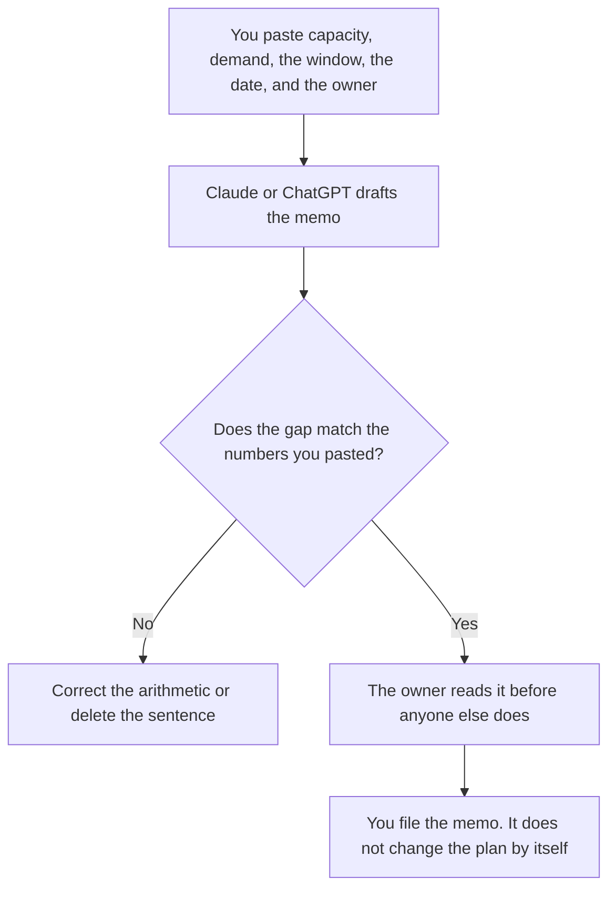

**A capacity risk memo written with AI states the capacity you measured, the demand you measured, the gap, the date, and the owner, using only figures a person pasted.** The model may format that memo. It may not invent a pipeline number, pull a date forward, or recommend a hire as if the hire were already approved. If a figure is missing, the line says Figure missing.

The wider register this memo can point at is [how to create a risk register with AI](/blog/how-to-create-a-risk-register-with-ai-2026/). The message when a bill spikes, which is a different risk, is [what an AI cost anomaly alert is](/blog/what-is-ai-cost-anomaly-alert-2026/). The ask to exceed a quota, after someone decides, is [how to create a quota exception request with AI](/blog/how-to-create-a-quota-exception-request-with-ai-2026/).

Claude's prices are from claude.com/pricing on October 24, 2026. Hex, Notion, and ChatGPT prices are from directory pages checked October 16. chatgpt.com/pricing returned HTTP 403 on October 24. Published October 24, 2026. We did not score forecasts. This page is not finance advice.

## What belongs in the memo

| Row | Who owns it | The model may |
|---|---|---|
| Capacity and the unit | The person who measured it | Copy the number and the unit. It may not convert units |
| Demand and the window | The same source, or a second source you name | Copy both. It may not blend them into one "pressure" score |
| The gap | Arithmetic you can check | Subtract only if you asked it to, and show the subtraction |
| The date and the owner | You | Copy them. A blank owner stays Owner missing |
| The ask | Only if you wrote it | Not add "hire two people" because the gap is large |

A capacity memo is internal. It tells a decision-maker that a number does not cover another number. It is not a hiring plan and it is not an OKR. The OKR, if it needs a target, is [Gemini vs ChatGPT for OKR drafts](/blog/gemini-vs-chatgpt-for-okr-drafts-2026/). If the OKR and the memo use different units, stop and name the units. Do not let the model "reconcile" them.

## Where it is written

**The draft, when the definition must match last month.** [Claude](/tools/claude/) Pro is $17 a month billed annually, $200 up front, or $20 monthly. Put the unit definition at the top of the Project. The review is [Claude review](/blog/claude-review-2026/).

**The query the number came from.** [Hex](/tools/hex/) Professional is $36 an editor a month on the October 16 card. Paste the result, not a screenshot the model cannot read as a cell. The invoice is [Hex pricing explained](/blog/hex-pricing-explained-2026/).

**The page leadership will open.** [Notion AI](/tools/notion-ai/) Business is $20 a seat a month if that is the wiki. Plus at $10 is not the full AI tier. The invoice is [Notion AI pricing explained](/blog/notion-ai-pricing-explained-2026/).

**One memo, from a short paste.** [ChatGPT](/tools/chatgpt/) Plus is $20 a month on the October 16 card. Discard a version that adds a cause. The review is [ChatGPT review](/blog/chatgpt-review-2026/).

A prompt that holds the line:

"Write a capacity risk memo from the capacity, demand, window, date, and owner I pasted. Show the gap as demand minus capacity. If a figure is missing, write Figure missing. Do not recommend a hire or a tool purchase."

## What not to delegate

Do not ask whether the risk is acceptable. Do not paste a customer list so the example looks specific. Do not send the memo because the prose is finished. The owner sends it. The people who live in this memo every week have a shelf at [best AI tools for revenue ops analysts](/blog/best-ai-tools-for-revenue-ops-analysts-2026/).

## FAQ

### How is this different from a risk register?

The register is the list of risks, owners, and statuses. This memo is one risk, with the two numbers and the gap written out. The memo can be a row on the register. The register should not be the only place the arithmetic appears.

### How is this different from a quota exception?

The exception asks for more quota, against a form your provider or finance already defined. The memo says the gap exists. You can write the memo and still decide not to ask. The exception article starts after that decision.

### Can the model pull the numbers from the warehouse?

Only from results you paste or from a query you already ran and checked. A model that "knows" last quarter's capacity is using a stale thread. Paste the cell.

### Who may call the risk accepted?

The owner named on the memo. A clear gap is not a decision to hire, to slip a date, or to buy a larger plan.

## Last verified

October 24, 2026 for Claude. October 16, 2026 for Hex, Notion, and ChatGPT. Published October 24, 2026.

**Sources:** [Claude pricing](https://claude.com/pricing), [Hex pricing](https://hex.tech/pricing), [Notion pricing](https://www.notion.com/pricing), [ChatGPT pricing](https://chatgpt.com/pricing/).

*Published by Andrew for [AI Tools Optimizer](https://aitoolsoptimizer.com).*

[Claude](/tools/claude/) is in the [chatbots and assistants directory](/tools/category/chatbots-assistants/). Directory pages may use affiliate links. A purchase through them may earn us a commission at no extra cost to you.
