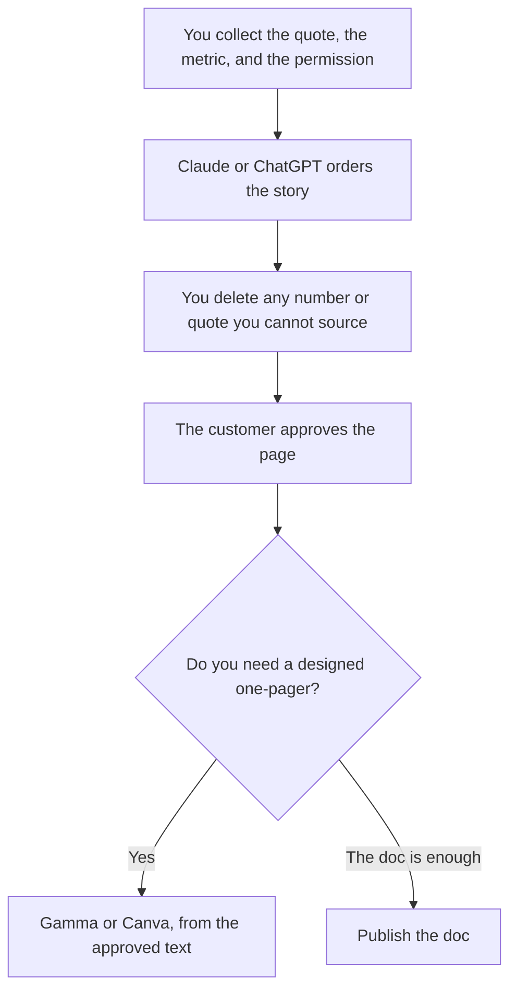

**A case study written with AI is a story you are allowed to tell, in the customer's words and numbers, tightened into a page.** The model can shape the problem, the work, and the result. It cannot interview the customer, and it cannot invent a percentage. If you do not have a quote and a result the customer will sign, you do not have a case study yet. You have a draft of a claim.

The editing standard is [how to write a blog post with Claude](/blog/how-to-write-a-blog-post-with-claude-2026/). The pass on names and numbers is [how to fact-check AI writing](/blog/how-to-fact-check-ai-writing-2026/). The person who sends it for approval is [what human-in-the-loop AI is](/blog/what-is-human-in-the-loop-ai-2026/).

Prices are US list prices excluding tax from directory pages checked October 16, 2026. Published October 24, 2026. We did not score case studies.

## What the model may touch

| Piece | Who owns it | The model may |
|---|---|---|
| The customer and the permission | You, in writing | Not pick a logo from a call |
| The quote | The customer | Tighten nothing that changes the meaning. You send the final words back |
| The metric | The customer, or your data the customer approved | Format it. It may not round it into a bigger win |
| The narrative | You | Order problem, what you did, result |
| A photo or a diagram | You, from assets you can use | Not generate a fake office with their logo |

A model asked for a "strong result" will produce one. That sentence is [a hallucination](/blog/what-is-ai-hallucination-2026/) your sales team will repeat. If the true result is "the team saved a weekly meeting," say that. Do not upgrade it to a revenue number.

## Where the draft happens

**The long pass.** [Claude](/tools/claude/) Pro is $20 a month, or $17 billed annually. Put the quote, the metric, and a one-paragraph description of the work in a Project. Ask for a short page and a list titled "claims not in the source." Free includes Projects, with limits. The container is [Claude Projects vs ChatGPT Projects](/blog/claude-projects-vs-chatgpt-projects-2026/).

**The team's default chat.** [ChatGPT](/tools/chatgpt/) Plus is $20. Go at $8 can draft a short page. The ladder is [ChatGPT Go vs Plus vs Pro](/blog/chatgpt-go-vs-plus-vs-pro-2026/). The writing split is [ChatGPT vs Claude for writing](/blog/chatgpt-vs-claude-for-writing-2026/).

**The sentence, after the customer has approved the facts.** [Grammarly](/tools/grammarly/) Free covers grammar. Pro is $12 a member a month billed annually. Do not run the rewrite pass before the quote is locked. Tone suggestions can sand off the customer's phrasing. The card is [Grammarly pricing explained](/blog/grammarly-pricing-explained-2026/). The head-to-head with a workspace is [Notion AI vs Grammarly](/blog/notion-ai-vs-grammarly-2026/).

**The one-pager.** [Gamma](/tools/gamma/) Plus is $9 a seat a month for 1,000 credits. Free credits do not refresh. Generate the layout from the approved text, not from a prompt that re-tells the story. The review is [Gamma review](/blog/gamma-review-2026/). [Canva](/tools/canva/) Pro is $18 a month, or $180 a year, when the page has to match a kit you already have.

**A stored brand voice, if more than one person writes these.** [Jasper](/tools/jasper/) Pro is $59 a seat a month billed yearly, or $69 monthly, with a 7-day trial. It includes 2 Brand Voices. One case study does not need that seat. A team producing them every week might. The comparison is [Jasper vs ChatGPT for marketing](/blog/jasper-vs-chatgpt-for-marketing-2026/).

If the notes live in Notion, [Notion AI](/tools/notion-ai/) Business at $20 a seat can draft on the page. The system of record is still the approved doc, not the chat. The card is [Notion AI pricing explained](/blog/notion-ai-pricing-explained-2026/).

A prompt that holds the line:

"Here is an approved quote and an approved metric. Write a one-page case study with the headings Problem, What we did, and Result. Use the quote as a quote. Do not add metrics, customers, or timelines that are not in the notes. List anything you were tempted to add under Do not publish."

## Permission before polish

Get the customer to approve the facts before you spend an hour on layout. A beautiful page they cannot sign is waste. Name the approver. Date the metric. If the number will go stale, say the period it covers.

The research that should have produced the quote is not this page. Competitive notes are [how to use AI for competitive analysis](/blog/how-to-use-ai-for-competitive-analysis-2026/). A market scan is [how to use Perplexity for market research](/blog/how-to-use-perplexity-for-market-research-2026/). Neither one is a substitute for the customer's words.

The team that does this as a job is [best AI tools for marketers](/blog/best-ai-tools-for-marketers-2026/) and [best AI tools for content teams](/blog/best-ai-tools-for-content-teams-2026/). Social lines cut from the finished page are [how to create social posts from a blog with AI](/blog/how-to-create-social-posts-from-a-blog-with-ai-2026/). Cut them from the approved page, not from the first draft.

## FAQ

### Can AI write a case study without a customer interview?

It can write a page. You should not publish it as a case study. Without a quote and a permission, call it an example, or do not publish it. Invented customers are a trust problem, not a style problem.

### What if the result is small?

Keep it. A specific small result is more believable than a round number the model prefers. If you are embarrassed by the truth, you do not have a case study yet.

### Should I generate a photo of the customer?

No. Use a photo they provided, their logo under their brand rules, or none. A generated person is not the customer.

### How long should it be?

Long enough to carry the quote and the number, short enough that sales will send it. One page is a useful target. The model can cut. You decide which cut removed the caveat the customer required.

## Last verified

October 16, 2026 for Claude, ChatGPT, Grammarly, Gamma, Canva, Jasper, and Notion prices named above. Published October 24, 2026.

**Sources:** [Claude pricing](https://claude.com/pricing), [Grammarly Pro cost](https://support.grammarly.com/hc/en-us/articles/115000090011-How-much-does-Grammarly-Pro-cost), [Gamma pricing](https://gamma.app/pricing).

*Published by Andrew for [AI Tools Optimizer](https://aitoolsoptimizer.com).*

[Claude](/tools/claude/) is in the [chatbots and assistants directory](/tools/category/chatbots-assistants/). Directory pages may use affiliate links. A purchase through them may earn us a commission at no extra cost to you.
