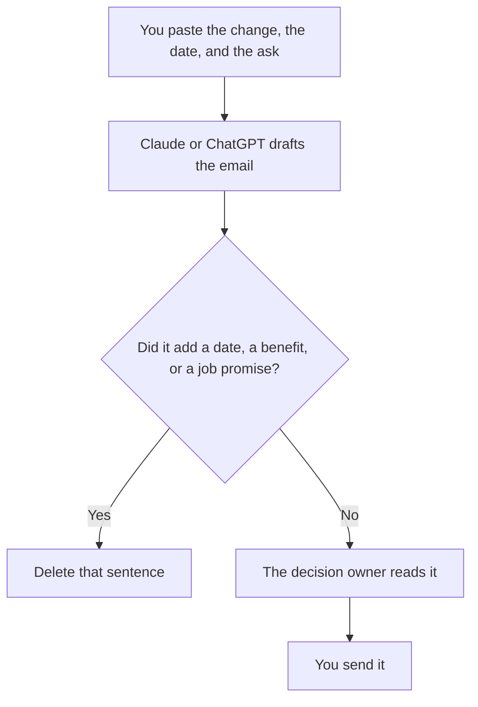

**A change management email written with AI states the change, the date, what people should do, and what stays the same, using facts you pasted.** The model may tighten the sentences. It may not invent a deadline, a benefit, or a promise about jobs. You send it. A cheerful email that softens a date you set is a different policy.

The customer-facing cousin is [how to write customer emails with AI](/blog/how-to-write-customer-emails-with-ai-2026/). A product launch note, which is a narrower change, is [how to create a feature announce email with AI](/blog/how-to-create-a-feature-announce-email-with-ai-2026/). The person who hits send is [what human-in-the-loop AI is](/blog/what-is-human-in-the-loop-ai-2026/).

Prices are US list prices excluding tax from directory pages checked October 16, 2026. Published October 24, 2026. This page is not legal or HR advice. If the change affects employment, pay, or a contract, the approved text comes from the owner of that decision, not from a model.

## What the email is allowed to say

| Block | You paste | The model may |
|---|---|---|
| The change | One sentence a leader already approved | Shorten it. It may not widen the change |
| The date | A calendar date, with the timezone | Copy it. It may not write "soon" |
| The ask | The action, who does it, and by when | Format it as steps. It may not add a task |
| What stays the same | The list you want people to stop worrying about | Repeat it. It may not add reassurance you did not approve |
| The channel for questions | A person or a path you named | Repeat it. It may not invent an office hour |
| What you will not say | Topics that are not decided | Omit them. It may not "address the rumor" |

If a sentence is not in the paste, it does not ship. Tone is the last edit. Facts are the first.

## Where you draft it

**The long version, with the decision memo beside it.** [Claude](/tools/claude/) Pro is $20 a month, or $17 billed annually, and includes Projects. Put the approved memo in the Project. Free can take a short paste. The review is [Claude review](/blog/claude-review-2026/).

**The short version in the chat you already use.** [ChatGPT](/tools/chatgpt/) Plus is $20 a month. Go is $8 and may include ads. Do not take an ad as a change-management tip. Business at $20 a user a month billed annually, two-user minimum, is the seat when the memo is confidential. The seat pair for ordinary email is [ChatGPT vs Claude for email](/blog/chatgpt-vs-claude-for-email-2026/).

**A grammar pass after the facts are locked.** [Grammarly](/tools/grammarly/) Pro is $12 a member a month billed annually, or $30 monthly. It will not know that "next Friday" was the wrong Friday. Lock the date first.

**The page people return to.** [Notion AI](/tools/notion-ai/) Business is $20 a seat a month if the canonical note lives in Notion. The email points at that page. The page holds the date. A second draft in chat is not a second policy. The record is [what a system of record for AI is](/blog/what-is-a-system-of-record-for-ai-2026/).

A prompt that holds the line:

"Draft an internal email from the change, the date, the ask, and the 'stays the same' list I pasted. Do not add a benefit, a layoff statement, or a deadline. If a detail is missing, write Missing. Keep it under 200 words. End with the question path I named."

## What not to delegate

Do not ask the model to guess how people will feel and then promise a remedy. Do not let it announce a tool, a vendor, or a reorg that is not in the memo. Do not send a draft the decision owner has not read. The status update after the change has landed is a different note: [how to write a status update with AI](/blog/how-to-write-a-status-update-with-ai-2026/).

If the change is a new process with owners, the grid is [how to create a RACI chart with AI](/blog/how-to-create-a-raci-chart-with-ai-2026/). The email can link to that chart. It should not invent the roles.

## FAQ

### Can AI write the whole announcement?

It can write the sentences from a memo you approved. The decision, the date, and the ask are yours. A model that "makes it sound less scary" will often delete the date or add a promise. Read for those two failures first.

### What if we do not know the date yet?

Say that, in words you approve: the date is not set, and the next update will come from a person you name. Do not let the model pick a date so the email feels complete.

### Should we personalize every copy?

Only with fields you have and may use. A mail merge that inserts a guessed team name is worse than one email. The personalization rule is [what AI personalization is](/blog/what-is-ai-personalization-2026/).

### Is Plus required?

No. Free can draft one note from a paste. Pay when the memo has to live in a Project or the account has to be a business seat. The $100 tiers are the wrong upgrade for one announcement.

## Last verified

October 16, 2026 for Claude, ChatGPT, Grammarly, and Notion AI. Published October 24, 2026.

**Sources:** [Claude pricing](https://claude.com/pricing), [ChatGPT pricing](https://chatgpt.com/pricing/), [Grammarly pricing](https://www.grammarly.com/plans).

*Published by Andrew for [AI Tools Optimizer](https://aitoolsoptimizer.com).*

[Grammarly](/tools/grammarly/) is in the [writing directory](/tools/category/writing/). Directory pages may use affiliate links. A purchase through them may earn us a commission at no extra cost to you.
