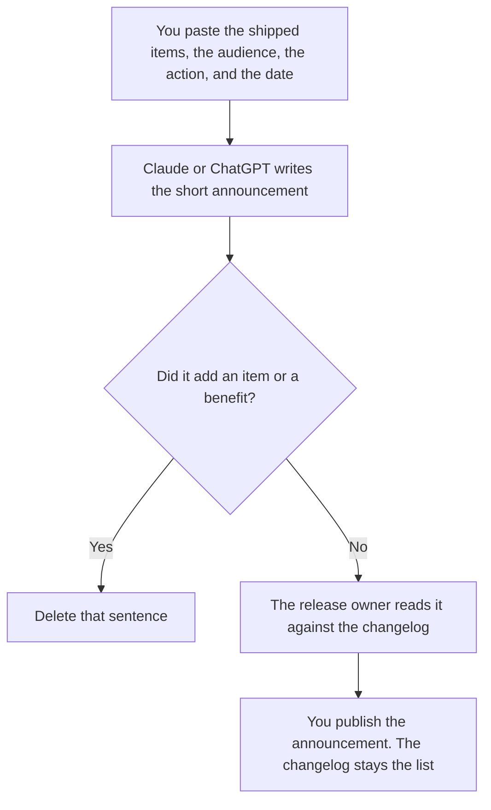

**A changelog announcement written with AI is the short note people read: what shipped, who it is for, and what they should do, taken from a shipped list a person already accepted.** The model may tighten sentences. It may not add a feature, a date, or a benefit you did not paste. The list of commits is [how to write a changelog with AI](/blog/how-to-write-a-changelog-with-ai-2026/). The email version of a shipped list is [how to write a product changelog email with AI](/blog/how-to-write-a-product-changelog-email-with-ai-2026/). A feature that is going away, which is a different note, is [how to write a feature deprecation note with AI](/blog/how-to-write-a-feature-deprecation-note-with-ai-2026/).

Prices are US list prices excluding tax from directory pages checked October 16, 2026. A live fetch of vendor pricing pages on October 24, 2026 returned HTTP 401, so this page stays on the directory record. Published October 24, 2026. We did not score announcements.

## What the announcement is allowed to say

| Row | Who owns it | The model may |
|---|---|---|
| What shipped | The release owner, from the changelog | Name those items. It may not add one |
| Who it is for | You | Copy the audience. It may not say "everyone" unless you did |
| What to do | You | Copy the action. If there is nothing to do, say that |
| The date | The release | Copy it. It may not move the date to "this week" |
| What did not ship | You, if you want it said | Include it only if you pasted it. Silence is not a promise |

The changelog is the inventory. The announcement is the door into that inventory: a few sentences and a link. The email is the same facts in an inbox, for people who will not visit the page. If you are writing all three, write the changelog first, then the announcement, then the email, from the same list. A benefit that appears only in the announcement is a claim you have not put on the list.

A deprecation is not a cheerful bullet at the bottom. If something is going away, use the deprecation note and link it. Do not let the model fold a removal into "improvements."

## Where it is written

**The draft of a longer note.** [Claude](/tools/claude/) Pro is $20 a month, or $17 billed annually, when the announcement sits beside the changelog in a Project so you can see an added claim. The review is [Claude review](/blog/claude-review-2026/).

**A short note from a paste.** [ChatGPT](/tools/chatgpt/) Plus is $20 a month. Go is $8 and may include ads, on the directory card. A release note is a poor fit for that plan. The review is [ChatGPT review](/blog/chatgpt-review-2026/).

**The last pass.** [Grammarly](/tools/grammarly/) Pro is $12 a member a month billed annually, or $30 monthly. If it deletes the "what to do" line because the paragraph was short, put the line back. The invoice is [Grammarly pricing explained](/blog/grammarly-pricing-explained-2026/).

**The page.** [Notion AI](/tools/notion-ai/) Business is $20 a seat a month if the announcement lives next to the changelog in Notion. The page people bookmark is the system of record. The chat is not.

A prompt that holds the line:

"Write a short announcement from the shipped items, audience, action, and date I pasted. Do not add an item. Do not add a benefit. If the action is missing, write Action missing and stop."

## What not to delegate

Do not ask the model to make the release sound bigger. Do not announce an item that is behind a flag the rollout plan has not turned on for this audience. That plan is [how to create a feature flag rollout plan with AI](/blog/how-to-create-a-feature-flag-rollout-plan-with-ai-2026/). Do not publish until the release owner has matched every bullet to the changelog. The adoption plan, if you need one, is [how to create a feature adoption plan with AI](/blog/how-to-create-a-feature-adoption-plan-with-ai-2026/), and it is not this note.

## FAQ

### How is an announcement different from the changelog?

The changelog lists what changed, close to the commits or the tickets. The announcement is the short public or internal note that points at that list and says what the reader should do. If the announcement is longer than the changelog, it is probably adding claims.

### How is it different from the changelog email?

The email is a message you send. The announcement is the note on the site, in the app, or in the doc. They should name the same items. Write the announcement from the changelog, and the email from the announcement, so a benefit cannot appear in only one of them.

### Can the model group items into "highlights"?

Yes, if every highlight is an item you pasted and the other items remain on the changelog you link. A highlight that merges two items into a new capability is an added feature. Keep them separate.

### Who publishes it?

The release owner. A model does not post. A note with no date is a draft, even if the prose is finished.

## Last verified

October 16, 2026 for Claude, ChatGPT, Grammarly, and Notion. Published October 24, 2026.

**Sources:** [Claude pricing](https://claude.com/pricing), [ChatGPT pricing](https://chatgpt.com/pricing/), [Grammarly pricing](https://www.grammarly.com/plans), [Notion pricing](https://www.notion.com/pricing).

*Published by Andrew for [AI Tools Optimizer](https://aitoolsoptimizer.com).*

[Claude](/tools/claude/) is in the [chatbots and assistants directory](/tools/category/chatbots-assistants/). Directory pages may use affiliate links. A purchase through them may earn us a commission at no extra cost to you.
