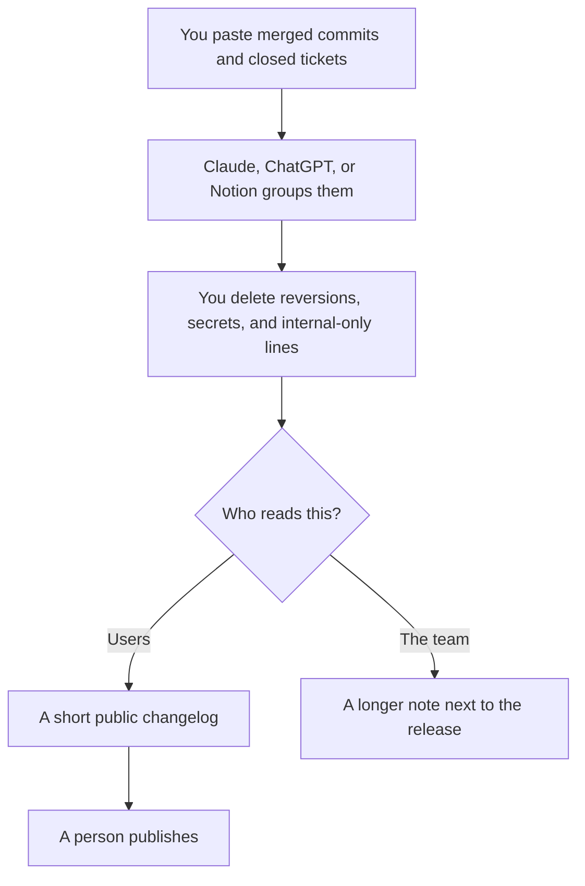

**A changelog written with AI is a list of changes you already shipped, rewritten so a user can see them.** The model can group commits and cut the jargon. It cannot know which commit was reverted, which ticket was internal, or which line would leak a customer name. Paste the commits. Delete anything you would not say in the product.

The narrative version, for people who will not read a list, is [how to write release notes with AI](/blog/how-to-write-release-notes-with-ai-2026/). The pass on names and numbers is [how to fact-check AI writing](/blog/how-to-fact-check-ai-writing-2026/). The person who hits publish is [what human-in-the-loop AI is](/blog/what-is-human-in-the-loop-ai-2026/).

Prices are US list prices excluding tax from directory pages checked October 16, 2026. Published October 24, 2026. We did not score changelog quality.

## What the model may touch

| Line | Who owns it | The model may |
|---|---|---|
| The change | You, from a commit or a ticket that merged | Rewrite it in plain language |
| The audience | You. Users, admins, or only the team | Keep an internal fix out of the public list |
| The version and the date | You | Format them. It may not invent a version |
| A breaking change | You | Put it first, in the words you approve |
| A metric or a customer | You, if it belongs there at all | Not invent one, and not paste one from a different ticket |

If the commit message is a joke or a ticket number, the model will still produce a feature. Read the diff, or the ticket, before you bless the sentence. A changelog that describes work you did not ship is [a hallucination](/blog/what-is-ai-hallucination-2026/) with a version number on it.

## Where the draft happens

**A long pass on a big release.** [Claude](/tools/claude/) Pro is $20 a month, or $17 billed annually. Put the repo's style for changelog lines in a Project, plus this release's commits. Free includes up to five Projects. Ask for grouped bullets and a section titled "unclear, do not publish." The container is [Claude Projects vs ChatGPT Projects](/blog/claude-projects-vs-chatgpt-projects-2026/).

**The team's default chat.** [ChatGPT](/tools/chatgpt/) Plus at $20. Go at $8 is enough for a short list. Keep a Project for the product so the headings stay stable. The ladder is [ChatGPT Go vs Plus vs Pro](/blog/chatgpt-go-vs-plus-vs-pro-2026/).

**The page the list will live on.** [Notion AI](/tools/notion-ai/) Business is $20 a seat. Plus at $10 is not the full AI tier. If the changelog is a Notion database, generate there or paste the approved lines in. The card is [Notion AI pricing explained](/blog/notion-ai-pricing-explained-2026/). The writing choice is [ChatGPT vs Notion AI for writing](/blog/chatgpt-vs-notion-ai-for-writing-2026/).

**The editor, if the changelog is a file in the repo.** [Cursor](/tools/cursor/) Plus is $8 a month. [GitHub Copilot](/tools/github-copilot/) Pro is $10. Either can draft `CHANGELOG` text from the diff you have open. You still delete the lines. The editor comparison is [Cursor vs GitHub Copilot](/blog/cursor-vs-github-copilot-2026/). A cloud prototype tool is the wrong place to publish release history. That split is [Cursor vs Replit Agent](/blog/cursor-vs-replit-agent-2026/).

A prompt that holds the line:

"Here are merged commits and ticket titles. Group them under Added, Changed, Fixed, and Security. One bullet each. If a line is not understandable from the text I pasted, put it under Unclear. Do not add features that are not in the list. Do not include internal ticket numbers in the public group."

One changelog entry you already liked, pasted above the commits, is [what few-shot prompting is](/blog/what-is-few-shot-prompting-2026/).

## Public list versus internal note

Users need the change they can see, the breaking change, and the fix for the bug they reported. The team needs the migration, the flag, and the rollback. Generate them as two lists from the same source. Do not publish the internal list by accident because it was the longer one and looked more complete.

Security notes stay factual and short. Name the fix you shipped. Do not publish a recipe for the bug. If you are unsure a detail is safe to print, leave it out and ask the person who owns security. This workflow does not need an exploit write-up to be useful.

The people who do this every week, in a docs repo or a help center, are the audience of [best AI tools for technical writers](/blog/best-ai-tools-for-technical-writers-2026/). A sprint ritual that should feed the list, not replace it, is [how to run a retro with AI](/blog/how-to-run-a-retro-with-ai-2026/).

## FAQ

### Can AI write the changelog from the repo with no review?

It can draft from the text you give it. It should not publish. Reverted commits, feature flags, and "fix typo" that was actually a security patch all look like bullets. A person who saw the release picks the list.

### How is this different from release notes?

A changelog is the inventory. Release notes are the story you tell about the items that matter to a reader. Write the inventory first. Then write the story from the inventory, not from memory. The story workflow is the release-notes guide linked above.

### What if the commit messages are bad?

Fix the worst ones in the paste, in your own words, before you ask for prose. The model will launder a vague message into a confident feature. Garbage in still ships.

### Where should it live?

Next to the product: a docs page, a Notion database, or a file in the repo. A chat thread is not a changelog. Link the version. Date it.

## Last verified

October 16, 2026 for Claude, ChatGPT, Notion, Cursor, and GitHub Copilot prices named above. Published October 24, 2026.

**Sources:** [Claude pricing](https://claude.com/pricing), [ChatGPT pricing](https://chatgpt.com/pricing), [Notion pricing](https://www.notion.com/pricing).

*Published by Andrew for [AI Tools Optimizer](https://aitoolsoptimizer.com).*

[Claude](/tools/claude/) is in the [chatbots and assistants directory](/tools/category/chatbots-assistants/). Directory pages may use affiliate links. A purchase through them may earn us a commission at no extra cost to you.
