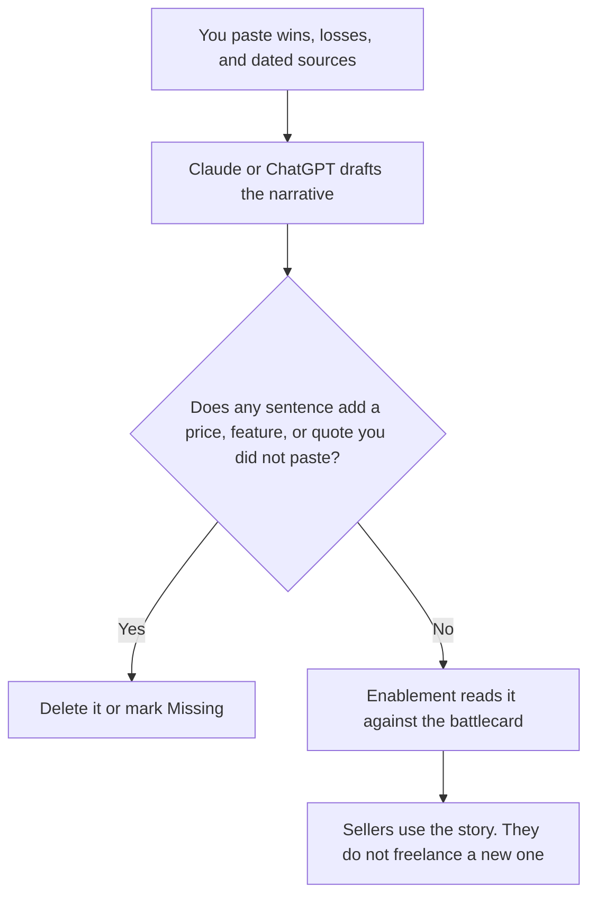

**A competitive battle narrative written with AI is a short story of when you win, when you lose, and what the seller should say, drafted only from notes and sources you paste.** The model may order the scenes. It may not invent a competitor's price, a feature, a customer quote, or a win rate. A fluent story you cannot source is a liability in the next deal.

The one-page leave-behind is a different file: [how to create a competitive battlecard with AI](/blog/how-to-create-a-competitive-battlecard-with-ai-2026/). The check before anyone memorizes it is [how to fact-check AI writing](/blog/how-to-fact-check-ai-writing-2026/). The research step, when a public page is the source, is [how to use Perplexity for market research](/blog/how-to-use-perplexity-for-market-research-2026/). The team that keeps the story current sits in [best AI tools for revenue enablement](/blog/best-ai-tools-for-revenue-enablement-2026/).

Prices for the writing tools are US list prices excluding tax from directory pages checked October 16, 2026. Published October 24, 2026. We did not score win rates. This page does not pick a competitor for you.

## What the model may touch

| Block | Who owns the fact | The model may |
|---|---|---|
| When we win | You, from deals you name | State the situation in the words you used |
| When we walk away | You | Keep the walk-away. It may not turn a loss into a near-win |
| The trap | A real question a buyer asked | Phrase it. It may not add a question you have not heard |
| Proof | A quote, a metric, or a public page you pasted, with a date | Repeat it. It may not upgrade the metric |
| Their price or feature | Only a source you pasted, dated | Copy it. If the paste says Missing, the narrative says Missing |
| The talk track | You, after the facts are frozen | Shorten it. It may not add a promise |

The narrative and the battlecard have to match. If the card says "we do not have SSO" and the story implies you do, fix both the same day. The record is [what a system of record for AI is](/blog/what-is-a-system-of-record-for-ai-2026/).

## Where the draft is written

**The long version.** [Claude](/tools/claude/) Pro is $20 a month, or $17 billed annually. Keep the approved narrative in a Project with the sources. Free can hold a Project, with usage limits. The review is [Claude review](/blog/claude-review-2026/).

**The default chat.** [ChatGPT](/tools/chatgpt/) Plus is $20 a month. Business is $20 a user a month billed annually, minimum two users, when the paste includes an unreleased roadmap or a private loss review. Do not paste a customer's confidential loss notes into a personal account your policy forbids. The ladder is [ChatGPT Go vs Plus vs Pro](/blog/chatgpt-go-vs-plus-vs-pro-2026/).

**The public-page check.** [Perplexity](/tools/perplexity/) Pro is $17 a month billed annually when you need a citation for a competitor's published claim. Open the page. A search snippet is not the source. The pairwise with a file you already hold is [Perplexity vs Gemini for market research](/blog/perplexity-vs-gemini-for-market-research-2026/).

**The home for the story.** [Notion AI](/tools/notion-ai/) Business is $20 a seat a month. Plus at $10 is not the full AI tier. The narrative lives next to the battlecard, with an owner and a review date. The invoice is [Notion AI pricing explained](/blog/notion-ai-pricing-explained-2026/).

A prompt that holds the line:

"Draft a battle narrative from these notes only. Include when we win, when we walk away, the trap question, and the proof I pasted. If a competitor price or feature is not in the paste, write Missing. Do not invent quotes or win rates. Do not insult the competitor. Keep it under one page."

The person who approves the story is [what human-in-the-loop AI is](/blog/what-is-human-in-the-loop-ai-2026/). An invented differentiator is [what an AI hallucination is](/blog/what-is-ai-hallucination-2026/).

## After it leaves the doc

A partner should receive the same story, not a rougher one. The packet is [how to write a partner enablement kit with AI](/blog/how-to-write-a-partner-enablement-kit-with-ai-2026/). A webinar slide that mentions a rival uses the same facts, or it stays silent: [Gamma vs Canva for webinars](/blog/gamma-vs-canva-for-webinars-2026/).

Date the narrative. Competitor pages change. A review date in the header is the feature. When the date passes, re-open the sources. Do not ask the model to "refresh" from memory.

## FAQ

### How is this different from a battlecard?

The card is a grid: feature, us, them, proof. The narrative is the order a seller says it, including when to stop selling. Build the card from sources first. Derive the story from the card, so they cannot drift.

### Can AI tell us how we compare?

It can organize comparisons you paste. It cannot sit in your last twenty deals unless those notes are in the paste. A model that "knows the market" will invent a price. Mark that sentence Missing.

### Should we name the competitor in public?

Only where counsel and the source allow it. This workflow is for the internal story and the partner kit. A public page that quotes a rival's price goes stale and can be wrong. Prefer your offer, which is [how to write a pricing page with AI](/blog/how-to-write-a-pricing-page-with-ai-2026/).

### How long should it be?

One page. If you cannot tell the story in one page, the notes are still a pile. Cut scenes, do not shrink the font. The model may propose cuts. You choose which loss stays in the story, because the walk-away is the part sellers skip.

## Last verified

October 16, 2026 for Claude, ChatGPT, Perplexity, and Notion AI. Published October 24, 2026.

**Sources:** [Claude pricing](https://claude.com/pricing), [ChatGPT pricing](https://chatgpt.com/pricing/), [Perplexity pricing](https://www.perplexity.ai/hub/pricing), [Notion pricing](https://www.notion.com/pricing).

*Published by Andrew for [AI Tools Optimizer](https://aitoolsoptimizer.com).*

[Claude](/tools/claude/) is in the [chatbots and assistants directory](/tools/category/chatbots-assistants/). Directory pages may use affiliate links. A purchase through them may earn us a commission at no extra cost to you.
