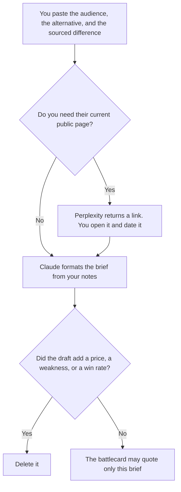

**A competitive positioning brief written with AI is an internal page that names the audience, the alternative they compare you with, the difference you can source, and the claims you will not make.** The model may arrange notes. It may not invent a competitor's price, a weakness, or a win rate. The one-page crib sheet a rep uses on a call is [how to create a competitive battlecard with AI](/blog/how-to-create-a-competitive-battlecard-with-ai-2026/). The research file of their pages, dated, is [how to create a competitor teardown with AI](/blog/how-to-create-a-competitor-teardown-with-ai-2026/). This page is the statement the card and the teardown should not contradict.

Who the product is for, before a competitor enters the sentence, is [how to write a product one-pager with AI](/blog/how-to-write-a-product-one-pager-with-ai-2026/). A claim you did not open a source for is [what an AI hallucination is](/blog/what-is-ai-hallucination-2026/).

Prices are US list prices excluding tax from directory pages checked October 16, 2026. Published October 24, 2026. We did not score win rates. A win rate does not belong here unless you computed it from your own records and a person who owns that number pasted it.

## What the brief has to contain

| Block | Who owns it | The model may |
|---|---|---|
| Audience | The buyer you already named on the product one-pager | Copy it. It may not switch audiences to make the contrast easier |
| Alternative | The product, the spreadsheet, or the "do nothing" you actually lose to | Copy it. It may not add a rival you do not see in deals |
| Difference | A difference you can show in your product or in a source you opened | Phrase it. It may not add "only we" |
| Proof | Your number, or a dated page you opened | Place it. It may not update their price from memory |
| Will not say | The jabs and the unverified rumors | Keep the list. It may not talk you out of it |
| Owner | A person who can change the brief when a deal teaches you something | Copy the name |

The alternative is often a spreadsheet or a hire, not a logo. Forcing a logo into the brief because the category has a leader will make the sales team argue with a rival the buyer never mentioned. Name the alternative you hear on calls.

## Where the brief is written

**The public page.** [Perplexity](/tools/perplexity/) Pro is $17 a month billed annually when you need their current pricing or feature page, and you will open it. The brief stores the URL and the date you opened it. A citation you did not open is not proof. The invoice is [Perplexity pricing explained](/blog/perplexity-pricing-explained-2026/). The lookup habit is [how to use Perplexity for market research](/blog/how-to-use-perplexity-for-market-research-2026/).

**The draft.** [Claude](/tools/claude/) Pro is $20 a month, or $17 billed annually, when the product one-pager and the notes from the last five losses live in a Project. The brief may not outrun those notes. The review is [Claude review](/blog/claude-review-2026/).

**The record.** [Notion AI](/tools/notion-ai/) Business is $20 a seat a month if this is the page enablement and product both open. One page. A second copy in a chat will drift.

**A tighter sentence.** [ChatGPT](/tools/chatgpt/) Plus at $20 a month can shorten the difference. Discard a superlative. "Faster" needs the measurement you pasted, or it comes out.

A prompt that holds the line:

"Draft a competitive positioning brief from the audience, alternative, difference, and sources I pasted. Do not add a competitor, a price, a weakness, or a win rate. If a difference has no source, write Unsourced. Repeat the will-not-say list at the bottom."

## What not to delegate

Do not ask the model why you win. Do not publish this brief to customers. It is internal, and the will-not-say list is there so a public page does not pick up a line you cannot defend. Do not let a battlecard grow a claim this brief marks unsourced. If the card and the brief disagree, stop using the card until a person edits one of them.

## FAQ

### How is this different from a battlecard?

The battlecard is what a rep can glance at on a call: questions to ask, claims they may repeat, claims they may not. This brief is the decision underneath: who the audience is, what they compare you with, and the difference you are willing to defend. The card quotes the brief. The brief does not quote a card that went further.

### Can we include their price?

Only the price on a page you opened, with the date, or a price a buyer showed you and you are allowed to record. A price the model remembers is the line to delete. Prices change. The date is the part that keeps the brief honest.

### What if we lose to "do nothing"?

Write that as the alternative. The difference is then against the status quo you hear in the notes, not against a vendor you wish you were compared with. A brief that ignores the real alternative will produce a campaign the buyer does not recognize.

### Who updates it?

The owner, when a sourced fact changes or three losses in a row describe a different alternative. The model can format the edit. It should not refresh the page on a schedule and quietly rewrite the difference. A stale date on a source is a prompt to re-open the page, not a prompt to trust the old sentence.

## Last verified

October 16, 2026 for Perplexity, Claude, Notion AI, and ChatGPT. Published October 24, 2026.

**Sources:** [Perplexity pricing](https://www.perplexity.ai/pro), [Claude pricing](https://claude.com/pricing), [Notion pricing](https://www.notion.com/pricing), [ChatGPT pricing](https://chatgpt.com/pricing/).

*Published by Andrew for [AI Tools Optimizer](https://aitoolsoptimizer.com).*

[Perplexity](/tools/perplexity/) is in the [research and search directory](/tools/category/research-search/). Directory pages may use affiliate links. A purchase through them may earn us a commission at no extra cost to you.
