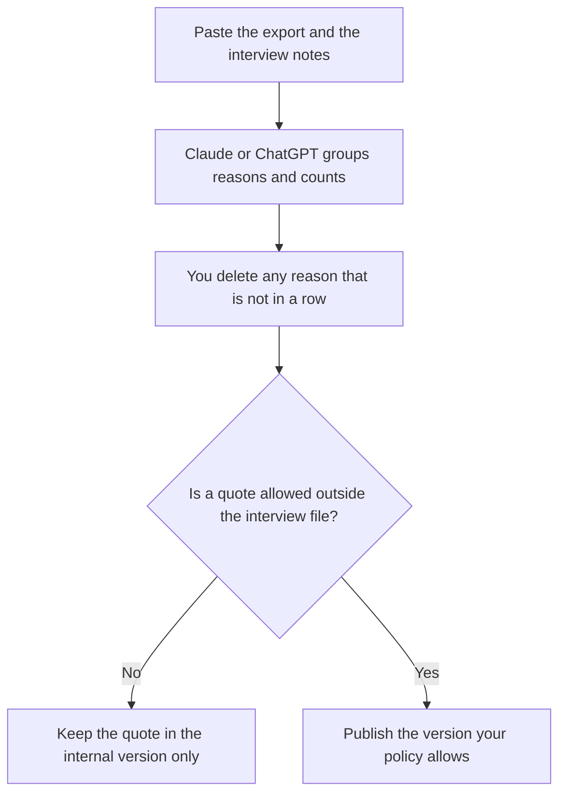

**A win-loss report written with AI is a summary of why deals closed or died, using interviews and CRM fields you paste, with a count you can trace to rows.** The model can group reasons. It cannot invent a competitor's discount, a buyer's motive, or a win rate. If a lost deal has no interview and no loss reason in the CRM, the row stays Unknown. Unknown is a finding. A filled-in story is a different document.

A teardown of a competitor's public page is the neighboring workflow, and it is not this one: [how to create a competitor teardown with AI](/blog/how-to-create-a-competitor-teardown-with-ai-2026/). The sales shelf is [best AI tools for sales teams](/blog/best-ai-tools-for-sales-teams-2026/). The enablement leave-behind, after the report is real, is [how to write a sales enablement deck with AI](/blog/how-to-write-a-sales-enablement-deck-with-ai-2026/).

Prices are US list prices excluding tax from directory pages checked October 16, 2026. Published October 24, 2026. We did not score win-rate models. Gong's price is custom, and this page does not invent a dollar for it.

## What belongs in the report

| Section | Who owns the fact | The model may |
|---|---|---|
| The set | The deals in the window, with a source export and a date | Count them. It may not drop a loss because the note was short |
| Win reasons | Codes or quotes from the export and the interviews | Group them. It may not add a reason that appears once and call it the theme |
| Loss reasons | The same standard | Include price only if a buyer or a field said price |
| Competitor named | Only names that appear in the rows | Not a rival you wish you lost to |
| Quote | A line you have permission to show, attributed the way your policy requires | Not a cleaned-up quote that changes the claim |
| What to change | A proposal a person will own | Not a new feature the notes did not request |

A loss reason of "they chose the market leader" with no sentence behind it is [a hallucination](/blog/what-is-ai-hallucination-2026/) in a forecast meeting. The check is [how to fact-check AI writing](/blog/how-to-fact-check-ai-writing-2026/).

## Where the notes and the draft happen

**The long read of a quarter's notes.** [Claude](/tools/claude/) Pro is $20 a month, or $17 billed annually. Put the code list in a Project so next quarter's labels do not drift. The review is [Claude review](/blog/claude-review-2026/).

**The CRM paste in a shared Project.** [ChatGPT](/tools/chatgpt/) Plus is $20 a month. Business is $20 a user a month billed annually, minimum two users, when the rows include customer names. The ladder is [ChatGPT Go vs Plus vs Pro](/blog/chatgpt-go-vs-plus-vs-pro-2026/).

**A call you are allowed to cite.** [Fathom](/tools/fathom/) Premium is $16 a month billed annually. The free plan lists unlimited recordings. Confirm the buyer allowed the recording. The invoice is [Fathom pricing explained](/blog/fathom-pricing-explained-2026/).

**A revenue platform, if you already have the quote.** [Gong](/tools/gong/) is custom: per-user licenses plus a platform fee, no public dollar, no free plan. Use it as a source of calls you already capture. Do not buy it to draft this report. The invoice, such as it is, is [Gong pricing explained](/blog/gong-pricing-explained-2026/).

**The file product and marketing will reopen.** [Notion AI](/tools/notion-ai/) Business is $20 a seat a month. Name the quarter, the export date, and the author. The invoice is [Notion AI pricing explained](/blog/notion-ai-pricing-explained-2026/).

A prompt that holds the line:

"Group these closed deals by the win or loss reason in the paste. Count each group. Quote only lines I marked as quotable. If a deal has no reason, count it as Unknown. Do not infer a competitor price or a buyer's motive. Do not compute a win rate unless I pasted the denominator."

The person who publishes the report is [what human-in-the-loop AI is](/blog/what-is-human-in-the-loop-ai-2026/).

## What this report is not

It is not a battlecard. A battlecard tells a rep what to say. This report tells the company what buyers said. Build the card after, from lines that survived. It is not a market-size story. It is not a reason to change list price by itself. Finance owns price. The report can show how often price was mentioned. It cannot show what the competitor charged unless a row says so.

The record habit is [what a system of record for AI is](/blog/what-is-a-system-of-record-for-ai-2026/).

## FAQ

### How many deals do we need?

Enough that a single colorful loss cannot set the theme. If the window is small, say the count in the first line. A model that writes "customers consistently" about three rows is overstating the paste. Keep the number visible.

### Can AI interview the buyer?

Not in this workflow. A person runs the conversation, with consent. The model summarizes notes you already have. A synthetic buyer is fiction.

### Should we name the competitor in an external post?

Only with a policy that allows it, and only with words the buyer actually used. The internal report can be more specific than the public one. Produce both from the same rows so they do not diverge.

### What if sales and the buyer disagree about why you lost?

Record both, labeled. Do not average them into one motive. The disagreement is the finding.

## Last verified

October 16, 2026 for Claude, ChatGPT, Fathom, Gong, and Notion. Gong has no public dollar on the directory card. Published October 24, 2026.

**Sources:** [Claude pricing](https://claude.com/pricing), [ChatGPT pricing](https://chatgpt.com/pricing/), [Fathom pricing](https://www.fathom.ai/pricing).

*Published by Andrew for [AI Tools Optimizer](https://aitoolsoptimizer.com).*

[Gong](/tools/gong/) is in the [sales directory](/tools/category/sales/). Directory pages may use affiliate links. A purchase through them may earn us a commission at no extra cost to you.
