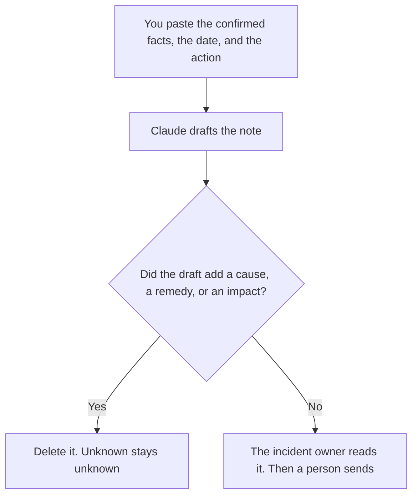

**A customer advisory note written with AI is a short notice that states a change you have confirmed, the date it takes effect, what the customer should do, and what you are not claiming.** The model may order those facts into plain sentences. It may not invent an impact, a workaround, or an apology offer. A note that says sorry for a harm you have already described, with a remedy you are allowed to make, is [how to write a customer apology email with AI](/blog/how-to-write-a-customer-apology-email-with-ai-2026/). A meeting where customers react to your plans is [how to create a customer advisory board agenda with AI](/blog/how-to-create-a-customer-advisory-board-agenda-with-ai-2026/). This page is the written notice, not the meeting and not the apology.

The record of what you shipped, when the note is about a release, is [how to write a changelog with AI](/blog/how-to-write-a-changelog-with-ai-2026/). The person who still owns a case the note creates is [what AI human escalation is](/blog/what-is-ai-human-escalation-2026/).

Prices are US list prices excluding tax from directory pages checked October 16, 2026. Published October 24, 2026. We did not score customer response. Counsel or the incident owner reads the note before it sends. The model does not clear it.

## What the note has to contain

| Line | Who owns it | The model may |
|---|---|---|
| What changed | The fact you confirmed, in the words you approved | Copy it. It may not soften a defect into a "enhancement" |
| When | The date and time you will actually do it, with the zone you use | Copy them. It may not pick a window |
| Who is affected | The plan, region, or product you named | Copy it. It may not write "some customers" |
| What to do | The action you want, or "no action" | Copy it. It may not invent a workaround |
| What you are not saying | The impacts you have not confirmed | Keep the boundary. It may not fill the unknown with a likely cause |
| Contact | A channel a person staffs | Copy it. It may not offer a phone number you do not have |

If you do not yet know the blast radius, the note says what you know and when you will update. A precise-sounding impact the model inferred from the feature name is how a small maintenance window becomes a scare, or a large one gets described as minor.

## Where the note is written

**The draft.** [Claude](/tools/claude/) Pro is $20 a month, or $17 billed annually, when the facts live in a Project next to the last advisory you sent, so the shape stays stable. Free can draft one note from a paste. The review is [Claude review](/blog/claude-review-2026/).

**The line edit.** [Grammarly](/tools/grammarly/) Pro is $12 a member a month billed annually. A clean sentence can still contain a wrong date. Read the date out loud against the change record.

**The file.** [Notion AI](/tools/notion-ai/) Business is $20 a seat a month if advisories are pages with a status: draft, approved, sent. The chat is not the system of record.

**A second formatting.** [ChatGPT](/tools/chatgpt/) Plus at $20 a month can shorten a long internal write-up into the customer lines. Discard any sentence that was not in the facts you pasted. Business, at $20 a user a month billed annually with a two-user minimum, is the row when the incident notes cannot sit in a personal account.

A prompt that holds the line:

"Draft a customer advisory from the facts I pasted. Include only the change, the date and time zone, who is affected, the action, and the contact. If an impact was not in the facts, write Impact not confirmed. Do not apologize, do not offer credit, and do not guess a cause."

## What not to delegate

Do not ask the model whether you should disclose. That is the incident owner's decision, with whoever your process already names. Do not let the model pick a friendlier time zone than the one you operate in. Do not combine this note with a feature announcement. Customers can tell when a maintenance notice is selling. The launch message is a different plan: [how to create a launch comms plan with AI](/blog/how-to-create-a-launch-comms-plan-with-ai-2026/).

## FAQ

### Is this an apology?

An apology admits a harm and, when you are allowed to, offers a remedy a person approved. An advisory tells customers about a change or a risk before or as it happens, including when nobody did anything wrong. If you are sorry, use the apology workflow, and still do not let the model invent the remedy. If you are notifying, use this one, and skip the performance of regret.

### Can the model write the workaround?

Only a workaround you already tested and pasted. A plausible fix the model "often sees" for this kind of product is how customers follow a step that makes the incident worse. If you have no workaround, the line says no action, or it names the update time.

### Who sends it?

The owner on the note. A draft in a chatbot has not been sent. Status stays draft until that person sends it on the channel you named. Support should see the same text the customer sees, filed where the team already works.

### What if the facts change after you send?

Send an update that says what changed, with the new date. Do not edit the old sentence into a memory of accuracy. Keep the first note. The second note points at it. The retention of those copies is [what an AI data retention policy is](/blog/what-is-ai-data-retention-policy-2026/).

## Last verified

October 16, 2026 for Claude, Grammarly, Notion AI, and ChatGPT. Published October 24, 2026.

**Sources:** [Claude pricing](https://claude.com/pricing), [Grammarly pricing](https://www.grammarly.com/plans), [Notion pricing](https://www.notion.com/pricing), [ChatGPT pricing](https://chatgpt.com/pricing/).

*Published by Andrew for [AI Tools Optimizer](https://aitoolsoptimizer.com).*

[Claude](/tools/claude/) is in the [writing directory](/tools/category/writing/). Directory pages may use affiliate links. A purchase through them may earn us a commission at no extra cost to you.
