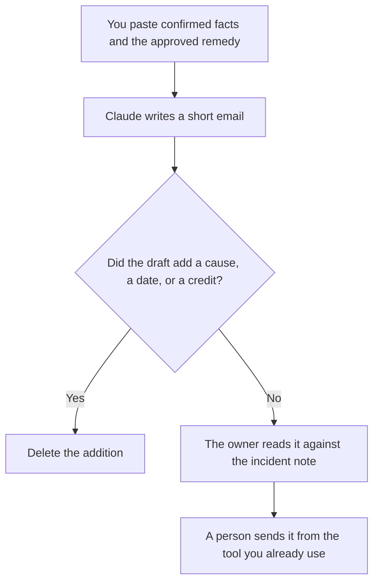

**A customer apology email written with AI is a short note that states facts a person confirmed and a remedy a person is allowed to offer.** The model may tighten the sentences. It may not invent the cause, the duration, the credit, or the promise that it will not happen again. If you do not yet know the cause, the note says you are still looking, in the words you approved. The email is not the incident record. A person sends it.

The path that should have put a person on the case is [what AI human escalation is](/blog/what-is-ai-human-escalation-2026/). The roles and severities are [how to create a support escalation matrix with AI](/blog/how-to-create-a-support-escalation-matrix-with-ai-2026/). The internal write-up after the incident is [how to write a postmortem with AI](/blog/how-to-write-a-postmortem-with-ai-2026/).

Prices are US list prices excluding tax from directory pages checked October 16, 2026. Published October 24, 2026. We did not score how an apology will land. This page is not legal advice. The model does not send the email.

## The lines that have to be real

| Line | Who owns it | The model may |
|---|---|---|
| What happened | The facts you confirmed, with times you pasted | Shorten them. It may not add a cause |
| Who is affected | The segment you named | Copy it. It may not widen the audience |
| What you are doing | The action you already started | State it. It may not promise a date you did not give |
| The remedy | The credit, refund, or "none," as approved | Copy the approved remedy. It may not sweeten it |
| What you will not say | Legal, blame, or a guarantee you marked out | Keep those sentences out |
| The ask | None, or the single next step you wrote | Leave the ask out if you wrote none |

If the email needs a fact that is not confirmed, the incident note is unfinished. Wait, or say you do not know yet, in a sentence you wrote. A changelog mail about a feature you shipped is a different note: [how to write a product changelog email with AI](/blog/how-to-write-a-product-changelog-email-with-ai-2026/). A planned change that is not an apology is [how to write a change management email with AI](/blog/how-to-write-a-change-management-email-with-ai-2026/).

## Where the note is written

**The draft.** [Claude](/tools/claude/) Pro is $20 a month, or $17 billed annually, when the incident facts sit in a Project and the email has to stay inside them. Free can tighten one note from a paste. The review is [Claude review](/blog/claude-review-2026/).

**A plainer second wording.** [ChatGPT](/tools/chatgpt/) Plus at $20 a month can offer a shorter version of the same facts. Discard a version that sounds warmer by adding a promise. The review is [ChatGPT review](/blog/chatgpt-review-2026/).

**A tone pass.** [Grammarly](/tools/grammarly/) Pro is $12 a member a month billed annually, or $30 monthly, after the facts are frozen. Grammarly must not add an apology for something you did not confirm. The invoice is [Grammarly pricing explained](/blog/grammarly-pricing-explained-2026/).

**The archive.** [Notion AI](/tools/notion-ai/) Business is $20 a seat a month if the sent note should live next to the incident. The sent file is what you told customers. A chat draft is not.

A prompt that holds the line:

"Write a short apology email from the facts, the audience, and the remedy I pasted. Do not add a cause, a date, a dollar amount, or a promise that it will not recur. If the cause is marked unknown, say we are still confirming it. Do not assign blame to a team or a vendor. This is a draft. A person will send it."

## What not to delegate

Do not ask the model why the incident happened. Do not let it offer a credit "to be safe." Do not send a note to every customer because the draft said "we value all of our users." The segment is a field you fill. A security questionnaire that asks what you told customers is a later file, answered from the sent note, not from the model's first draft. That workflow is [how to write a security questionnaire response with AI](/blog/how-to-write-a-security-questionnaire-response-with-ai-2026/).

## FAQ

### Can the model decide the remedy?

No. The remedy is a credit, a refund, a fix date, or none, and a person who is allowed to offer it has already chosen. The model copies that choice. A more generous draft is the one you delete.

### What if we do not know the cause yet?

Say that, in the words you approved. A specific cause the model found plausible is the sentence most likely to be wrong in public. Unknown stays unknown until the incident owner says otherwise.

### Is this the postmortem?

The postmortem is internal. This email is the part you decided customers should receive. Write the email from the facts you are willing to say. Write the postmortem from the fuller record. Do not paste the internal draft into the customer note.

### Can a bot send it?

No. Sending is a person, after the facts match the incident note and the remedy matches the approval. A workflow that sends when a sentiment score drops is not this article. The handoff rules are the escalation pages linked above.

## Last verified

October 16, 2026 for Claude, ChatGPT, Grammarly, and Notion AI. Published October 24, 2026.

**Sources:** [Claude pricing](https://claude.com/pricing), [ChatGPT pricing](https://chatgpt.com/pricing/), [Grammarly Pro cost](https://support.grammarly.com/hc/en-us/articles/115000090011-How-much-does-Grammarly-Pro-cost), [Notion pricing](https://www.notion.com/pricing).

*Published by Andrew for [AI Tools Optimizer](https://aitoolsoptimizer.com).*

[Claude](/tools/claude/) is in the [chatbots and assistants directory](/tools/category/chatbots-assistants/). Directory pages may use affiliate links. A purchase through them may earn us a commission at no extra cost to you.
