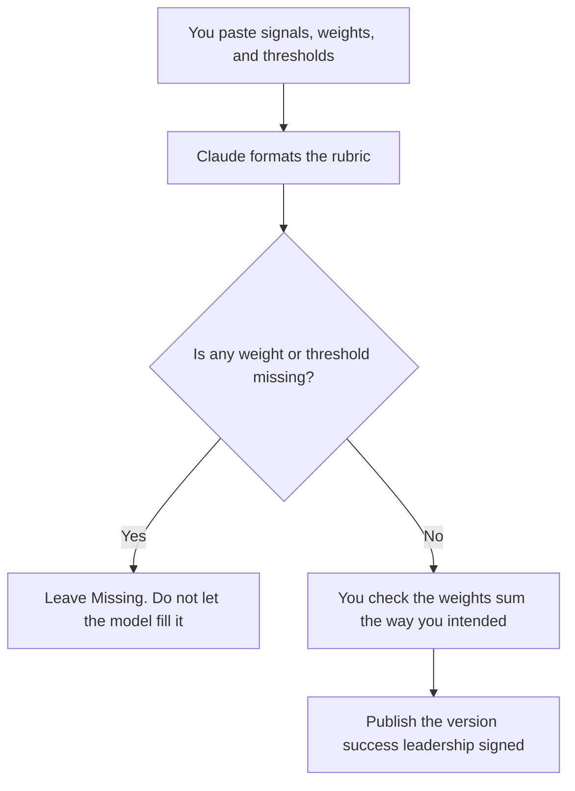

**A customer health score rubric written with AI is a table of signals, weights, and thresholds you already chose.** The model may make the rows consistent and the language plain. It may not invent a weight, a threshold, or a customer's score. A blank weight stays blank until a person fills it. A fluent "red account" you did not define is a forecast dressed up as math.

The playbook those rows should match is [how to write a customer success playbook with AI](/blog/how-to-write-a-customer-success-playbook-with-ai-2026/). The renewal conversation that uses the score is [how to write a QBR deck with AI](/blog/how-to-write-a-qbr-deck-with-ai-2026/). The person who still owns the account is [what human-in-the-loop AI is](/blog/what-is-human-in-the-loop-ai-2026/). A number the model filled in is [what an AI hallucination is](/blog/what-is-ai-hallucination-2026/).

Prices are US list prices excluding tax from directory pages checked October 16, 2026. Published October 24, 2026. We did not score retention. This page does not set your health model.

## The columns that have to be real

| Column | Who owns it | The model may |
|---|---|---|
| Signal | You. A fact you can pull: logins, tickets, a sponsor meeting | Suggest a name for a signal you already listed. It may not add "sentiment" |
| Source | The system that holds the fact | Repeat it. It may not point at a tool you do not run |
| Weight | A number you paste, and the scale | Copy it. It may not "balance" the weights to 100 by inventing one |
| Threshold | The cut you use for green, yellow, and red | Format it. It may not pick a cut from a blog |
| Missing data | What you do when the field is empty | Write the rule you pasted. Empty is not a zero unless you said so |
| Owner | The role who can change the rubric | Leave Missing if you did not name one |
| Review date | A date you set | Copy it |

Four signals you will actually collect beat twelve you will estimate. The model will happily add product-usage poetry. Refuse it. If a signal has no source, it is not in the rubric.

## Where the rubric is kept

**The draft.** [Claude](/tools/claude/) Pro is $20 a month, or $17 billed annually. Put the current rubric in a Project so a later edit does not resurrect a retired signal. Free can take a short paste. The review is [Claude review](/blog/claude-review-2026/).

**The page the team opens.** [Notion AI](/tools/notion-ai/) Business is $20 a seat a month if the rubric lives in Notion. Plus at $10 is not the full AI tier. The page needs the owner and the review date in the header, not only in a chat. The invoice is [Notion AI pricing explained](/blog/notion-ai-pricing-explained-2026/).

**The CRM that may store the inputs.** [HubSpot](/tools/hubspot/) has a free CRM. Starter was a limited-time $7 or $10 a seat on the October 16 card. Professional and Enterprise are a quote, not a sticker this site invented. The score, if you store one, is a field you defined. An agent that writes the field needs a credit cap. The invoice is [HubSpot pricing explained](/blog/hubspot-pricing-explained-2026/).

**Call evidence, if a signal is "we spoke."** [Gong](/tools/gong/) is custom: per-user licenses plus a platform fee. There is no public dollar. A recorded call can support a signal you defined, such as "executive attended." It cannot be the weight. The quote is [Gong pricing explained](/blog/gong-pricing-explained-2026/).

A prompt that holds the line:

"Format a health rubric from the signals, weights, and thresholds I pasted. Do not add a signal. Do not change a weight. If a weight is missing, write Missing. Do not score any customer. Do not convert an empty field to zero."

## What not to delegate

Do not ask the model which accounts are healthy. That is a run of the rubric against data, after the rubric is signed, in the system that holds the data. Do not paste a customer's private notes into a personal chat your policy forbids. Do not let a pretty red-yellow-green legend replace the threshold table.

The shelf of tools around the renewal is [best AI tools for customer success](/blog/best-ai-tools-for-customer-success-2026/). This rubric is the definition. Those tools are the work.

## FAQ

### Can AI pick the weights?

It can draft a layout. The weights are a decision about what your company will act on. A model that sets them has set your operating policy. Put the numbers in yourself, then let it format.

### What if the weights do not sum to 100?

Leave them as you wrote them, and decide whether you want them to sum. Do not let the model rescale quietly. A rescaled rubric is a different model.

### Should empty usage be a zero?

Only if you said so. A new customer with no logins yet is not the same as a customer who stopped. Write that case as its own row or keep the cell empty.

### How often do we rerun it?

On the review date you put on the page. A weekly automatic score is fine when the inputs are the signals you named. A weekly prompt that "updates the rubric" will drift the definitions. Change weights in a signed edit.

## Last verified

October 16, 2026 for Claude, Notion AI, HubSpot, and Gong's pricing model. Published October 24, 2026. Gong has no public dollar.

**Sources:** [Claude pricing](https://claude.com/pricing), [Notion pricing](https://www.notion.com/pricing), [HubSpot pricing](https://www.hubspot.com/pricing).

*Published by Andrew for [AI Tools Optimizer](https://aitoolsoptimizer.com).*

[HubSpot](/tools/hubspot/) is in the [sales directory](/tools/category/sales/). Directory pages may use affiliate links. A purchase through them may earn us a commission at no extra cost to you.
