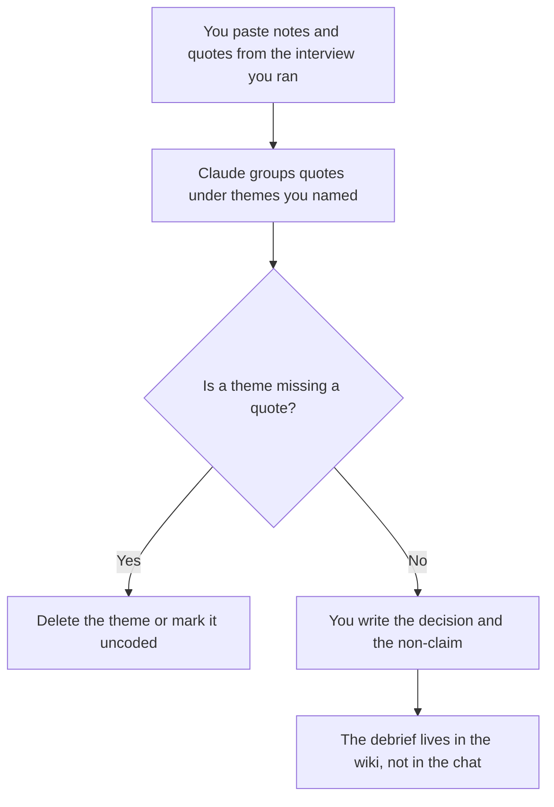

**A customer interview debrief written with AI is a short record of what the participant said, what you decided, and what you will not claim.** The model may group quotes you captured under themes you named. It may not add a theme, a statistic, or a feature request the participant did not make.

The questions you ask beforehand are [how to create a user interview guide with AI](/blog/how-to-create-a-user-interview-guide-with-ai-2026/). The raw notes are [how to use AI for user interview notes](/blog/how-to-use-ai-for-user-interview-notes-2026/). The person you thought you were interviewing is [how to create a user persona with AI](/blog/how-to-create-a-user-persona-with-ai-2026/). A finding with no quote is [what an AI hallucination is](/blog/what-is-ai-hallucination-2026/).

Prices are US list prices excluding tax from directory pages checked October 16, 2026. Published October 24, 2026. This page is not research advice. One interview is not a market.

## The sections that have to be real

| Section | Who owns it | The model may |
|---|---|---|
| Participant | A role and a date you paste. No extra identity | Copy it. It may not guess a company size |
| Quotes | Lines you captured, with who said them | Place them under a theme you named |
| Theme | A label you chose after you read the notes | Rename nothing. It may not add "users want" |
| Decision | What you will change, or explicitly not change | Format it. It may not invent the decision |
| Non-claim | What this interview does not prove | Keep the sentence you wrote |
| Open question | What you still need to ask someone else | List only gaps you pointed at |

A debrief is one session. A persona is a composite. Do not let the model promote a single quote into "customers." If you have five debriefs, you still write the cross-interview read yourself, or you paste only the quotes and label the count.

## Where the debrief is built

**The draft.** [Claude](/tools/claude/) Pro is $20 a month, or $17 billed annually. Keep the guide and the notes in a Project so the debrief cannot drift from the questions you asked. Free can format one short session. The review is [Claude review](/blog/claude-review-2026/).

**The page of record.** [Notion AI](/tools/notion-ai/) Business is $20 a seat a month. The signed debrief lives there. A chat thread is not the research archive. The record rule is [what a system of record for AI is](/blog/what-is-a-system-of-record-for-ai-2026/).

**The capture, if a call tool was allowed.** [Granola](/tools/granola/) Business is $14 a user a month and does not put a bot in the call. Free keeps 30 days of history. Use the transcript only when the participant knew. The debrief still quotes the lines you stand behind, not every filler word.

**A shorter version for a stakeholder.** [ChatGPT](/tools/chatgpt/) Plus at $20 can shorten a debrief you already wrote. It is the wrong tool to discover what the customer meant. The review is [ChatGPT review](/blog/chatgpt-review-2026/).

A prompt that holds the line:

"Write a debrief from the notes and quotes I pasted. Use only themes I listed. Every theme needs a quote I included. If it does not, write Uncoded. Do not add a finding, a percentage, or a feature. Copy my decision and my non-claim. If either is missing, write Missing."

## What not to delegate

Do not ask what the customer "really wanted." Do not combine this session with memories from other calls unless you paste those quotes too. Do not include a name, an email, or a recording link in a tool your policy forbids. The research stack for the team is [best AI tools for UX researchers](/blog/best-ai-tools-for-ux-researchers-2026/).

## FAQ

### Can AI find the themes?

It can propose labels. You accept or delete them before the debrief is filed. A label with no quote does not survive. The decision under the theme is yours.

### Is a debrief the same as the notes?

Notes are the capture. The debrief is what you concluded and what you refused to conclude. If you only needed a transcript, stop at the notes article.

### How many interviews before a theme is real?

This page does not pick a number. Write the count you actually have in the non-claim. "One session" is an honest scope. The model will try to sound broader. Delete that sentence.

### Should stakeholders get the raw quotes?

Give them the quotes you are willing to defend, with the decision. A polished paragraph with the quotes removed is how a maybe becomes a roadmap item. Keep at least one quote next to each theme you ship.

## Last verified

October 16, 2026 for Claude, Notion AI, Granola, and ChatGPT. Published October 24, 2026.

**Sources:** [Claude pricing](https://claude.com/pricing), [Notion pricing](https://www.notion.com/pricing), [Granola pricing](https://www.granola.ai/pricing).

*Published by Andrew for [AI Tools Optimizer](https://aitoolsoptimizer.com).*

[Granola](/tools/granola/) is in the [meetings and transcription directory](/tools/category/meetings-transcription/). Directory pages may use affiliate links. A purchase through them may earn us a commission at no extra cost to you.
