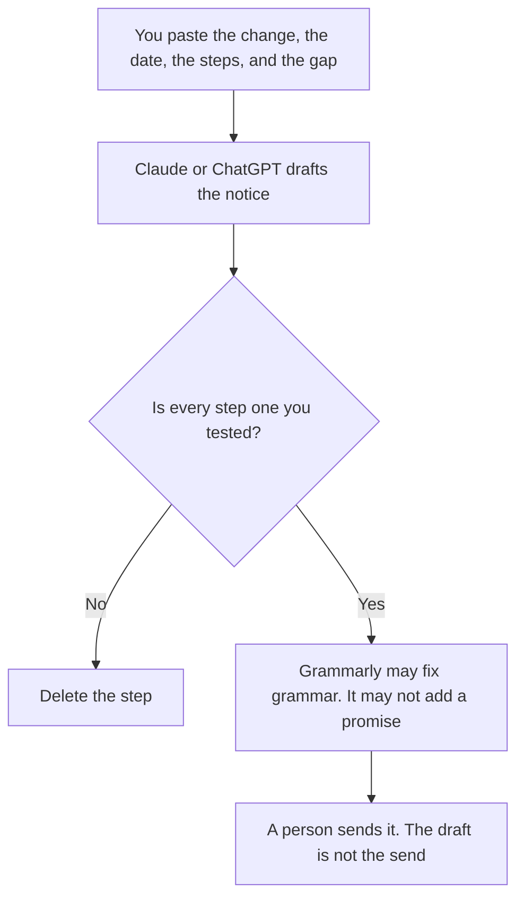

**A customer migration notice written with AI tells the customer what will change, on which date, what they must do, and what will not be ready.** The model may make that notice readable. It may not pick the date, invent a self-serve path, or promise parity the notes do not claim. A feature that is going away entirely, with a replacement named, is [how to write a feature deprecation note with AI](/blog/how-to-write-a-feature-deprecation-note-with-ai-2026/). This page is the move: the customer has to do something, or something they use will point somewhere else.

The internal email that walks your own team through a change is [how to write a change management email with AI](/blog/how-to-write-a-change-management-email-with-ai-2026/). The gate before you send anything is [how to create a launch readiness checklist with AI](/blog/how-to-create-a-launch-readiness-checklist-with-ai-2026/).

Claude's prices are from claude.com/pricing on October 24, 2026. Notion, Grammarly, and ChatGPT prices are from directory pages checked October 16. chatgpt.com/pricing returned HTTP 403 on October 24. Published October 24, 2026. We did not score notices.

## What the customer needs to see

| Line | Who supplies it | The model may |
|---|---|---|
| What changes | The approved description | Phrase it in one paragraph. It may not add a benefit you did not write |
| The date, with the timezone | You | Copy both. It may not say "soon" |
| What the customer must do | The steps you already tested | Number them. It may not add a step |
| What is not ready | The gap you wrote | Copy it. It may not call the gap "temporary" unless you did |
| Where to get help | The channel you named | Copy it. If it is blank, write Help channel missing |

A migration notice is customer-facing. An internal plan can say "we hope to automate step 3." The notice cannot, unless that hope is an approved sentence with a date. If partners must move too, say so in a separate paragraph you paste. Do not let one notice pretend the partner portal and the customer app change on the same day unless you wrote that.

## Where it is drafted

**The draft, when several notices must sound like the same product.** [Claude](/tools/claude/) Pro is $17 a month billed annually, $200 up front, or $20 monthly. Keep the approved verbs in a Project. The review is [Claude review](/blog/claude-review-2026/).

**The page support will paste from.** [Notion AI](/tools/notion-ai/) Business is $20 a seat a month. The sent notice is the record. A later chat that "clarifies" it is a new draft. The invoice is [Notion AI pricing explained](/blog/notion-ai-pricing-explained-2026/).

**The last pass.** [Grammarly](/tools/grammarly/) Pro is $12 a member a month billed annually, or $30 monthly. If the rewrite softens "must export by Friday" into "you may want to export," put the requirement back. The invoice is [Grammarly pricing explained](/blog/grammarly-pricing-explained-2026/).

**One notice, from a short paste.** [ChatGPT](/tools/chatgpt/) Plus is $20 a month on the October 16 card. Discard a version that adds a cheerleading close. The review is [ChatGPT review](/blog/chatgpt-review-2026/).

A prompt that holds the line:

"Write a customer migration notice from the change, the date, the timezone, the steps, the gap, and the help channel I pasted. Do not add a step. Do not move the date. If the help channel is missing, write Help channel missing."

## What not to delegate

Do not ask the model to choose a softer date. Do not include a customer-specific balance or a private contract term in a notice that will be reused. Do not send from the chat. The model-version move, if the migration is a model rather than a feature, is [how to write a model deprecation plan with AI](/blog/how-to-write-a-model-deprecation-plan-with-ai-2026/).

## FAQ

### How is this different from a deprecation note?

A deprecation note says something will stop, and names the replacement and the gap. A migration notice says what the customer must do to end up on the new path. You often need both. If there is no action, you may only need the deprecation note. If the old path keeps working and the customer must switch a setting, you need this notice.

### How is this different from a changelog?

A changelog lists what shipped. A migration notice tells a specific audience to act before a date. Shipping the feature does not migrate the customer. The notice does not replace the changelog.

### Can the model translate it?

Only after the English source is accepted, and a person who knows the language reads the translation. A translated step that gained a click is a new, untested step. This page does not pick a language.

### Who may send it?

The owner named on the notice. Support may reply with it after that send. They may not invent a grace period in the chat.

## Last verified

October 24, 2026 for Claude. October 16, 2026 for Notion, Grammarly, and ChatGPT. Published October 24, 2026.

**Sources:** [Claude pricing](https://claude.com/pricing), [Notion pricing](https://www.notion.com/pricing), [Grammarly pricing](https://www.grammarly.com/plans), [ChatGPT pricing](https://chatgpt.com/pricing/).

*Published by Andrew for [AI Tools Optimizer](https://aitoolsoptimizer.com).*

[Claude](/tools/claude/) is in the [chatbots and assistants directory](/tools/category/chatbots-assistants/). Directory pages may use affiliate links. A purchase through them may earn us a commission at no extra cost to you.
