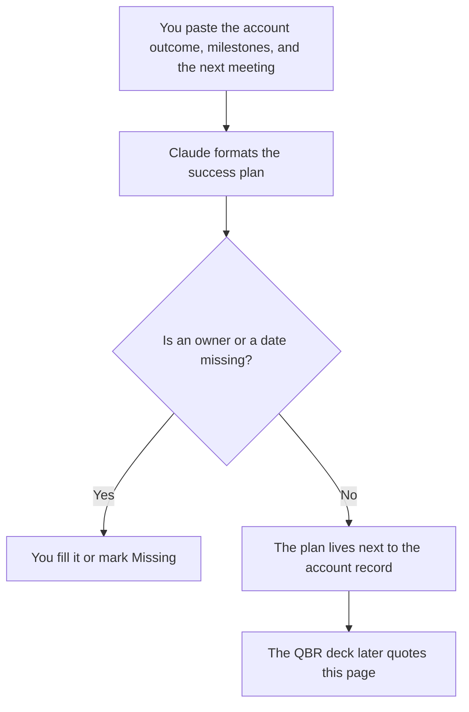

**A customer success plan written with AI is a one-account page: the outcome the customer named, the milestones you dated, and the next meeting you already booked.** The model may format that page from notes you paste. It may not invent a renewal forecast, a health score, or a feature promise.

The repeatable motions for every account are [how to write a customer success playbook with AI](/blog/how-to-write-a-customer-success-playbook-with-ai-2026/). The formula for a score is [how to write a customer health score rubric with AI](/blog/how-to-write-a-customer-health-score-rubric-with-ai-2026/). The meeting that reviews the plan is [how to write a QBR deck with AI](/blog/how-to-write-a-qbr-deck-with-ai-2026/). The team shelf is [best AI tools for customer success](/blog/best-ai-tools-for-customer-success-2026/).

Prices are US list prices excluding tax from directory pages checked October 16, 2026. Published October 24, 2026. This page is not a forecast and not legal advice. A plan is not a contract.

## The fields that have to be real

| Field | Who owns it | The model may |
|---|---|---|
| Account outcome | A result the customer stated, in their words or your notes | Copy it. It may not upgrade it to a metric |
| Milestone | A date and a deliverable you set | Format the list. It may not add a milestone |
| Owner | Your role and the customer's role | Leave Missing if unnamed |
| Health inputs | The signals your rubric already uses | List only inputs you pasted |
| Next meeting | A date that exists on a calendar | Copy it. It may not suggest a cadence you did not choose |
| Non-promise | What this plan does not commit | Keep your sentence |

The playbook says how your team handles onboarding. The success plan says what this account is trying to achieve by the dates you wrote. Mixing them produces a generic page with the customer's logo on it. Keep the playbook linked, and keep the milestones local.

## Where the plan is written

**The draft.** [Claude](/tools/claude/) Pro is $20 a month, or $17 billed annually. Put the last call notes and the contract's public milestones in a Project. Do not paste confidential terms a personal account may not hold. Free can format one short plan. The review is [Claude review](/blog/claude-review-2026/).

**The page of record.** [Notion AI](/tools/notion-ai/) Business is $20 a seat a month if the plan lives in the wiki. The account system of record may instead be the CRM. Pick one. The rule is [what a system of record for AI is](/blog/what-is-a-system-of-record-for-ai-2026/).

**The CRM.** [HubSpot](/tools/hubspot/) has a free CRM. Starter was $7 or $10 a seat a month as a limited-time offer on the October 16 card. Professional and Enterprise are a quote. The plan can point at fields you already have. The model does not create a forecast category. The invoice is [HubSpot pricing explained](/blog/hubspot-pricing-explained-2026/).

**The call, when the customer knows.** [Fathom](/tools/fathom/) has a free recording tier. Premium is $16 a month billed annually. Use the summary as notes you still edit. The plan quotes decisions, not the whole transcript. Paid rows are in [Fathom pricing explained](/blog/fathom-pricing-explained-2026/).

The manager who looks across accounts is [best AI tools for CS managers](/blog/best-ai-tools-for-cs-managers-2026/).

A prompt that holds the line:

"Format a success plan for this one account from the outcome, milestones, owners, and next meeting I pasted. Do not add a milestone. Do not invent a renewal amount or a health score. If a field is missing, write Missing. Copy the non-promise I included."

## What not to delegate

Do not ask whether the account will renew. Do not let the model promise a roadmap item. Do not compute health in the prompt. Health uses the rubric, with inputs you can show. A smooth paragraph is not a score.

## FAQ

### Can AI set the milestones?

It can format dates you typed. A milestone it added is a commitment the customer did not hear. Delete it or take it to the customer before it is on the page.

### Is the success plan the QBR deck?

The plan is the running agreement on outcomes and dates. The QBR deck is the meeting artifact. Build the deck from the plan. Do not let the deck become a second plan with different numbers.

### What if the customer never named an outcome?

Write Missing and ask. A plan that invents "increase ROI" is a template. The first milestone can be "agree the outcome," with a date. That is honest. A fabricated outcome is not.

### Should every account have one?

Use one when the account is large enough that a missed milestone matters. A long tail of tiny accounts can follow the playbook only. Say which motion you are in. The model will try to produce a full plan anyway. Stop it when you meant the playbook.

## Last verified

October 16, 2026 for Claude, Notion AI, HubSpot, and Fathom. HubSpot Starter was a promotion. Published October 24, 2026.

**Sources:** [Claude pricing](https://claude.com/pricing), [Notion pricing](https://www.notion.com/pricing), [HubSpot pricing](https://www.hubspot.com/pricing), [Fathom pricing](https://www.fathom.ai/pricing).

*Published by Andrew for [AI Tools Optimizer](https://aitoolsoptimizer.com).*

[HubSpot](/tools/hubspot/) is in the [sales directory](/tools/category/sales/). Directory pages may use affiliate links. A purchase through them may earn us a commission at no extra cost to you.
