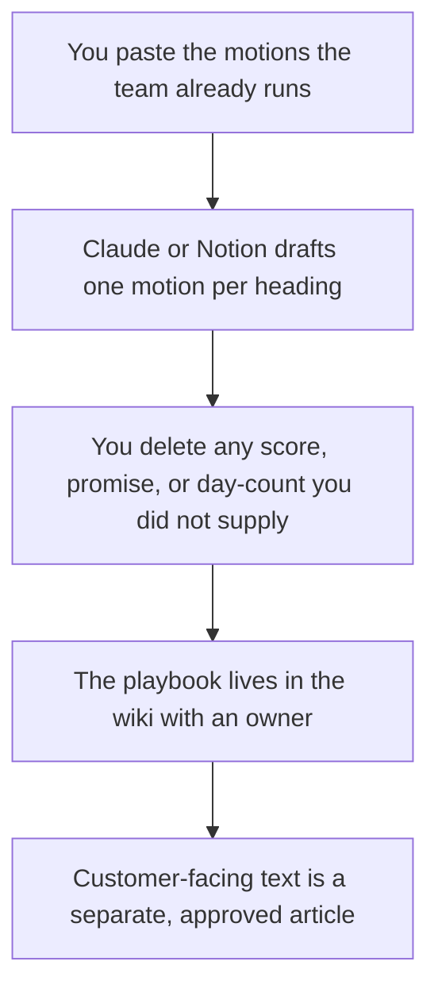

**A customer-success playbook written with AI is an internal page that says: when the customer does this, we do that, and this person owns the step.** The model can turn a rep's notes into a consistent format. It cannot invent a health score, a renewal forecast, or a promise the contract does not contain. If the motion is not one your team runs, it does not go in the playbook.

The tool shelf for the job is [best AI tools for customer success](/blog/best-ai-tools-for-customer-success-2026/). The help center the customer sees, which is a different document, is [how to build a help center with AI](/blog/how-to-build-a-help-center-with-ai-2026/). The new-hire list inside your own company is [how to create an onboarding checklist with AI](/blog/how-to-create-an-onboarding-checklist-with-ai-2026/).

Prices are US list prices excluding tax. Notion, Claude, Chatbase, and Grammarly are from directory pages checked October 16, 2026. Fathom's prices match the directory and the October 24, 2026 pricing article. Published October 24, 2026. We did not score retention.

## The motions worth writing down

| Motion | Owner | The model may |
|---|---|---|
| Kickoff | The CSM you name | List the agenda you already use |
| Time-to-value check | The day you actually look | Use your day count. It may not invent "day 14" |
| Risk | The signals you trust, such as a missed meeting you logged | List them. It may not score the account |
| Renewal | The window in the contract | Copy the window. It may not predict a yes |
| Escalation | The person who joins | Name them. It may not create a committee |
| Hand-off to support | The article or the queue | Link it. It may not rewrite policy |

A playbook that customers can read by accident will be treated as a commitment. Mark it internal. The person who publishes a customer-facing article is [what human-in-the-loop AI is](/blog/what-is-human-in-the-loop-ai-2026/).

## Where the page is written

**The wiki.** [Notion AI](/tools/notion-ai/) Business is $20 a seat a month and is the AI tier if the playbook lives in Notion. Plus at $10 is not that tier. Custom Agents are extra, at $10 per 1,000 credits. An agent should not update a renewal motion on a schedule until a person has approved the text. The card is [Notion AI pricing explained](/blog/notion-ai-pricing-explained-2026/).

**The long draft.** [Claude](/tools/claude/) Pro is $20 a month, or $17 billed annually. Put one motion in a Project at a time. A single prompt that says "write our entire CS playbook" will invent the company you wish you had. [ChatGPT](/tools/chatgpt/) Plus at $20 is fine for a rep who keeps notes there. The container is [Claude Projects vs ChatGPT Projects](/blog/claude-projects-vs-chatgpt-projects-2026/).

**The call that revealed the motion.** [Fathom](/tools/fathom/) Business is $25 a user a month billed annually when you need CRM fields. Free lists unlimited recordings. The notes are an input. They are not the playbook until someone promotes a repeated step. The sales-call pair is [Otter vs Fathom for sales calls](/blog/otter-vs-fathom-for-sales-calls-2026/).

**Answers the customer can see.** [Chatbase](/tools/chatbase/) Hobby is $32 a month billed yearly for 700 message credits, pointed at articles you maintain. Do not point it at the internal playbook. The build is [how to build a knowledge-base chatbot](/blog/how-to-build-a-knowledge-base-chatbot-2026/).

**The edit.** [Grammarly](/tools/grammarly/) Pro is $12 a member a month billed annually, after the steps are real.

A prompt that holds the line:

"Turn these notes into a customer-success playbook. One heading per motion. Under each heading: trigger, owner, steps, customer-facing or internal, and the link I provided. If a day-count, a metric, or an owner is missing, write Missing. Do not add a health score. Do not promise a result."

The claim check is [how to fact-check AI writing](/blog/how-to-fact-check-ai-writing-2026/). A QBR still needs a person. The meeting-notes choice is [Claude vs ChatGPT for meeting notes](/blog/claude-vs-chatgpt-for-meetings-notes-2026/).

## FAQ

### Is a health score part of the playbook?

Only if a system you trust already computes it and you can say what the number means. The model does not invent one from sentiment. This page does not treat a score as a motion.

### Can AI write the renewal email?

It can draft from the playbook after the playbook is true. The send stays with a person. A generated discount is not a playbook step unless your notes include the discount you are allowed to offer.

### How is this different from onboarding docs?

Onboarding docs teach a new hire how your company works. This playbook tells a CSM what to do when a customer hits a known moment. The checklist that feeds a new hire is the onboarding article linked above. Keep the audiences separate.

### What if every CSM does it differently?

Write the motion you want repeated, and label the rest as local practice. A model that "harmonizes" five styles will pick one and sound official. You pick.

## Last verified

October 16, 2026 for Notion, Claude, ChatGPT, Chatbase, and Grammarly. Fathom's Business price matches the directory and the October 24, 2026 pricing article. Published October 24, 2026.

**Sources:** [Notion AI](https://www.notion.com/product/ai), [Claude pricing](https://claude.com/pricing), [Fathom](https://www.fathom.ai).

*Published by Andrew for [AI Tools Optimizer](https://aitoolsoptimizer.com).*

[Notion AI](/tools/notion-ai/) is in the [productivity and notes directory](/tools/category/productivity-notes/). Directory pages may use affiliate links. A purchase through them may earn us a commission at no extra cost to you.
