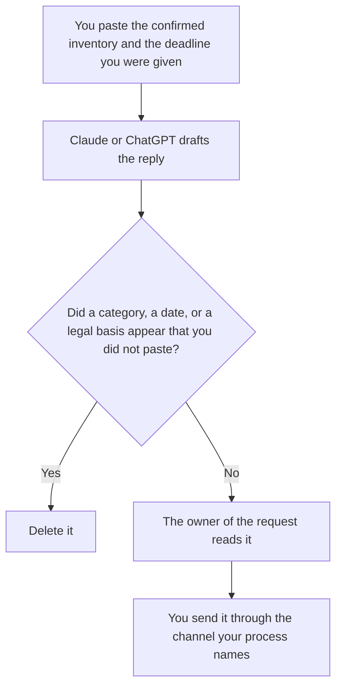

**A data access reply written with AI lists the categories a person already confirmed you hold, the place the requester can read them, and the items you do not hold, and it stops there.** The model may format the reply. It may not invent a data category, a retention period, or a legal conclusion. If the inventory is silent, the line says Not in the inventory. This page is not legal advice, and it is not a privacy policy.

How long you keep a category, which has to be your rule and not the model's, is [what an AI data retention policy is](/blog/what-is-ai-data-retention-policy-2026/). Stripping identifiers before a draft sees them is [what AI PII redaction is](/blog/what-is-ai-pii-redaction-2026/). Where a field came from is [what AI data lineage is](/blog/what-is-ai-data-lineage-2026/).

Claude's prices are from claude.com/pricing on October 24, 2026. Notion, ChatGPT, and Grammarly prices are from directory pages checked October 16, 2026, except ChatGPT Plus at $20 a month on the October 24 Codex plan page. Published October 24, 2026. We did not score compliance.

## What the reply is allowed to say

| Block | Who owns it | The model may |
|---|---|---|
| The categories you confirmed | The inventory a person checked | Copy the names. It may not add "and similar data" |
| Where the requester can access them | You | Copy the path or the attachment plan. It may not promise a portal you do not have |
| Categories you confirmed you do not hold | The same inventory | Say you do not hold them. It may not guess why |
| A deadline | Only the date you pasted | Not pick "30 days" from a statute it remembers |
| A refusal or an exception | Only text counsel or your policy already approved | Not draft a legal basis |

A helpful reply that adds "we also store device fingerprints" has created a record you may now have to defend. If the inventory does not list it, it is not in the reply. A request you cannot parse stays a question back to the requester, in words you wrote, not a guess at what they "probably want."

## Where it is drafted

**The reply, when the categories must match the last response.** [Claude](/tools/claude/) Pro is $17 a month billed annually, $200 up front, or $20 monthly. Put the allowed category names in the Project. The review is [Claude review](/blog/claude-review-2026/).

**The inventory page.** [Notion AI](/tools/notion-ai/) Business is $20 a seat a month if that is where the confirmed list lives. Plus at $10 is not the full AI tier. The chat is not the inventory. The invoice is [Notion AI pricing explained](/blog/notion-ai-pricing-explained-2026/).

**One reply, from a short paste.** [ChatGPT](/tools/chatgpt/) Plus is $20 a month. Use a workspace your policy allows. A personal login is the wrong place for a requester's file. The review is [ChatGPT review](/blog/chatgpt-review-2026/).

**A last pass.** [Grammarly](/tools/grammarly/) Pro is $12 a member a month billed annually, or $30 monthly. If it changes "we do not hold" into "we hold only what we need," put the denial back. The invoice is [Grammarly pricing explained](/blog/grammarly-pricing-explained-2026/).

A prompt that holds the line:

"Draft a data access reply from the inventory I pasted. List only those categories. If a category the requester asked about is absent, write Not in the inventory. Do not state a retention period or a legal basis I did not paste. Do not add a category."

## What not to delegate

Do not paste the requester's full file into the prompt so the model can "see what we have." Paste the category names a person already confirmed. Do not ask whether the request is valid. Do not send the draft because it sounds official.

## FAQ

### Is this a privacy policy?

No. A privacy policy is a document counsel or your process publishes for everyone. This reply is one response to one request, bounded by an inventory. The model does not update the policy by writing a polite email.

### Can the model decide what we are required to provide?

No. It can only format what you already confirmed. A deadline, a refusal, and a legal basis enter the draft only as text you pasted from the process you trust. This page will not supply them.

### What if the inventory is incomplete?

The reply says Not in the inventory for anything you have not confirmed. Then a person finishes the inventory. Shipping a partial reply that pretends to be complete is worse than a short reply that says the check is still open, if your process allows you to say that. If your process does not allow that sentence, do not let the model invent a softer one.

### Who may send it?

The owner of the request queue, through the channel your process names. A finished paragraph is not a send. A personal mailbox is not that channel unless the process says it is.

## Last verified

October 24, 2026 for Claude and for ChatGPT Plus. October 16, 2026 for Notion and Grammarly. Published October 24, 2026.

**Sources:** [Claude pricing](https://claude.com/pricing), [Notion pricing](https://www.notion.com/pricing), [ChatGPT and Codex pricing](https://learn.chatgpt.com/docs/pricing), [Grammarly plans](https://www.grammarly.com/plans).

*Published by Andrew for [AI Tools Optimizer](https://aitoolsoptimizer.com).*

[Claude](/tools/claude/) is in the [chatbots and assistants directory](/tools/category/chatbots-assistants/). Directory pages may use affiliate links. A purchase through them may earn us a commission at no extra cost to you.
