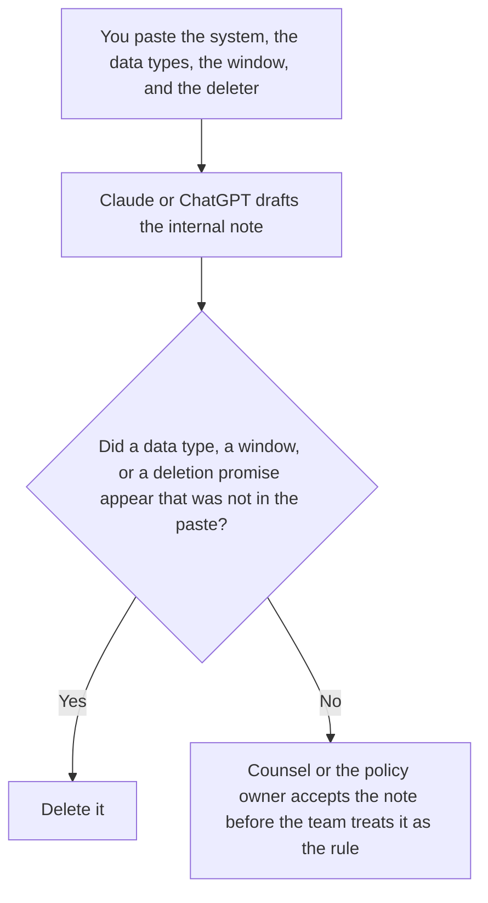

**An internal data retention note for an AI system, written with AI, tells your own team what this system keeps, for how long, and who deletes it, using only the window counsel already approved.** The model may make the sentences plain. It may not pick a retention period, add a data type, or promise a deletion speed. The customer-facing page, which uses the same window and a different audience, is [how to write a data retention notice with AI](/blog/how-to-write-a-data-retention-notice-with-ai-2026/). The rule the note has to match is [what an AI data retention policy is](/blog/what-is-ai-data-retention-policy-2026/).

Stripping identifiers before a prompt is stored is [what AI PII redaction is](/blog/what-is-ai-pii-redaction-2026/). Redaction is not retention. A redacted prompt can still be kept too long.

This page is not legal advice. Claude's prices are from claude.com/pricing on October 24, 2026. Notion, ChatGPT, and Grammarly prices are from directory pages checked October 16, 2026, except ChatGPT Plus, which is from learn.chatgpt.com/docs/pricing on October 24. Published October 24, 2026. We did not review a vendor contract.

## What the note has to name

| Line | Who owns it | The model may |
|---|---|---|
| The system, by the name you use internally | You | Copy it. It may not rename the product |
| The data types in scope | You, from the policy | Copy them. It may not add "analytics" |
| The window, in the unit counsel wrote | You | Copy it. It may not convert days into a rounder number |
| Who deletes, and what "deleted" means here | You | Copy it. It may not promise a backup is gone |

The customer notice and this note can share a window. They do not share an audience. Do not paste internal system names into the customer notice. Do not paste the customer notice into the wiki and call it the internal note if the internal note has to name a deleter and a backup.

## Where it is written

**The draft.** [Claude](/tools/claude/) Pro is $17 a month billed annually, $200 up front, or $20 monthly. Keep the approved window in a Project so a later edit does not shorten it. The review is [Claude review](/blog/claude-review-2026/).

**The page the team opens.** [Notion AI](/tools/notion-ai/) Business is $20 a seat a month. Link the policy version and the date. The invoice is [Notion AI pricing explained](/blog/notion-ai-pricing-explained-2026/).

**One draft from a short paste.** [ChatGPT](/tools/chatgpt/) Plus is $20 a month. Business is the workspace when the note is company data: $25 a user a month billed monthly, for two or more users, on the October 24 plan page. The annual Business dollar is in [ChatGPT Team pricing explained](/blog/chatgpt-team-pricing-explained-2026/). The review is [ChatGPT review](/blog/chatgpt-review-2026/).

**A plain-language pass.** [Grammarly](/tools/grammarly/) Pro is $12 a month billed annually, or $30 monthly, on the October 16 card. It may not change the window while it changes a sentence. The invoice is [Grammarly pricing explained](/blog/grammarly-pricing-explained-2026/).

A prompt that holds the line:

"Write the internal retention note from the system, the data types, the window, and the deleter I pasted. If the window is missing, write Window not set. Do not add a data type. Do not promise that backups are deleted."

## What not to delegate

Do not ask how long you should keep prompts. Do not paste a full customer export into the chat so the example "looks real." Do not publish the note to customers. The policy owner accepts the internal note. A smoother sentence is not a new retention period.

## FAQ

### How is this different from the customer notice?

The notice tells people outside the company what you keep and who to ask. This note tells the team which system, which data types, which window, and who deletes. They should not contradict each other. They are not the same page.

### How is this different from the policy?

The policy is the rule. The note is the one-system explanation that has to match the rule. A note that picks a shorter window "for this bot" has amended the policy without a decision. Stop and write Window not set until the policy names that system.

### How is this different from redaction?

Redaction removes identifiers from what you store or send. Retention says how long the remainder stays. You can redact and still retain too long. You can retain briefly and still have stored a raw prompt. Name both if both apply. Do not let the note claim that redaction is deletion.

### Who may change the window?

Counsel or the policy owner, in the policy, with a date. The model does not. A vendor's default retention setting is a fact to paste if you have read it. It is not permission to adopt it.

## Last verified

October 24, 2026 for Claude and for ChatGPT's plan page. October 16, 2026 for Notion and Grammarly. Published October 24, 2026.

**Sources:** [Claude pricing](https://claude.com/pricing), [Notion pricing](https://www.notion.com/pricing), [ChatGPT and Codex pricing](https://learn.chatgpt.com/docs/pricing), [Grammarly pricing](https://www.grammarly.com/plans).

*Published by Andrew for [AI Tools Optimizer](https://aitoolsoptimizer.com).*

[Claude](/tools/claude/) is in the [chatbots and assistants directory](/tools/category/chatbots-assistants/). Directory pages may use affiliate links. A purchase through them may earn us a commission at no extra cost to you.
