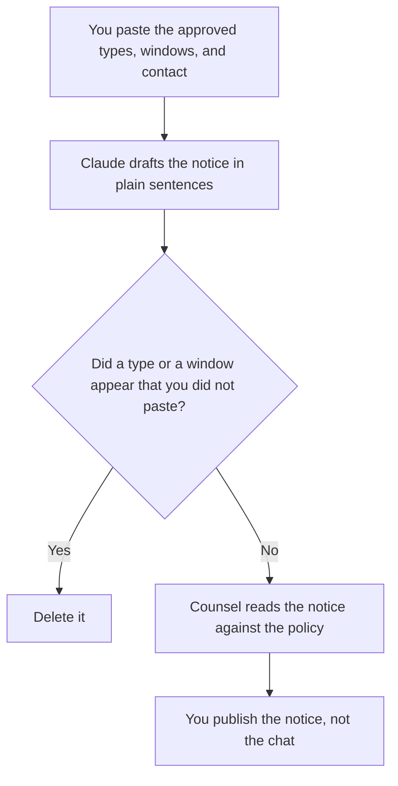

**A data retention notice written with AI tells people what you keep, how long, and who to ask, using only the window and the data types counsel already approved.** The model may make the sentences plain. It may not pick a retention period, add a data type, or promise a deletion speed. The internal rule this notice has to match is [what an AI data retention policy is](/blog/what-is-ai-data-retention-policy-2026/). The customer note for a one-time event is [how to write a customer advisory note with AI](/blog/how-to-write-a-customer-advisory-note-with-ai-2026/).

What a product remembers inside a chat, which is easy to confuse with retention, is [what AI memory is](/blog/what-is-ai-memory-2026/). Stripping identifiers before a prompt is stored is [what AI PII redaction is](/blog/what-is-ai-pii-redaction-2026/).

Prices are US list prices excluding tax from directory pages checked October 16, 2026. Published October 24, 2026. This page is not legal advice. We did not review a vendor contract.

## What the notice has to name

| Line | Who supplies it | The model may |
|---|---|---|
| Data types | The list counsel approved | Copy the list. It may not add "and similar data" |
| Window | The period already approved, with the unit | Copy it. It may not say "as long as needed" |
| Start of the clock | What event starts the window | Copy it |
| Who can ask | The contact path you named | Copy it. If it is missing, stop |
| Exceptions | The legal holds you already listed | Copy them. It may not invent a safety exception |
| Memory | Whether chat memory is a separate switch | Say so only if you pasted that fact |

A notice that is clearer than the policy is a new policy. If the plain sentence and the policy table disagree, the table wins until counsel changes the table. Do not "simplify" 30 days into "about a month" if the table says 30 days.

## Where the notice is drafted

**The draft.** [Claude](/tools/claude/) Pro is $20 a month, or $17 billed annually, when the notice is a page counsel will mark up. Paste the approved table, not a dump of customer records. The review is [Claude review](/blog/claude-review-2026/).

**The published page.** [Notion AI](/tools/notion-ai/) Business is $20 a seat a month if the help center draft lives there. The public page is the notice. The chat transcript is not.

**A shorter card.** [ChatGPT](/tools/chatgpt/) Plus at $20 a month can shorten a paragraph you already approved. Ask it to flag any number that was not in the source. The review is [ChatGPT review](/blog/chatgpt-review-2026/).

**The tone.** [Grammarly](/tools/grammarly/) Pro is $12 per member per month billed annually, or $30 monthly. It can make a sentence easier to read. It cannot choose a retention window.

A prompt that holds the line:

"Rewrite the retention table I pasted as a short notice. Use only those data types and those windows. Do not add a type. If the contact path is missing, write Contact missing and stop."

## What not to delegate

Do not ask the model what the law requires. Do not paste customer files so the notice "sounds specific." Do not publish a notice that mentions a vendor setting you have not checked against the policy. Vendor marketing pages change. Your notice should cite your decision, and the policy page records the date you checked the vendor.

## FAQ

### How is a notice different from the retention policy?

The policy is the internal rule: windows, owners, and deletion. The notice is the version people outside that document are allowed to read. Every number in the notice has to be in the policy. The notice can be shorter. It cannot be newer than the policy.

### Can the model choose a reasonable window?

No. A reasonable window is a decision counsel and the data owner make. The model can show you that two rows use different units. It cannot pick 90 days because other companies do.

### What about AI memory?

If the product has a memory switch, the notice should say what that switch keeps, only if you pasted that behavior from the policy. Memory and log retention are different stores. The memory article is the definition. This page is the sentence you publish.

### Who approves the notice?

Counsel, or the role your company names for privacy copy. A clearer sentence is not approved because it is clearer. It is approved when the numbers match.

## Last verified

October 16, 2026 for Claude, Notion AI, ChatGPT, and Grammarly. Published October 24, 2026.

**Sources:** [Claude pricing](https://claude.com/pricing), [Notion pricing](https://www.notion.com/pricing), [ChatGPT pricing](https://chatgpt.com/pricing/), [Grammarly pricing](https://www.grammarly.com/plans).

*Published by Andrew for [AI Tools Optimizer](https://aitoolsoptimizer.com).*

[Claude](/tools/claude/) is in the [chatbots and assistants directory](/tools/category/chatbots-assistants/). Directory pages may use affiliate links. A purchase through them may earn us a commission at no extra cost to you.
