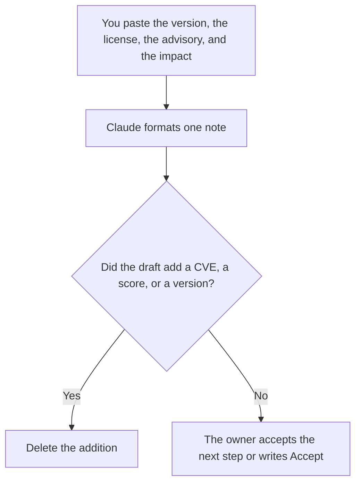

**A dependency risk note written with AI is a short page on one dependency: the version you run, the license and maintainer facts you pasted, the impact you can show, and the owner who can upgrade or remove it.** The model may format those facts. It may not invent a CVE, a severity, or a compromise. The changelog you ship if you do upgrade is [how to write a changelog with AI](/blog/how-to-write-a-changelog-with-ai-2026/). The steps for a planned move off the dependency are [how to write a migration runbook with AI](/blog/how-to-write-a-migration-runbook-with-ai-2026/).

Which source became a production answer, when the dependency is data rather than a library, is [what AI data lineage is](/blog/what-is-ai-data-lineage-2026/). The behavior-preserving edit that removes a call is [Cursor vs GitHub Copilot for refactors](/blog/cursor-vs-github-copilot-for-refactors-2026/).

Prices are US list prices excluding tax from directory pages checked October 16, 2026. A live fetch of vendor pricing pages returned HTTP 401 on October 24, 2026, so this page stays on the directory record. Published October 24, 2026. We did not scan any codebase, and we did not score supply-chain tools.

## What fits on the note

| Block | Who owns it | The model may |
|---|---|---|
| Identity | The package name and the version you run | Copy them. It may not bump the version |
| Where it runs | The service or app you named | Copy it. It may not guess transitive use |
| License | The license text or name you pasted | Place it. It may not interpret a license you did not paste |
| Known issue | A advisory id and a summary you pasted | Quote it. It may not search for a worse one |
| Impact | What breaks if you remove it, in your words | Shorten it. It may not invent reach |
| Next step | Upgrade, pin, remove, or accept, as you wrote | Copy it, with the owner and the date |

An empty advisory block stays empty. "No known issues" is a sentence only a person can write, and only after they say which database they checked and on which date. The model does not get to certify that. If you want the note to be parsed by another system, the fields are [what structured output is](/blog/what-is-structured-outputs-2026/).

## Where the note is written

**The draft.** [Claude](/tools/claude/) Pro is $20 a month, or $17 billed annually, when the note has to sit beside a policy paragraph. The review is [Claude review](/blog/claude-review-2026/).

**The diff that proves where it is used.** [Cursor](/tools/cursor/) Plus is $8 a month, or $80 a year, when you ask for the call sites in a branch and you read them. A list of files the agent did not open is not evidence. The ladder is [Cursor pricing explained](/blog/cursor-pricing-explained-2026/).

**The editor you already use.** [GitHub Copilot](/tools/github-copilot/) Pro is $10 a user a month when the search happens in that IDE. You still paste only the usages you confirmed into the note. The invoice is [GitHub Copilot pricing explained](/blog/github-copilot-pricing-explained-2026/).

**The record.** [Notion AI](/tools/notion-ai/) Business is $20 a seat a month if risk notes are a database with an owner property. A chat transcript is not the record.

A prompt that holds the line:

"Format a dependency risk note from the package, version, locations, license, advisory, impact, and next step I pasted. Do not add a CVE, a CVSS score, or a newer version. If the advisory block is empty, write Not provided. Do not say the dependency is safe."

## What not to delegate

Do not ask the model to find vulnerabilities. Do not ask it whether the license "is fine." Do not upgrade in the same breath as the note. The note is the decision record. The upgrade is a diff a person reviews, with tests. Do not paste a private security report into a consumer chat if your policy says that report stays in the tracker.

## FAQ

### Can the model list our dependencies?

It can format a list you generated from the lockfile and pasted. A list it remembers from training data is the wrong repository. If the lockfile and the note disagree, the lockfile wins and the note says Conflict.

### What counts as impact?

The blast radius you can show: which service imports it, what fails if it is removed, and whether it runs on untrusted input. "It is popular" is not impact. "Every request parses user XML with it" is impact, if that sentence is true in your code.

### Should we accept a risk in the note?

Yes, when a person writes Accept, the reason, and the date you will look again. The model may not accept on your behalf. An unsigned acceptance is a blank.

### Where does the changelog fit?

After you ship the upgrade or the removal. The changelog lists what changed for a reader. The risk note lists why you touched the dependency. They should not contradict the version numbers. If they do, fix the note or the changelog before you publish either.

## Last verified

October 16, 2026 for Claude, Cursor, GitHub Copilot, and Notion AI. Published October 24, 2026. Live pricing fetches returned HTTP 401 that day.

**Sources:** [Claude pricing](https://claude.com/pricing), [Cursor pricing](https://cursor.com/help/account-and-billing/pricing), [GitHub Copilot plans](https://github.com/features/copilot), [Notion pricing](https://www.notion.com/pricing).

*Published by Andrew for [AI Tools Optimizer](https://aitoolsoptimizer.com).*

[GitHub Copilot](/tools/github-copilot/) is in the [coding directory](/tools/category/coding/). Directory pages may use affiliate links. A purchase through them may earn us a commission at no extra cost to you.
