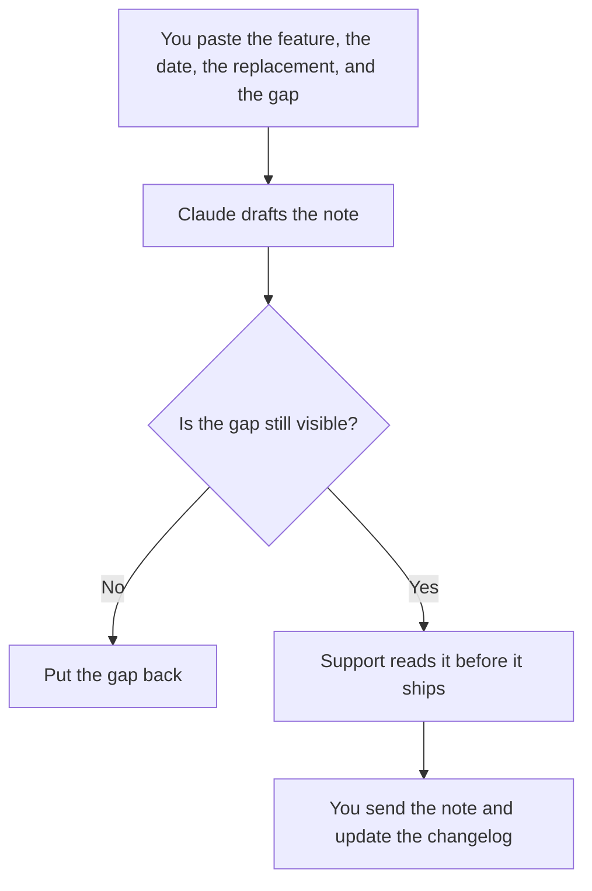

**A feature deprecation note written with AI tells customers what will stop, on which date, what replaces it, and what the replacement does not do yet.** The model may make that note readable. It may not pick the sunset date, invent a migration, or hide a gap. A one-time incident note is [how to write a customer advisory note with AI](/blog/how-to-write-a-customer-advisory-note-with-ai-2026/). The shipped-change list is [how to write release notes with AI](/blog/how-to-write-release-notes-with-ai-2026/).

The short public log is [how to write a changelog with AI](/blog/how-to-write-a-changelog-with-ai-2026/). Turning the replacement on for a slice first is [how to create a feature flag rollout plan with AI](/blog/how-to-create-a-feature-flag-rollout-plan-with-ai-2026/).

Prices are US list prices excluding tax from directory pages checked October 16, 2026. Published October 24, 2026. We did not score adoption.

## What the note must include

| Line | You already decided | The model may |
|---|---|---|
| The feature | The name customers use | Copy it. It may not rename the feature in the first sentence |
| The date | The last day it works | Copy it. It may not say "later this year" |
| The replacement | The path you named, or "none yet" | Copy it |
| The gap | What the replacement cannot do | Copy the gap. It may not soften it into "improved" |
| The action | What the customer should do, if anything | Only steps you pasted |
| Support | Where questions go | Copy the path. If it is missing, stop |

A deprecation note that reads like a launch will create angry tickets. Customers need the loss first, then the replacement. If there is no replacement, say that in the second sentence. The changelog should carry the same date. Two dates is how a customer plans to the wrong week.

## Where the note is written

**The draft.** [Claude](/tools/claude/) Pro is $20 a month, or $17 billed annually, when the note has to stay honest about the gap. The review is [Claude review](/blog/claude-review-2026/).

**The help page.** [Notion AI](/tools/notion-ai/) Business is $20 a seat a month if the article lives in the wiki. Update the article in the same change as the email. The invoice is [Notion AI pricing explained](/blog/notion-ai-pricing-explained-2026/).

**A short email.** [ChatGPT](/tools/chatgpt/) Plus at $20 a month can cut the note to the length of an email. Ask it to keep the date and the gap verbatim. The review is [ChatGPT review](/blog/chatgpt-review-2026/).

**The tone.** [Grammarly](/tools/grammarly/) Pro is $12 per member per month billed annually, or $30 monthly. A smoother sentence that deletes the limitation is a failed edit.

A prompt that holds the line:

"Draft a deprecation note from the feature name, last date, replacement, and gap I pasted. Lead with what stops. Do not invent a benefit. If the support path is missing, write Support missing and stop."

## What not to delegate

Do not ask the model for a sunset date that will "feel fair." Do not bury the gap under a list of improvements. Do not email a segment the lifecycle tool invented. The audience is the list you exported from the product, which is [how to write customer emails with AI](/blog/how-to-write-customer-emails-with-ai-2026/) once the facts are frozen. A change-management note inside the company is [how to write a change management email with AI](/blog/how-to-write-a-change-management-email-with-ai-2026/).

## FAQ

### How is this different from release notes?

Release notes say what shipped. A deprecation note says what will stop, and when. A release can include a deprecation line. The customer email still needs the date and the gap in sentences, not only a bullet in a changelog.

### What if the replacement is not ready?

Say the date you will remove the old feature, and say the replacement is not ready if that is true. Shipping a note that implies a migration guide you do not have is the ticket spike. Write "no migration steps yet" until the steps exist.

### Can the model name the audience?

It can format a description you pasted, such as "accounts that used the export in the last 90 days," if that definition came from your data. It cannot decide that 90 days is the right window.

### Who signs off?

The product owner for the date, support for the macro, and the person who sends the email. A model draft with no names is not ready.

## Last verified

October 16, 2026 for Claude, Notion AI, ChatGPT, and Grammarly. Published October 24, 2026.

**Sources:** [Claude pricing](https://claude.com/pricing), [Notion pricing](https://www.notion.com/pricing), [ChatGPT pricing](https://chatgpt.com/pricing/), [Grammarly pricing](https://www.grammarly.com/plans).

*Published by Andrew for [AI Tools Optimizer](https://aitoolsoptimizer.com).*

[Notion AI](/tools/notion-ai/) is in the [productivity and notes directory](/tools/category/productivity-notes/). Directory pages may use affiliate links. A purchase through them may earn us a commission at no extra cost to you.
