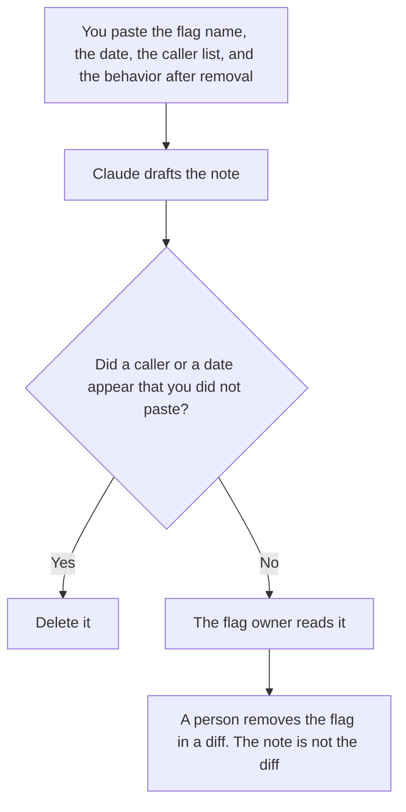

**A feature flag retirement note written with AI says which flag will be removed, on what date, and which callers a person already listed.** The model may format that notice. It may not add a caller, move the date, or declare the flag unused because a search "should" be empty. The plan that turned the flag on is [how to create a feature flag rollout plan with AI](/blog/how-to-create-a-feature-flag-rollout-plan-with-ai-2026/). The customer-facing end of a feature, which may be a different document, is [how to write a feature deprecation note with AI](/blog/how-to-write-a-feature-deprecation-note-with-ai-2026/).

Claude's prices are from claude.com/pricing on October 24, 2026. Cursor, Notion, and ChatGPT prices are from directory pages checked October 16, 2026. chatgpt.com/pricing returned HTTP 403 on October 24. Published October 24, 2026. We did not score flag hygiene.

## What belongs in the note

| Row | Who owns it | The model may |
|---|---|---|
| The flag name | The owner, copied exactly | Not rename it to a friendlier name |
| The retirement date | The owner | Copy it. It may not pick the next sprint |
| Callers still on the old path | The list you pasted from a search you ran | Format the list. It may not add a service |
| The behavior after removal | The default you wrote | Copy it. If you did not write it, write Behavior missing |
| Who must ack | You | Copy the names. A missing ack stays missing |

Retiring a flag is an internal change. Deprecating a feature is what customers hear. If customers still depend on the old behavior, the deprecation note has to land first, on a date you can defend. A flag note that says "nobody uses this" needs the search you ran, including the date of the search. A model's belief that a flag looks old is not a search.

The rollout plan said who the flag was for. The retirement note says that experiment is over and names the remaining callers. If the rollout plan and this note name different defaults, one of them is stale. The code is the tie-breaker, and a person confirms it.

## Where it is written

**The draft.** [Claude](/tools/claude/) Pro is $17 a month billed annually, $200 up front, or $20 monthly, when the flag's history is long and the note should sit beside the rollout plan. The review is [Claude review](/blog/claude-review-2026/).

**The diff that deletes the flag.** [Cursor](/tools/cursor/) Plus is $8 a month, or $80 a year. You review every caller the note listed. A generated change that deletes the flag and leaves a caller is a defect. The ladder is [Cursor pricing explained](/blog/cursor-pricing-explained-2026/).

**The page the next on-call will find.** [Notion AI](/tools/notion-ai/) Business is $20 a seat a month if runbooks live there. Plus at $10 is not the full AI tier. The invoice is [Notion AI pricing explained](/blog/notion-ai-pricing-explained-2026/).

**One note, from a short card.** [ChatGPT](/tools/chatgpt/) Plus is $20 a month. Free can format a single flag. Discard a version that adds a cleanup of "related" flags you did not name. The review is [ChatGPT review](/blog/chatgpt-review-2026/).

A prompt that holds the line:

"Write a flag retirement note from the name, the date, the callers, and the post-removal behavior I pasted. Do not add a caller. Do not change the date. If behavior is missing, write Behavior missing and stop."

## What not to delegate

Do not ask the model whether the flag is safe to delete. Do not retire a second flag in the same note because the names look related. Do not skip the customer deprecation note when the old behavior is public. The technical PM who owns that sequence has a shelf at [best AI tools for technical PMs](/blog/best-ai-tools-for-technical-pms-2026/).

## FAQ

### How is this different from the rollout plan?

The rollout plan is how the flag turns on, and for whom. The retirement note is how it goes away, and who still branches on it. Keep both. A rollout plan with no end date is how flags accumulate.

### How is this different from a feature deprecation note?

Deprecation is the customer notice: what will stop working, and when. Retirement is the internal flag. Customers do not need the flag's name unless it appears in their API. If it appears in their API, the deprecation note is required, and this note links to it.

### Can the model search the repo for callers?

A coding assistant can propose a search, and you run it. Paste the results into the note. Do not let the note claim "no callers" unless the search output you pasted is empty, and you write the query and the date.

### Who may delete the flag?

The owner on the note, in a reviewed diff, on or after the date. A model does not merge the deletion. A note with callers and no acks is not ready.

## Last verified

October 24, 2026 for Claude. October 16, 2026 for Cursor, Notion, and ChatGPT. Published October 24, 2026.

**Sources:** [Claude pricing](https://claude.com/pricing), [Cursor pricing](https://cursor.com/help/account-and-billing/pricing), [Notion pricing](https://www.notion.com/pricing), [ChatGPT pricing](https://chatgpt.com/pricing/).

*Published by Andrew for [AI Tools Optimizer](https://aitoolsoptimizer.com).*

[Cursor](/tools/cursor/) is in the [coding directory](/tools/category/coding/). Directory pages may use affiliate links. A purchase through them may earn us a commission at no extra cost to you.
