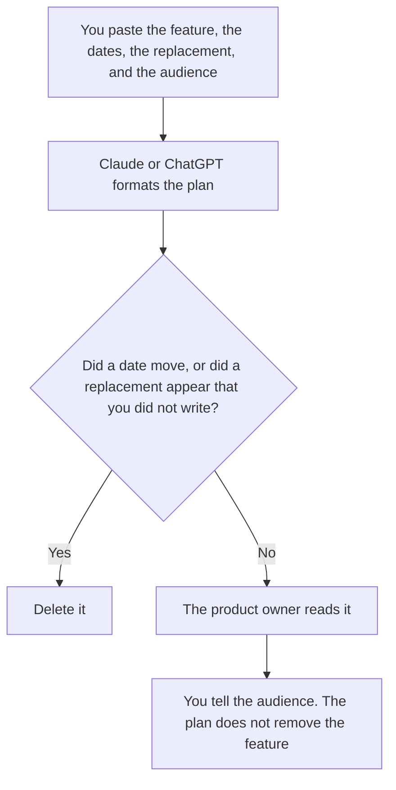

**A feature sunset plan written with AI names the feature, the date it will be removed, the replacement or the fact that there is none, and the audience who must be told, using only lines a person pasted.** The model may format the plan. It may not move the date, invent a replacement, or tell customers the removal already happened. A model going away is a different plan: [how to write a model deprecation plan with AI](/blog/how-to-write-a-model-deprecation-plan-with-ai-2026/). A flag going away is [how to write a feature flag retirement note with AI](/blog/how-to-write-a-feature-flag-retirement-note-with-ai-2026/).

Claude's prices are from claude.com/pricing on October 24, 2026. Notion and Gamma prices are from directory pages checked October 16, 2026. ChatGPT Plus is $20 a month on learn.chatgpt.com/docs/pricing on October 24, 2026. Published October 24, 2026. We did not score product decisions.

## What the plan contains

| Line | Who owns it | The model may |
|---|---|---|
| The feature name, exactly | The product owner | Copy it. It may not rename the feature to sound smaller |
| The removal date, and the notice date | You | Copy both. A blank stays Date missing |
| The replacement, or "no replacement" | You | Copy it. It may not propose a substitute |
| The audience | You | Internal and external notes stay separate |
| What is not being removed | You | Keep those lines. Silence reads like a wider sunset |

A sunset plan is the decision and the notice. It is not the pull request that deletes the code, and it is not a flag note unless the feature is only a flag. If you later undo the sunset, the message is a rollback-style note, not a quiet edit of the old plan. That shape is [how to write a rollback comms note with AI](/blog/how-to-write-a-rollback-comms-note-with-ai-2026/). The day you ship the removal still wants its own list: [how to write a go-live checklist with AI](/blog/how-to-write-a-go-live-checklist-with-ai-2026/).

## Where it is written

**The draft, when this sunset must match the last one.** [Claude](/tools/claude/) Pro is $17 a month billed annually, $200 up front, or $20 monthly. Put the required lines in the Project. The review is [Claude review](/blog/claude-review-2026/).

**The page customers' teams will be pointed at.** [Notion AI](/tools/notion-ai/) Business is $20 a seat a month if that is the public-internal source. Plus at $10 is not the full AI tier on the October 16 card. The invoice is [Notion AI pricing explained](/blog/notion-ai-pricing-explained-2026/).

**One plan, from a short paste.** [ChatGPT](/tools/chatgpt/) Plus is $20 a month. Discard a version that apologizes by promising a replacement you did not name. The review is [ChatGPT review](/blog/chatgpt-review-2026/).

**A deck after the plan is accepted.** [Gamma](/tools/gamma/) Plus is $9 a seat a month, $108 a year, on the October 16 card. The deck copies the plan. It does not add a milestone. The invoice is [Gamma pricing explained](/blog/gamma-pricing-explained-2026/).

A prompt that holds the line:

"Write a feature sunset plan from the name, the dates, the replacement, the audience, and the items that stay. If a field is missing, write Missing. Do not move a date. Do not invent a replacement. Do not say the feature is already gone."

## What not to delegate

Do not ask the model whether the feature should be removed. That decision is already made, or it is not this plan. Do not merge two features into one sunset so the note is shorter. Do not tell the audience before the owner has read the dates.

## FAQ

### How is this different from a model deprecation plan?

A model deprecation plan is about a model id, a last-call date, and the model that replaces it. A feature sunset is about a product surface a customer uses. A feature can go away while the model stays. A model can go away while the feature stays on a different model. Keep the documents apart.

### How is this different from a flag retirement note?

A flag note is about one toggle: the name, the default, and the date the code path dies. A sunset plan is the customer-facing decision. If the feature is only a flag, you may need both. The flag note does not replace the audience line.

### Can the model look up who uses the feature?

Only from a list you paste. A guess that "most teams have migrated" is not a list. If the audience cell is empty, the plan says Audience missing and it does not go out.

### Who may move the date?

The product owner, in the plan, with the old date still visible. A chat that suggests a quieter week has not moved the date. The go-live checklist for the removal uses the date in the plan, not a date the draft preferred.

## Last verified

October 24, 2026 for Claude and for ChatGPT Plus. October 16, 2026 for Notion and Gamma. Published October 24, 2026.

**Sources:** [Claude pricing](https://claude.com/pricing), [Notion pricing](https://www.notion.com/pricing), [ChatGPT and Codex pricing](https://learn.chatgpt.com/docs/pricing), [Gamma pricing](https://gamma.app/pricing).

*Published by Andrew for [AI Tools Optimizer](https://aitoolsoptimizer.com).*

[Claude](/tools/claude/) is in the [chatbots and assistants directory](/tools/category/chatbots-assistants/). Directory pages may use affiliate links. A purchase through them may earn us a commission at no extra cost to you.
