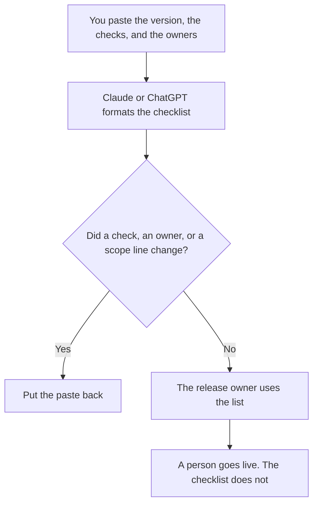

**A go-live checklist written with AI is the day-of list: the version, the checks a person already marked, the owner on point, and the rollback owner, using only facts that were pasted.** The model may format that list. It may not mark a check passed, invent a dependency, or decide the launch is ready. The earlier gate, before this day, is [how to create a launch readiness checklist with AI](/blog/how-to-create-a-launch-readiness-checklist-with-ai-2026/). The note if you undo the change is [how to write a rollback comms note with AI](/blog/how-to-write-a-rollback-comms-note-with-ai-2026/).

Claude's prices are from claude.com/pricing on October 24, 2026. Notion and GitHub Copilot prices are from directory pages checked October 16, 2026. ChatGPT Plus is $20 a month on learn.chatgpt.com/docs/pricing on October 24, 2026. Published October 24, 2026. We did not score launches.

## What belongs on the list

| Line | Who owns it | The model may |
|---|---|---|
| The version that will serve | The person who will ship | Copy it. A blank stays Version missing |
| Checks already marked pass or fail | The owner of each check | Copy the mark. It may not flip a fail to a pass |
| The person on point, and the rollback owner | You | Copy the names. It may not assign a new one |
| What is out of scope today | You | Keep those lines. Dropping one widens the launch |
| The comms owner | You | Name them only if you named them |

Launch readiness is the work that happens before the day. This list is what you hold while the day happens. A readiness item that is still open does not become "accepted" because it would look bad on a go-live page. Leave it open, or do not go live. The train note that tells people the release exists is [how to write a release train note with AI](/blog/how-to-write-a-release-train-note-with-ai-2026/).

## Where it is written

**The draft, when the list must match the last launch.** [Claude](/tools/claude/) Pro is $17 a month billed annually, $200 up front, or $20 monthly. Put the required lines in the Project. The review is [Claude review](/blog/claude-review-2026/).

**The page the company will keep.** [Notion AI](/tools/notion-ai/) Business is $20 a seat a month if that is the runbook. Plus at $10 is not the full AI tier on the October 16 card. The invoice is [Notion AI pricing explained](/blog/notion-ai-pricing-explained-2026/).

**One list, from a short paste.** [ChatGPT](/tools/chatgpt/) Plus is $20 a month. Discard a version that adds a check you did not write. The review is [ChatGPT review](/blog/chatgpt-review-2026/).

**The repo, if a check is a command a person will run.** [GitHub Copilot](/tools/github-copilot/) Business is $19 a user a month on the October 16 card when the company seat is the one you use. The checklist still does not run the command. The invoice is [GitHub Copilot Business pricing explained](/blog/github-copilot-business-pricing-explained-2026/).

A prompt that holds the line:

"Format a go-live checklist from the version, the checks, the owners, and the out-of-scope lines I pasted. If a field is missing, write Missing. Do not mark a check passed. Do not add a dependency."

## What not to delegate

Do not ask the model whether you should launch. Do not paste a customer list so the example looks specific. Do not archive the checklist because the bullets look even. The release owner uses it while the change is in motion.

## FAQ

### How is this different from a launch readiness checklist?

Readiness is the earlier gate: the work that has to be true before the day. This list is the day-of page, with the version and the owners who are actually on point. An open readiness item stays open. It does not graduate because the day arrived.

### How is this different from a rollback note?

The rollback note tells people a change came back. This checklist names the rollback owner before you need that note. Writing the owner down is not the same as sending the note.

### Can the model see the deploy tool?

Only through text you paste or a status a person has confirmed. A model that "knows" the version is using a stale thread. Paste the version string.

### Who may check the last box?

The release owner. A complete-looking list is not a launch. The person named on point is the person who was named in the paste, not a name the draft found helpful.

## Last verified

October 24, 2026 for Claude and for ChatGPT Plus. October 16, 2026 for Notion and GitHub Copilot. Published October 24, 2026.

**Sources:** [Claude pricing](https://claude.com/pricing), [Notion pricing](https://www.notion.com/pricing), [ChatGPT and Codex pricing](https://learn.chatgpt.com/docs/pricing), [GitHub Copilot](https://github.com/features/copilot).

*Published by Andrew for [AI Tools Optimizer](https://aitoolsoptimizer.com).*

[Claude](/tools/claude/) is in the [chatbots and assistants directory](/tools/category/chatbots-assistants/). Directory pages may use affiliate links. A purchase through them may earn us a commission at no extra cost to you.
