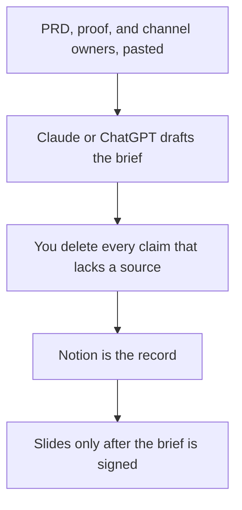

**A go-to-market brief written with AI is a short agreement for one launch: who it is for, the problem, the offer, the proof, the channels you will actually staff, and what you will not claim.** The model can assemble notes you paste. It cannot invent a segment, a pipeline number, or a partner. If a section has no source, it stays marked Missing until an owner fills it.

The product agreement underneath it is [how to write a PRD with AI](/blog/how-to-write-a-prd-with-ai-2026/). The team shelf is [best AI tools for product marketing](/blog/best-ai-tools-for-product-marketing-2026/). The competitor page it must not contradict is [how to create a competitor teardown with AI](/blog/how-to-create-a-competitor-teardown-with-ai-2026/).

Prices are US list prices excluding tax from directory pages checked October 16, 2026. Published October 24, 2026. We did not score launches.

## The sections

| Section | Owner | The model may |
|---|---|---|
| Audience | One segment you can name and reach | Describe them from your notes. It may not add a second segment to sound bigger |
| Problem | Language from interviews or the site, that you paste | Shorten it |
| Offer | The PRD and the rate card | State them. It may not add a discount or a feature |
| Proof | A number, logo, or quote with permission | Place it, or write Missing |
| Channels | The ones a person is staffed to run | List them. It may not add a channel because it is popular |
| Risks and non-claims | Legal, brand, and the teardown | Repeat them |
| Date and owner | You | Not leave the brief ownerless |

A pipeline forecast the model typed because the brief "felt thin" is [a hallucination](/blog/what-is-ai-hallucination-2026/). The check is [how to fact-check AI writing](/blog/how-to-fact-check-ai-writing-2026/).

## Where the brief is drafted

**The long version.** [Claude](/tools/claude/) Pro is $20 a month, or $17 billed annually. Keep the PRD excerpt in a Project. The container is [Claude Projects vs ChatGPT Projects](/blog/claude-projects-vs-chatgpt-projects-2026/).

**The marketer's chat.** [ChatGPT](/tools/chatgpt/) Plus is $20. Business is $20 a user a month billed annually, minimum two, when the launch is still confidential. The ladder is [ChatGPT Go vs Plus vs Pro](/blog/chatgpt-go-vs-plus-vs-pro-2026/).

**A cited look at a public page.** [Perplexity](/tools/perplexity/) Pro is $17 a month billed annually, for a competitor or a category page you will date. Open the link. The research habit is [Perplexity vs ChatGPT for shopping research](/blog/perplexity-vs-chatgpt-for-shopping-research-2026/) when the "product" is a purchase, and the teardown article when the product is a rival.

**The record.** [Notion AI](/tools/notion-ai/) Business is $20 a seat a month. Name the owner in the page properties. The invoice is [Notion AI pricing explained](/blog/notion-ai-pricing-explained-2026/).

**The deck, later.** [Gamma](/tools/gamma/) Plus is $9 a seat a month. A brief that only exists as slides will be edited like a design, not like a decision. The invoice is [Gamma pricing explained](/blog/gamma-pricing-explained-2026/).

A prompt that holds the line:

"Draft a go-to-market brief from my notes. Sections: audience, problem, offer, proof, channels, non-claims, owner, date. Use only the notes. If proof or a channel owner is missing, write Missing. Do not invent pipeline, press, partners, or discounts."

The person who signs it is [what human-in-the-loop AI is](/blog/what-is-human-in-the-loop-ai-2026/).

## What this brief is not

It is not the PRD, and it should not add scope. It is not a pitch deck for investors. That workflow is [how to create a pitch deck with AI](/blog/how-to-create-a-pitch-deck-with-ai-2026/). It is not a sales enablement deck, which is the rep talk track: [how to write a sales enablement deck with AI](/blog/how-to-write-a-sales-enablement-deck-with-ai-2026/). It is not a partner brief. That file has a second company: [how to write a partner brief with AI](/blog/how-to-write-a-partner-brief-with-ai-2026/).

## FAQ

### How long should the brief be?

A few pages. If the model writes a strategy essay, cut back to the table. Length is not alignment.

### Can AI name the channels?

Only from the owners you paste. "We should be on every network" is not a channel plan. A channel without a person is a wish.

### Should customer quotes be drafted?

No. Paste quotes you have permission to use, or leave proof as Missing. A composed quote is a false customer.

### When do slides start?

After the owner signs the brief. The enablement and launch decks pull from it. They do not replace it.

## Last verified

October 16, 2026 for Claude, ChatGPT, Perplexity, Notion, and Gamma. Published October 24, 2026.

**Sources:** [Claude pricing](https://claude.com/pricing), [Perplexity pricing](https://www.perplexity.ai/hub/pricing), [Notion pricing](https://www.notion.com/pricing).

*Published by Andrew for [AI Tools Optimizer](https://aitoolsoptimizer.com).*

[Notion AI](/tools/notion-ai/) is in the [productivity and notes directory](/tools/category/productivity-notes/). Directory pages may use affiliate links. A purchase through them may earn us a commission at no extra cost to you.
