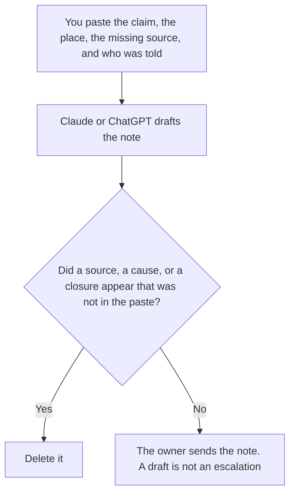

**A hallucination escalation note written with AI is a draft that states the claim, where it appeared, the source that was missing, who was told, and the next step a person already owns.** The model may order those lines. It may not decide the claim was true, invent a source, or close the note. What the word means on this site is [what an AI hallucination is](/blog/what-is-ai-hallucination-2026/). The note for one failed eval case is [how to create an eval failure triage with AI](/blog/how-to-create-an-eval-failure-triage-with-ai-2026/).

A number you compute from sources you accepted is [what an AI grounding score is](/blog/what-is-ai-grounding-score-2026/). The escalation note is not that number. It is the message a person sends when a claim had no source.

Claude's prices are from claude.com/pricing on October 24, 2026. Notion and Grammarly prices are from directory pages checked October 16, 2026. ChatGPT's Plus price is from learn.chatgpt.com/docs/pricing on October 24. Published October 24, 2026. We did not score factual accuracy.

## What the note is allowed to say

| Line | Who owns it | The model may |
|---|---|---|
| The claim, quoted | You | Copy the words. It may not soften them into a different claim |
| Where it appeared | You | Copy the place and the time. It may not guess the channel |
| The missing source | You | Write Source not found if that is what you found. It may not supply a link |
| Who was told, and the next step | You | Copy the name and the step. If the step is missing, write Next step not set |

A note that explains "why the model did this" has added a cause. If you do not know the cause, the note says Cause not established. It does not blame a prompt, a retrieval miss, or a user. Those are hypotheses for a separate line labeled Not established. The eval triage is where a failed case gets a reproducible note. This page is the escalation when someone may already have seen the claim.

## Where it is drafted

**The draft.** [Claude](/tools/claude/) Pro is $17 a month billed annually, $200 up front, or $20 monthly. Keep the required lines in a Project so every note has the same headings. The review is [Claude review](/blog/claude-review-2026/).

**The log the next incident will reopen.** [Notion AI](/tools/notion-ai/) Business is $20 a seat a month. Link the claim and the date. The invoice is [Notion AI pricing explained](/blog/notion-ai-pricing-explained-2026/).

**One note from a short paste.** [ChatGPT](/tools/chatgpt/) Plus is $20 a month. Discard a version that adds a citation. The ladder is [ChatGPT pricing explained](/blog/chatgpt-pricing-explained-2026/).

**A clarity pass that must not touch the quote.** [Grammarly](/tools/grammarly/) Pro is $12 a member a month billed annually, or $30 monthly, on the October 16 card. Compare the quoted claim before and after. A "clearer" quote is a different claim. The invoice is [Grammarly pricing explained](/blog/grammarly-pricing-explained-2026/).

A prompt that holds the line:

"Draft the escalation note from the claim, the place, the missing source, the person told, and the next step I pasted. If the source is missing, write Source not found. Do not add a link. Do not explain the cause. Do not close the note."

## What not to delegate

Do not ask the model to check whether the claim is true and then paste its answer in as the source. Do not include a customer secret in the quote if a redacted quote will do. The pass for listed secrets is [what an AI output redaction pass is](/blog/what-is-ai-output-redaction-pass-2026/). Do not send the note because it sounds calm. The owner sends it. A calm paragraph is not a correction to the people who saw the claim.

## FAQ

### How is this different from the definition of a hallucination?

The definition page says what the word means: a confident answer with no source. This page is the note you write when that has happened and someone needs to hear it. You can have a hallucination that does not need this note, because nobody saw it and the case is only an eval failure. You can need this note before you know which bug caused the sentence.

### How is this different from eval failure triage?

Triage is for a case in a set you re-run: what failed, what the expected check was, who owns the next edit. The escalation note is for a claim that may have reached a person. Triage can link the note. The note can link the case id. Neither one closes the other.

### How is this different from a grounding score?

A grounding score is a number from a formula you wrote. The note is a message: this claim, this place, no source, this person told, this next step. Do not put a score on the note unless you computed it and you are willing to show the formula. A missing source does not need a decimal to be escalated.

### Who may close the note?

The owner, after the next step they wrote is done, including a correction if people saw the claim. A model must not close it. Finding a source later means you update the note with that source and the date. It does not mean the original send was fine.

## Last verified

October 24, 2026 for Claude and for ChatGPT's plan page. October 16, 2026 for Notion and Grammarly. Published October 24, 2026.

**Sources:** [Claude pricing](https://claude.com/pricing), [Notion pricing](https://www.notion.com/pricing), [ChatGPT and Codex pricing](https://learn.chatgpt.com/docs/pricing), [Grammarly pricing](https://www.grammarly.com/plans).

*Published by Andrew for [AI Tools Optimizer](https://aitoolsoptimizer.com).*

[Claude](/tools/claude/) is in the [chatbots and assistants directory](/tools/category/chatbots-assistants/). Directory pages may use affiliate links. A purchase through them may earn us a commission at no extra cost to you.
