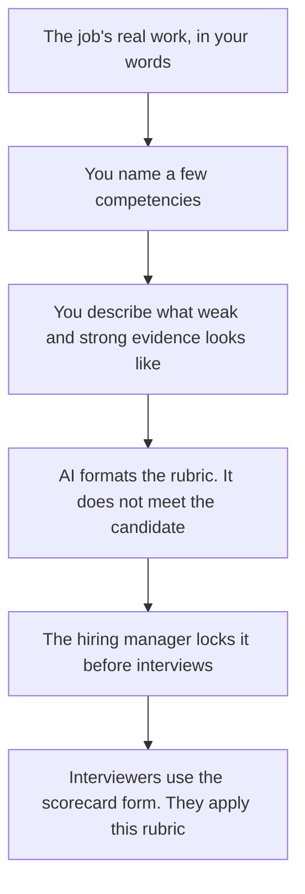

**A hiring scorecard rubric written with AI is the scale you lock before any interview: each competency, what a weak and a strong example looks like, and which interviewer owns it.** The model can format levels you already described. It does not invent competencies from a resume, and it does not score a person. The form you fill during the loop, with quotes and a human recommendation, is a different page: [how to create interview scorecards with AI](/blog/how-to-create-interview-scorecards-with-ai-2026/).

The role the rubric serves is [how to write a job description with AI](/blog/how-to-write-a-job-description-with-ai-2026/). The team that runs hiring is [best AI tools for people ops](/blog/best-ai-tools-for-people-ops-2026/). Sourcing is [best AI tools for recruiters](/blog/best-ai-tools-for-recruiters-2026/).

Prices are US list prices excluding tax from directory pages checked October 16, 2026. Published October 24, 2026. We did not score candidates. This page is not employment or legal advice.

## What the rubric contains

| Piece | Who writes the meaning | The model may |
|---|---|---|
| Competencies | The hiring manager, from the job, before the slate | Format the list. It may not add "culture fit" as a vague trait |
| Levels | You. A small scale, such as the labels you use, with room for "not assessed" | Lay out the rows. It may not decide how many levels exist |
| Anchors | A concrete example of evidence for each level, from work you have seen | Tighten the sentence. It may not invent an anecdote |
| Owner | Which interview covers which competency | Repeat the assignment. It may not give every trait to every interviewer |
| Bar | The minimum level a hire must clear, written by you | Not a recommendation to lower it for a specific person |

If you write the anchors after you have a favorite candidate, the rubric will describe that person. Write it first. "Culture fit" without a behavior is a place bias hides. Replace it with a behavior you can see, or delete the row.

## Where the rubric lives

**The page the loop reuses.** [Notion AI](/tools/notion-ai/) Business is $20 a seat a month. One database template. Duplicate the scorecard per candidate later. Do not let the rubric page become a scratch chat. Plus at $10 is not the full AI tier. The invoice is [Notion AI pricing explained](/blog/notion-ai-pricing-explained-2026/). The record habit is [what a system of record for AI is](/blog/what-is-a-system-of-record-for-ai-2026/).

**The long edit.** [Claude](/tools/claude/) Pro is $20 a month, or $17 billed annually. Put the job description and the draft anchors in a Project. Ask for clearer anchors, not for new traits. The container comparison is [Claude Projects vs ChatGPT Projects](/blog/claude-projects-vs-chatgpt-projects-2026/).

**A short pass, if that is where the manager already writes.** [ChatGPT](/tools/chatgpt/) Plus is $20 a month. If the paste includes employee or candidate data, use a plan your process allows. Business is $20 a user a month billed annually, minimum two users, and does not train on business data by default. The ladder is [ChatGPT Go vs Plus vs Pro](/blog/chatgpt-go-vs-plus-vs-pro-2026/).

**The line edit, after the anchors are human.** [Grammarly](/tools/grammarly/) Pro is $12 a member a month billed annually. It will not make a vague competency specific. The invoice is [Grammarly pricing explained](/blog/grammarly-pricing-explained-2026/).

A prompt that holds the line:

"Format a hiring rubric from these competencies and these anchors only. Keep my level labels. If an anchor is missing for a level, write Missing. Do not add competencies. Do not mention any candidate. Do not define culture fit. Do not recommend a hire bar I did not write."

The manager who locks the rubric is [what human-in-the-loop AI is](/blog/what-is-human-in-the-loop-ai-2026/).

## How the rubric meets the loop

Each competency has one owner. Two interviewers scoring the same trait with different anchors is two rubrics. The scorecard form, linked above, is where a person files evidence under the level. The rubric does not contain the candidate's name.

A level without an anchor will be scored as a feeling. If you cannot describe the evidence, cut the competency until you can. Four competencies you can defend beat twelve the model padded.

Do not ask the model to "match this resume to the rubric" as a shortcut to a decision. That request turns a scale into a ranking. Ranking is the debrief, done by people who ran the interviews, using evidence on the forms.

## FAQ

### How many levels?

The number your team will use consistently. Three labeled levels plus "not assessed" is enough for many roles. The model does not get a vote. If interviewers cannot explain the difference between two adjacent levels, merge them.

### Can we reuse a rubric across roles?

Only the competencies that mean the same evidence in both jobs. "Communication" for a support lead and a staff engineer is often two rubrics that share a word. Split them. A copied rubric is how the wrong bar gets applied.

### Should AI score the debrief?

No. It can file quotes under the competency you name, which is the scorecard workflow. The number or the level is a person applying this rubric. A model score is not a record you want in a dispute.

### What if we already started interviews?

Stop adding traits. Use the rubric you can still apply fairly to everyone still in process, and do not create a stricter anchor for the next candidate only. If the bar changed, write down when, and which slate it applies to.

## Last verified

October 16, 2026 for Notion AI, Claude, ChatGPT, and Grammarly. Published October 24, 2026.

**Sources:** [Notion pricing](https://www.notion.com/pricing), [Claude pricing](https://claude.com/pricing), [ChatGPT pricing](https://chatgpt.com/pricing/).

*Published by Andrew for [AI Tools Optimizer](https://aitoolsoptimizer.com).*

[Notion AI](/tools/notion-ai/) is in the [productivity and notes directory](/tools/category/productivity-notes/). Directory pages may use affiliate links. A purchase through them may earn us a commission at no extra cost to you.
