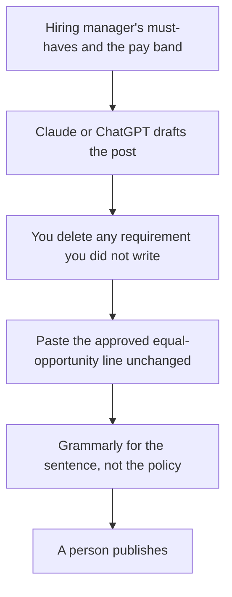

**A job description written with AI is a public version of a requirements list a hiring manager already signed.** The model can shorten sentences and match a voice. It cannot decide years of experience, a degree rule, a salary band, or a visa line. If those are not in the prompt, they must not appear in the post. Invented requirements narrow the pool by accident, and invented pay is a fact you will have to walk back.

This is a writing workflow. It is not hiring advice, and it is not a compensation survey. The team tools around it are [best AI tools for recruiters](/blog/best-ai-tools-for-recruiters-2026/) and [best AI tools for HR teams](/blog/best-ai-tools-for-hr-teams-2026/). The edit habit is [how to fact-check AI writing](/blog/how-to-fact-check-ai-writing-2026/).

Prices are US list prices excluding tax from directory pages checked October 16, 2026. Published October 24, 2026. We did not score postings or predict who will apply.

## The list, before the prose

| Block | Who writes it | The model may |
|---|---|---|
| The job in one sentence | The hiring manager | Make it concrete |
| Must-haves | The hiring manager, as few as they will really screen on | Not add a degree, a year count, or a tool |
| Nice-to-haves | The hiring manager | Keep them visibly optional |
| Pay and location | HR or the approved band | Paste the band exactly, or omit it |
| Legal and accommodation lines | The lines counsel or HR already approved | Paste them unchanged |
| How to apply | You | The real link |

Read the draft looking only for additions. "5+ years," "CS degree," "rockstar," and a salary the model rounded are the usual insertions. Delete them unless they were in the source. A tool you use every day can be a must-have. A tool the model associates with the title cannot.

## Where to draft

**The long version.** [Claude](/tools/claude/) Pro is $20 a month, or $17 billed annually. Put two postings you were proud of, with the requirements still true, in a Project, plus this role's list. Free includes up to five Projects if you are writing one role. The container comparison is [Claude Projects vs ChatGPT Projects](/blog/claude-projects-vs-chatgpt-projects-2026/). The writing comparison is [ChatGPT vs Claude for writing](/blog/chatgpt-vs-claude-for-writing-2026/).

**[ChatGPT](/tools/chatgpt/), if that is the company default.** Plus is $20 and lists projects. Go at $8 is the wrong seat for a posting you will reuse, and it may include ads. Keep the draft in a Project named for the role so the next req does not inherit this one's stack. That split is [ChatGPT Projects vs custom GPTs](/blog/chatgpt-projects-vs-custom-gpts-2026/).

**The sentence pass.** [Grammarly](/tools/grammarly/) Pro is $12 per member per month billed annually. Run it after the requirements are locked. It will not notice a discriminatory pattern you left in the must-haves. You will. The editing article is [Grammarly vs ChatGPT for editing](/blog/grammarly-vs-chatgpt-for-editing-2026/).

**The template library.** [Notion AI](/tools/notion-ai/) Business at $20 per seat is a reasonable home for approved blocks: the boilerplate, the benefits paragraph HR signed, the apply link. Generate into that template. Do not let a chat be the only copy. The card is [Notion AI pricing explained](/blog/notion-ai-pricing-explained-2026/).

**A marketing seat, only if the posting is a campaign.** [Jasper](/tools/jasper/) Pro is $69 a seat monthly, or $59 billed yearly. Most reqs do not need it. A careers site that must stay on-brand might. The review is [Jasper review](/blog/jasper-ai-review-2026/).

A prompt that keeps the fence:

"Requirements are below. Draft a job post with role, must-haves, nice-to-haves, and how to apply. Use only the requirements listed. If you want to add a year count, a degree, or a salary, write it under 'rejected additions' instead of in the post. Paste the legal block exactly."

An example posting you liked, above the list, is [what few-shot prompting is](/blog/what-is-few-shot-prompting-2026/).

## Before it goes live

Have the hiring manager mark each must-have as "I will reject a resume without this." Anything they hesitate on moves to nice-to-have. Have HR confirm the pay line matches the approved band, including currency. This site prices tools in USD. Your posting should use the currency you pay in, copied from the band, not translated by the model.

Do not ask the model who is a "culture fit," and do not paste resumes into the same chat as a request to rewrite the posting around a favorite candidate. The posting is the public bar. Screening is a different process, owned by a person.

## FAQ

### Can AI write an inclusive job description?

It can remove fluff and mirror a structure you provide. It can also reintroduce biased requirements with confident wording. The hiring manager still owns every must-have. There is no setting in these products that makes a posting fair by itself.

### Should I include a salary?

Include the band HR approved, copied exactly. If you do not have one, leave the line out. Do not ask the model for a competitive range. That number is not your compensation data.

### How long should it be?

Short enough that a candidate can see the must-haves without scrolling through culture copy. Ask for a draft under a length you choose. Then cut anything that is not a requirement, a duty, or a true perk.

### Can I generate ten roles at once?

Only if you have ten requirement lists. A single prompt that says "write postings for our engineering team" will invent levels. One list, one draft, one editor.

## Last verified

October 16, 2026 for Claude, ChatGPT, Grammarly, Notion, and Jasper prices. Published October 24, 2026.

**Sources:** [Claude pricing](https://claude.com/pricing), [ChatGPT pricing](https://chatgpt.com/pricing/), [Grammarly Pro pricing](https://support.grammarly.com/hc/en-us/articles/115000090011-How-much-does-Grammarly-Pro-cost).

*Published by Andrew for [AI Tools Optimizer](https://aitoolsoptimizer.com).*

[Grammarly](/tools/grammarly/) is in the [writing directory](/tools/category/writing/). Directory pages may use affiliate links. A purchase through them may earn us a commission at no extra cost to you.
