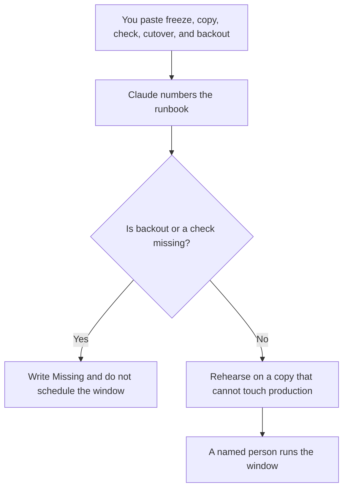

**A migration runbook written with AI is a step list for moving from a system you named to a system you named: what freezes, what is copied, what is checked, who cuts over, and how you go back.** The model may number steps you paste. It may not invent a maintenance window, a row count, or a backout. The general on-call page is [what an AI runbook is](/blog/what-is-an-ai-runbook-2026/). This page is the migration-specific one. If the two disagree about who can abort, the migration runbook is wrong, or the on-call page is, and a person decides before the window.

The record of what shipped after a code migration is [how to write a changelog with AI](/blog/how-to-write-a-changelog-with-ai-2026/). The place a rehearsal must not touch production is [what an AI tool sandbox is](/blog/what-is-ai-tool-sandbox-2026/).

Prices are US list prices excluding tax from directory pages checked October 16, 2026. A live fetch of vendor pricing pages returned HTTP 401 on October 24, 2026, so this page stays on the directory record. Published October 24, 2026. We did not score migrations.

## What fits in the runbook

| Block | Who owns it | The model may |
|---|---|---|
| Source and target | The systems you named, with owners | Copy the names. It may not add a "temporary" database |
| Freeze | What stops writing, and who confirms it | List it. It may not assume a quiet hour |
| Copy | The job you already run, and the count you expect | Place the count you pasted. It may not estimate rows |
| Check | The comparisons a person will run | Format them. It may not mark them passed |
| Cutover | The person, the command or click, and the clock | Copy them. It may not pick a Saturday |
| Backout | The steps that return the source to service | Copy them. If they are missing, stop |

A runbook that says "verify the data" is not a check. The check names the query, the expected relationship, and who signs it. A row count you did not paste stays blank. The model does not get to say the migration "usually takes an hour."

## Where the runbook is written

**The draft.** [Claude](/tools/claude/) Pro is $20 a month, or $17 billed annually, when the runbook is long and should live beside the last migration's notes. The review is [Claude review](/blog/claude-review-2026/).

**The record.** [Notion AI](/tools/notion-ai/) Business is $20 a seat a month if the page is what the bridge call has open. The chat is not the runbook. The page is.

**The commands.** [Cursor](/tools/cursor/) Plus is $8 a month, or $80 a year, when the steps quote scripts in the repo. You read every command. A generated flag is not a step until it matches the script. The ladder is [Cursor pricing explained](/blog/cursor-pricing-explained-2026/).

**A short card for a small move.** [ChatGPT](/tools/chatgpt/) Plus at $20 a month can format a one-page move. Discard a backout it wrote because every runbook "should have one" if you did not supply the actual steps. Inventing a backout is worse than a visible gap.

A prompt that holds the line:

"Format a migration runbook from the source, target, freeze, copy, checks, cutover owner, and backout I pasted. Do not add a window, a row count, or a command. If backout is missing, write Backout missing and stop."

## What not to delegate

Do not ask the model when to migrate. Do not rehearse against production and call it a dry run. Do not let the changelog go out before the checks are signed. The customer-facing list of what changed is the changelog workflow, and it may quote only steps that finished. A dependency you are worried about during the move has its own note: [how to write a dependency risk note with AI](/blog/how-to-write-a-dependency-risk-note-with-ai-2026/).

## FAQ

### How is this different from a generic AI runbook?

The generic runbook is what on-call opens for a failing model or a bad prompt. This runbook is a planned move between two systems, with a freeze and a backout. You may link them. You may not paste a migration into the incident page and hope the headings fit.

### Can the model write the SQL?

It can format a query you already use and have reviewed. A new query it composed is a proposal, not a step, until someone who can read the result has run it on a copy. The runbook does not gain a check by sounding specific.

### What belongs in the check block?

A comparison you can fail: row counts you computed, a checksum, a sample of records a person opens, or a user journey you click. "No errors in the log" is a start only if you name which log and which error strings count.

### Who aborts?

The cutover owner, using the backout you wrote, when a check fails. A group chat does not abort a migration. One person does, and the runbook names them before the window opens.

## Last verified

October 16, 2026 for Claude, Notion AI, Cursor, and ChatGPT. Published October 24, 2026. Live pricing fetches returned HTTP 401 that day.

**Sources:** [Claude pricing](https://claude.com/pricing), [Notion pricing](https://www.notion.com/pricing), [Cursor pricing](https://cursor.com/help/account-and-billing/pricing), [ChatGPT pricing](https://chatgpt.com/pricing/).

*Published by Andrew for [AI Tools Optimizer](https://aitoolsoptimizer.com).*

[Cursor](/tools/cursor/) is in the [coding directory](/tools/category/coding/). Directory pages may use affiliate links. A purchase through them may earn us a commission at no extra cost to you.
