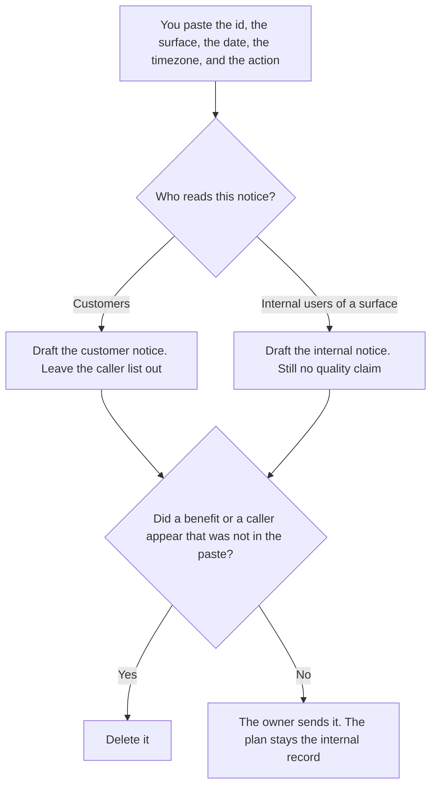

**A model deprecation notice written with AI tells a reader which model surface will stop, on which date, and what they must do, using only facts a person already accepted.** The model may format that notice. It may not move the date, invent a replacement benefit, or name a caller the notice was not meant to list. The internal plan, with the caller list and the fallback, is [how to write a model deprecation plan with AI](/blog/how-to-write-a-model-deprecation-plan-with-ai-2026/). The customer note when a product behavior changes is [how to write a customer migration notice with AI](/blog/how-to-write-a-customer-migration-notice-with-ai-2026/).

This page is the notice. It is shorter than the plan. It does not include the internal search for every caller.

Claude's prices are from claude.com/pricing on October 24, 2026. ChatGPT, Notion, and Cursor prices are from directory pages checked October 16, 2026. chatgpt.com/pricing returned HTTP 403 on October 24. Published October 24, 2026. We did not score model quality.

## What the notice contains

| Line | Who owns it | The model may |
|---|---|---|
| The model id and the surface | You, from the vendor notice or your own pin | Copy both. A family name is not an id |
| The date and the timezone | The notice you trust | Copy both. It may not call the date flexible |
| The action the reader must take | You | Copy it. If it is blank, write Action not set |
| What you are not claiming | You | Keep it. It may not say the new model is better |

A vendor retirement and your pin can be different dates. The notice shows the date that applies to the reader. The October 24 Codex pricing page said GPT-5.5 retires from Codex with ChatGPT sign-in on October 14, 2026, at noon PDT, and that API sessions using an API key were not affected. That sentence is an example of why the notice names the surface. It is not a template. Read the notice that applies to the id you pasted.

If customers never see the model id, do not send them this notice. Send the migration notice about the product behavior, and keep the model id on the internal plan.

## Where it is written

**The draft.** [Claude](/tools/claude/) Pro is $17 a month billed annually, $200 up front, or $20 monthly. Keep the id and the date in a Project so a later edit does not "upgrade" the name. The review is [Claude review](/blog/claude-review-2026/).

**A short notice.** [ChatGPT](/tools/chatgpt/) Plus is $20 a month on the October 16 card. Paste the four facts. Discard a version that adds a performance claim. The review is [ChatGPT review](/blog/chatgpt-review-2026/).

**The page readers will find.** [Notion AI](/tools/notion-ai/) Business is $20 a seat a month. Link the plan for the people who own the pin. Do not paste the caller list into the customer page. The invoice is [Notion AI pricing explained](/blog/notion-ai-pricing-explained-2026/).

**The pin, later.** [Cursor](/tools/cursor/) Plus is $8 a month, or $80 a year. The notice does not change the pin. The ladder is [Cursor pricing explained](/blog/cursor-pricing-explained-2026/).

A prompt that holds the line:

"Write the deprecation notice from the model id, the surface, the date, the timezone, and the action I pasted. Do not add a benefit. If the action is missing, write Action not set. Do not list internal callers."

## What not to delegate

Do not ask which model to recommend as better. Do not send the notice before the owner checks the date against the vendor page. Do not include a caller inventory. That inventory is the plan, and it is not for the audience of this notice.

## FAQ

### How is this different from the deprecation plan?

The plan names callers, the fallback, and the eval suite. The notice names the surface, the date, and the action for a reader. Customers should not receive the caller list. Internal readers of the notice still do not need every service name unless you pasted those names on purpose.

### How is this different from a customer migration notice?

The migration notice is about a product behavior the customer must change. This notice is about a model id. Use the migration notice when the customer never sees the model name. Use this one when the id is part of what they call. The dates still have to match if both go out.

### Can the notice say the new model is more capable?

Only if you pasted a sentence you are willing to stand behind, from a source you trust. A model that adds "faster and smarter" has written marketing. Delete it. The action line is enough.

### Who sends it?

The owner of that surface. A drafted notice is not a send. A date with no timezone is not ready, because the reader will guess the timezone.

## Last verified

October 24, 2026 for Claude and for the GPT-5.5 Codex retirement sentence on learn.chatgpt.com/docs/pricing. October 16, 2026 for ChatGPT's seat price, Notion, and Cursor. Published October 24, 2026.

**Sources:** [Claude pricing](https://claude.com/pricing), [ChatGPT and Codex pricing](https://learn.chatgpt.com/docs/pricing), [Notion pricing](https://www.notion.com/pricing), [Cursor pricing](https://cursor.com/help/account-and-billing/pricing).

*Published by Andrew for [AI Tools Optimizer](https://aitoolsoptimizer.com).*

[Claude](/tools/claude/) is in the [chatbots and assistants directory](/tools/category/chatbots-assistants/). Directory pages may use affiliate links. A purchase through them may earn us a commission at no extra cost to you.
