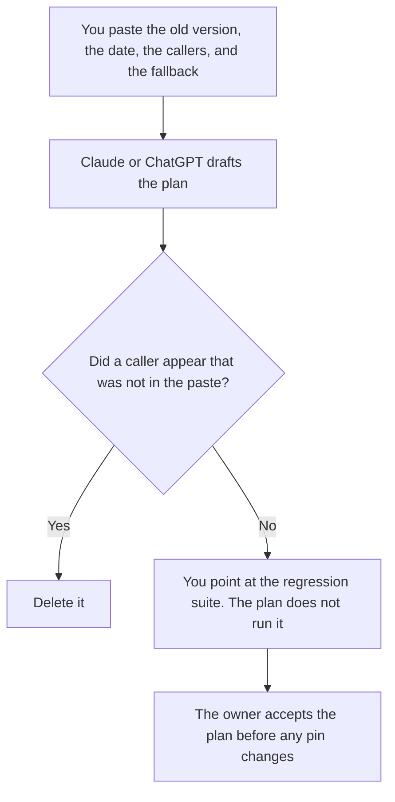

**A model deprecation plan written with AI names the model version that will stop, the date, the callers a person already listed, and the fallback version they already chose.** The model may format that plan. It may not discover callers, move the date, or declare the old version unused. The customer-facing note, when customers must act, is [how to write a customer migration notice with AI](/blog/how-to-write-a-customer-migration-notice-with-ai-2026/). A product feature going away is [how to write a feature deprecation note with AI](/blog/how-to-write-a-feature-deprecation-note-with-ai-2026/). This page is the model id.

The cases you re-run on the fallback are [what an AI eval regression suite is](/blog/what-is-ai-eval-regression-suite-2026/). The payload that still names the old model is [what AI prompt compilation is](/blog/what-is-ai-prompt-compilation-2026/).

Claude's prices are from claude.com/pricing on October 24, 2026. Cursor, Notion, and ChatGPT prices are from directory pages checked October 16. The X Subscription page fetched October 24 still lists Plus at $8 a month or $80 a year. chatgpt.com/pricing returned HTTP 403 on October 24. Published October 24, 2026. We did not score model quality.

## What the plan contains

| Row | Who owns it | The model may |
|---|---|---|
| The version id that will stop | You, from the vendor's notice or your own pin | Copy the id. It may not "upgrade" the name to a family |
| The date and the timezone | The notice you trust | Copy both. It may not assume the date is flexible |
| The caller list | A search you ran, with the date of the search | Copy the list. It may not add a service that "probably" calls it |
| The fallback version | A person | Copy it. If it is blank, write Fallback not chosen |
| The eval cases | The suite owner | Name the suite. It may not say the suite passed |

A vendor retirement and an internal pin are different dates. The plan should show both if both exist. The October 24 Codex pricing page said GPT-5.5 retires from Codex with ChatGPT sign-in on October 14, 2026, at noon PDT, and that API sessions using an API key were not affected. That sentence is an example of why the plan must name the surface. It is not a template for your model. Read the notice that applies to the id you pasted.

If customers see the model name in an API, the migration notice has to match this plan's date. If they do not, this plan can stay internal. Do not paste the internal caller list into the customer notice.

## Where it is written

**The draft.** [Claude](/tools/claude/) Pro is $17 a month billed annually, $200 up front, or $20 monthly. Keep the version ids in a Project so a later edit does not "helpfully" rename them. The review is [Claude review](/blog/claude-review-2026/).

**The repo, where the pin lives.** [Cursor](/tools/cursor/) Plus is $8 a month, or $80 a year. A suggestion that changes the pin is a diff you review. The plan does not merge it. The ladder is [Cursor pricing explained](/blog/cursor-pricing-explained-2026/).

**The page the on-call will open.** [Notion AI](/tools/notion-ai/) Business is $20 a seat a month. Link the search date next to the caller list. The invoice is [Notion AI pricing explained](/blog/notion-ai-pricing-explained-2026/).

**One plan, from a short paste.** [ChatGPT](/tools/chatgpt/) Plus is $20 a month on the October 16 card. Discard a version that adds a quality claim about the fallback. The review is [ChatGPT review](/blog/chatgpt-review-2026/).

A prompt that holds the line:

"Write a model deprecation plan from the version id, the date, the timezone, the caller list, and the fallback I pasted. Do not add a caller. If the fallback is missing, write Fallback not chosen. Do not say the new model is better."

## What not to delegate

Do not ask which model is safer to delete. Do not treat a green eval as permission to skip a caller you have not searched for. Do not change the pin from the chat. The person who owns model changes inside a product team has a related shelf at [best AI tools for technical PMs](/blog/best-ai-tools-for-technical-pms-2026/).

## FAQ

### How is this different from a feature deprecation note?

The feature note is what customers read about a product behavior. This plan is the model id, the callers, and the fallback. Customers may never see the model name. If they do, the dates must match, and the customer words start from the migration notice or the feature note, not from this plan.

### How is this different from a prompt diff?

A prompt diff is the line change inside a prompt. A model deprecation changes which model receives the compiled payload. You can need both. The diff does not retire the model. The plan does not rewrite the prompt unless a person makes that a separate row.

### Can the model search the repo for callers?

A chat cannot see the repo unless you paste the search output or point an editor at it and review the result. Paste the list and the date you searched. A guess is not a caller list.

### Who may change the pin?

The owner named on the plan, after the fallback is chosen and the suite they named has been run by a person. A finished document is not the pin change.

## Last verified

October 24, 2026 for Claude, the X Subscription Plus price, and the GPT-5.5 Codex retirement sentence on learn.chatgpt.com/docs/pricing. October 16, 2026 for Notion and ChatGPT's seat price. Published October 24, 2026.

**Sources:** [Claude pricing](https://claude.com/pricing), [Cursor pricing](https://cursor.com/help/account-and-billing/pricing), [Notion pricing](https://www.notion.com/pricing), [ChatGPT and Codex pricing](https://learn.chatgpt.com/docs/pricing).

*Published by Andrew for [AI Tools Optimizer](https://aitoolsoptimizer.com).*

[Cursor](/tools/cursor/) is in the [coding directory](/tools/category/coding/). Directory pages may use affiliate links. A purchase through them may earn us a commission at no extra cost to you.
