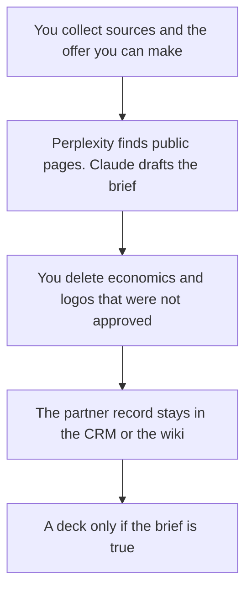

**A partner brief written with AI is a short mutual page: who they are, who you are, the customer you both serve, what each side will do, what you will not promise, and the next meeting.** The model can compress sources you paste. It cannot invent a revenue share, a marketplace fee, or a joint customer logo. If the economics are not in your notes, the brief says Not agreed.

The team that owns this file is [best AI tools for partnerships teams](/blog/best-ai-tools-for-partnerships-teams-2026/). The buyer leave-behind, which asks for a purchase rather than a mutual motion, is [how to write a sales one-pager with AI](/blog/how-to-write-a-sales-one-pager-with-ai-2026/). Cited company research is [how to use Perplexity for market research](/blog/how-to-use-perplexity-for-market-research-2026/).

Prices are US list prices excluding tax from directory pages checked October 16, 2026. HubSpot Starter was a limited-time offer on that card. Published October 24, 2026. We did not score partner fit.

## What the brief contains

| Section | Who owns the fact | The model may |
|---|---|---|
| Who they are | A source you can open | Summarize it, with the link |
| Who you are | Your current one-paragraph description | Shorten it. It may not add a market you do not serve |
| Shared customer | A segment you both already name | Use your words. It may not invent a logo |
| What each side will do | The motion you are willing to propose | List it. It may not add exclusivity |
| Economics | Only terms a person with authority has written | Copy them, or write Not agreed |
| Next meeting | A real date or a real ask | One line |

A fit score the model invented will leak into an email. Leave the score off the page. The person who sends the brief is [what human-in-the-loop AI is](/blog/what-is-human-in-the-loop-ai-2026/).

## Where the draft happens

**Public sources.** [Perplexity](/tools/perplexity/) Free cites the web with a weekly cap. Pro is $17 a month billed annually and adds premium data such as PitchBook and Statista. The card does not print the month-to-month Pro dollar. Open the citations. A partner brief does not need Max at $167 a month billed annually. The choice against a long-file reader is [Claude vs Perplexity for research](/blog/claude-vs-perplexity-for-research-2026/).

**The narrative.** [Claude](/tools/claude/) Pro is $20 a month, or $17 billed annually. Put prior briefs in a Project so the next one keeps your headings. [ChatGPT](/tools/chatgpt/) Plus at $20 is the right seat if the team already drafts there. Business is $20 a user a month billed annually, for two or more users, when the notes name a private deal. The container is [Claude Projects vs ChatGPT Projects](/blog/claude-projects-vs-chatgpt-projects-2026/).

**The page you will reopen.** [Notion AI](/tools/notion-ai/) Business is $20 a seat a month. Plus at $10 is not the full AI tier. The CRM, if you have one, stays the record of the deal. [HubSpot](/tools/hubspot/) has a free CRM. Starter was listed at $7 or $10 a seat a month, a limited-time offer. Confirm the promo before you budget it.

**Slides, later.** [Gamma](/tools/gamma/) Plus is $9 a seat a month once the brief is frozen. If the partner will edit PowerPoint, use [Plus AI](/tools/plus-ai/) Basic at $10 a user a month billed annually. The format choice is [Plus AI vs Gamma](/blog/plus-ai-vs-gamma-2026/).

A prompt that holds the line:

"Draft a partner brief with these headings: who they are, who we are, shared customer, what each side will do, what we will not promise, economics, next meeting. Use only my notes and the sources I pasted. If a revenue share, a logo, or a customer name is missing, write Not agreed. Do not add a fit score. Keep it under 600 words."

The claim check is [how to fact-check AI writing](/blog/how-to-fact-check-ai-writing-2026/). A questionnaire the partner sends back is [how to write an RFP response with AI](/blog/how-to-write-a-rfp-response-with-ai-2026/).

## What this page is not

It is not a contract. Counsel reviews terms. It is not a sales one-pager aimed at the end buyer. It is not a press announcement. That shape is closer to [how to create a newsletter with AI](/blog/how-to-create-a-newsletter-with-ai-2026/), and only after both sides have seen the claim.

## FAQ

### Can AI pick the partner?

It can summarize a list you already gathered. It should not rank "strategic fit" and sort your pipeline by that rank. You define what a good partner does, in a sentence, before the draft.

### Where do the economics go?

In the section titled economics, copied from the note a person authorized, or the words Not agreed. A generated "standard revenue share" is how a draft becomes an offer.

### Can two companies share one login to write it?

No. Each side uses its own seat. You exchange the document. A shared password is not a collaboration feature.

### How long should it be?

Short enough that both sides will read it before the meeting. If you need an appendix, the appendix is the sources, not another page of adjectives.

## Last verified

October 16, 2026 for Perplexity, Claude, ChatGPT, Notion, HubSpot, Gamma, and Plus AI prices named above. HubSpot Starter was promotional. Perplexity's month-to-month Pro dollar was not on the card. Published October 24, 2026.

**Sources:** [Perplexity pricing](https://www.perplexity.ai/hub/pricing), [Claude pricing](https://claude.com/pricing), [Gamma pricing](https://gamma.app/pricing).

*Published by Andrew for [AI Tools Optimizer](https://aitoolsoptimizer.com).*

[Perplexity](/tools/perplexity/) is in the [research and search directory](/tools/category/research-search/). Directory pages may use affiliate links. A purchase through them may earn us a commission at no extra cost to you.
