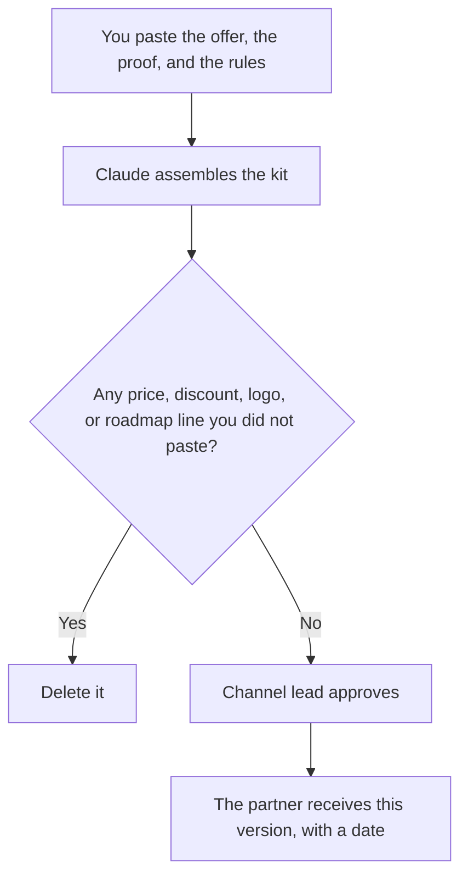

**A partner enablement kit written with AI is the packet a partner needs to talk about your product without inventing it: who it is for, the offer in your words, the proof you pasted, and the questions they must bring back to you.** The model may assemble the packet. It may not add a discount, a deal-registration rule, a roadmap date, or a customer logo you did not approve.

The internal deck is a different file: [how to write a sales enablement deck with AI](/blog/how-to-write-a-sales-enablement-deck-with-ai-2026/). The team that owns internal content is [best AI tools for revenue enablement](/blog/best-ai-tools-for-revenue-enablement-2026/). The talk track for a live demo is [how to create a demo script with AI](/blog/how-to-create-a-demo-script-with-ai-2026/). The check is [how to fact-check AI writing](/blog/how-to-fact-check-ai-writing-2026/).

Prices are US list prices excluding tax from directory pages checked October 16, 2026. Published October 24, 2026. We did not score partner-sourced revenue. This page does not set your channel terms.

## What goes in the kit

| Piece | Who owns the fact | The model may |
|---|---|---|
| Ideal customer | The segment you pasted | Restate it. It may not widen the segment |
| Offer and price | The current public price, pasted, with the date | Repeat it. It may not round or add a partner discount |
| Proof | A case, a metric, or a quote you have rights to share | Place it. It may not anonymize by inventing a new number |
| Demo path | The clicks you listed | Order them. It may not add a feature |
| Questions to escalate | The list you pasted | Format it. It may not answer those questions |
| Deal registration | The rule your channel lead pasted, or Missing | Leave Missing. A guessed rule pays the wrong partner |
| What not to say | You | Keep the prohibitions verbatim |

Internal battle language stays internal unless you explicitly include a sourced line. The internal story is [how to write a competitive battle narrative with AI](/blog/how-to-write-a-competitive-battle-narrative-with-ai-2026/). Partners repeat what you send them. Assume a sentence in the kit will be said to a buyer.

## Where the packet is built

**The prose.** [Claude](/tools/claude/) Pro is $20 a month, or $17 billed annually. A Project holds the approved kit and the sources. Free can draft a short version, with usage limits. The review is [Claude review](/blog/claude-review-2026/).

**The home.** [Notion AI](/tools/notion-ai/) Business is $20 a seat a month. The kit is a page with an owner and an expiry. Plus at $10 is not the full AI tier. A PDF emailed once will circulate after the price changes. The invoice is [Notion AI pricing explained](/blog/notion-ai-pricing-explained-2026/). The record is [what a system of record for AI is](/blog/what-is-a-system-of-record-for-ai-2026/).

**A short deck.** [Gamma](/tools/gamma/) Plus is $9 a seat a month when the partner wants slides from the same outline. The cards may not introduce a stat that is absent from the page. The webinar version of that choice is [Gamma vs Canva for webinars](/blog/gamma-vs-canva-for-webinars-2026/).

**A short explainer, if you are ready to maintain video.** [Synthesia](/tools/synthesia/) Starter is $29 a month billed monthly on the directory card, with a lower yearly figure shown on that card. SCORM export is on Enterprise, not on Starter. A partner portal that needs SCORM is a different purchase. Do not promise an LMS export from the Starter row. The invoice is [Synthesia pricing explained](/blog/synthesia-pricing-explained-2026/).

A prompt that holds the line:

"Assemble a partner kit from this paste only. Include the segment, the offer, the proof, the demo steps, and the questions that must come back to us. If discount, deal registration, or a roadmap item is not in the paste, write Missing. Do not add logos, quotes, or limits. Keep the 'do not say' list word for word."

The channel lead who ships it is [what human-in-the-loop AI is](/blog/what-is-human-in-the-loop-ai-2026/). A discount the model "remembered from other programs" is [what an AI hallucination is](/blog/what-is-ai-hallucination-2026/).

## What partners still may not do

They may not quote a price that expired with the kit's review date. They may not show a roadmap slide that was internal. They may not upload your unreleased deck into a tool that trains on inputs, unless your agreement and the vendor terms allow it. Say that in the kit, in a sentence a person wrote.

If the partner also implements, the delivery notes are a second document. The shelf for that job is [best AI tools for implementation consultants](/blog/best-ai-tools-for-implementation-consultants-2026/). Do not hide implementation limits inside a selling kit. Write them in the questions-to-escalate list.

## FAQ

### Can one kit serve every partner tier?

Only if the offer is the same. If registered partners get a discount, that discount is a fact you paste into their version. A single kit with a blank discount teaches people to guess. Two kits, or one kit with Missing, are safer than a blended paragraph.

### Should the kit include a battlecard?

Include the sourced lines you want repeated, not the full internal card. The card's workflow is [how to create a competitive battlecard with AI](/blog/how-to-create-a-competitive-battlecard-with-ai-2026/). Anything about a competitor needs a date and a source.

### Can AI translate the kit?

It can draft a translation. A person who knows the market reads the price, the legal terms, and the product names before a partner sees them. A translated discount is still a discount. Do not ship a translation nobody reviewed.

### How often do we refresh it?

On the review date, and whenever the public price or the demo path changes. The model can diff the new paste against the old kit. You accept the diff. An automatic refresh from the open web will import a stale third-party page.

## Last verified

October 16, 2026 for Claude, Notion AI, Gamma, and Synthesia. Published October 24, 2026.

**Sources:** [Claude pricing](https://claude.com/pricing), [Notion pricing](https://www.notion.com/pricing), [Gamma pricing](https://gamma.app/pricing), [Synthesia pricing](https://www.synthesia.io/pricing).

*Published by Andrew for [AI Tools Optimizer](https://aitoolsoptimizer.com).*

[Gamma](/tools/gamma/) is in the [presentations directory](/tools/category/presentations/). Directory pages may use affiliate links. A purchase through them may earn us a commission at no extra cost to you.
