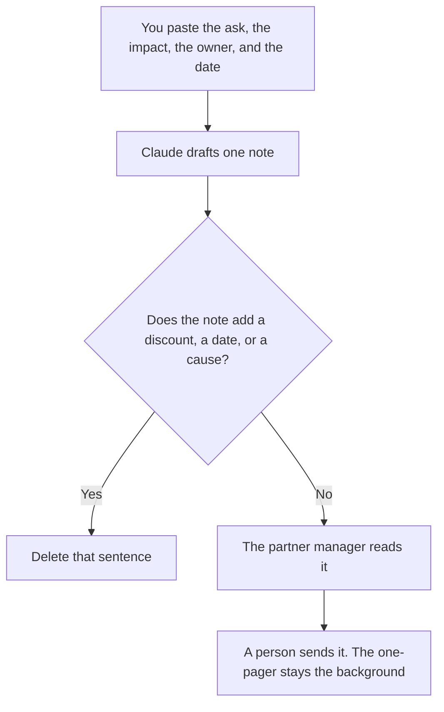

**A partner escalation note written with AI states the ask, the owner, the date, and the facts a person already accepted.** The model may put those facts in order. It may not offer a discount, a roadmap date, or an apology your partner manager did not write. The page you can hand over before anything is on fire is [how to write a partner one-pager with AI](/blog/how-to-write-a-partner-one-pager-with-ai-2026/). A security exception, which is a different ask, is [how to write a security exception request with AI](/blog/how-to-write-a-security-exception-request-with-ai-2026/).

Claude's prices are from claude.com/pricing on October 24, 2026. Notion, ChatGPT, and Grammarly prices are from directory pages checked October 16, 2026. chatgpt.com/pricing returned HTTP 403 on October 24. Published October 24, 2026. We did not score partner relationships.

## What belongs in the note

| Row | Who owns it | The model may |
|---|---|---|
| The partner and the account id you are allowed to share | You | Copy them. It may not add another partner |
| The ask | The partner manager | Phrase it as one sentence. It may not widen it |
| The impact | Facts you pasted | Shorten them. It may not add a revenue number |
| The owner and the date | You | Copy them. If either is blank, write Missing |
| What you will not offer | The commercial owner | Keep that list out of the ask |

An escalation is a request for a decision. It is not a status novel. If the cause is unknown, the note says the cause is not established. A guessed root cause will be forwarded as fact. The one-pager explains who the partner is. This note explains what you need by when. If they disagree, the note is wrong, because the one-pager is not the ask.

## Where it is written

**The draft.** [Claude](/tools/claude/) Pro is $17 a month billed annually, $200 up front, or $20 monthly, when the partner's constraints live in a Project and the note should not contradict them. Paste only facts you are allowed to share outside the account team. The review is [Claude review](/blog/claude-review-2026/).

**The page the next owner inherits.** [Notion AI](/tools/notion-ai/) Business is $20 a seat a month if partner notes live there. Plus at $10 is not the full AI tier. The invoice is [Notion AI pricing explained](/blog/notion-ai-pricing-explained-2026/).

**One note, from a short card.** [ChatGPT](/tools/chatgpt/) Plus is $20 a month. Free can format a single ask. Discard a version that opens with three paragraphs of relationship history. The review is [ChatGPT review](/blog/chatgpt-review-2026/).

**The last pass.** [Grammarly](/tools/grammarly/) Pro is $12 a member a month billed annually, or $30 monthly. If the rewrite softens the ask or adds a promise, put the original sentence back. The invoice is [Grammarly pricing explained](/blog/grammarly-pricing-explained-2026/).

A prompt that holds the line:

"Write an escalation note from the ask, the impact, the owner, and the date I pasted. Do not add a discount, a feature date, or a cause. If a field is missing, write Missing and stop."

## What not to delegate

Do not ask the model who is at fault. Do not name a customer of the partner unless the note's audience is allowed to see that name. Do not send the note from the chat. The partner manager sends it, or the person they name. A note with no date is a draft, even if the prose is polished.

## FAQ

### How is this different from the one-pager?

The one-pager is the standing description of the partner. The escalation is one ask, with an owner and a date. The one-pager should not change because a single note was urgent. If the standing facts changed, edit the one-pager on purpose.

### Can the model recommend a concession?

No. A concession is a commercial decision. The note can say "concession: not requested" or copy a concession you already approved. It cannot propose one because the tone would be "better."

### What if we do not know the impact yet?

Write Impact not established. Do not borrow a number from a different partner. An escalation without an impact can still be valid if the ask and the date are real. A fake number makes it worse.

### Who may close it?

The owner on the note, after the decision is recorded. A model does not mark the escalation done because a reply was polite.

## Last verified

October 24, 2026 for Claude. October 16, 2026 for Notion, ChatGPT, and Grammarly. Published October 24, 2026.

**Sources:** [Claude pricing](https://claude.com/pricing), [Notion pricing](https://www.notion.com/pricing), [ChatGPT pricing](https://chatgpt.com/pricing/), [Grammarly pricing](https://www.grammarly.com/plans).

*Published by Andrew for [AI Tools Optimizer](https://aitoolsoptimizer.com).*

[Notion AI](/tools/notion-ai/) is in the [productivity and notes directory](/tools/category/productivity-notes/). Directory pages may use affiliate links. A purchase through them may earn us a commission at no extra cost to you.
