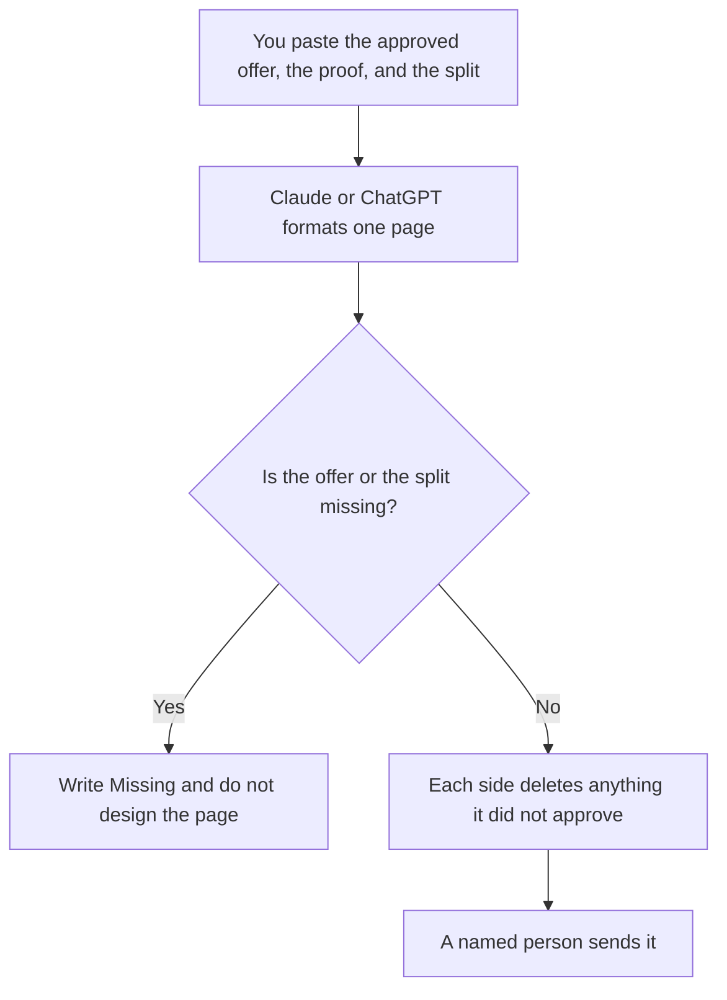

**A partner one-pager written with AI is a single page both companies can hand to a buyer: the joint offer, who it is for, the proof each side already has, and the sentence each side is allowed to say.** The model may compress notes you paste. It may not invent a customer, a discount, or a metric. The internal brief that assigns the work is [how to write a partner brief with AI](/blog/how-to-write-a-partner-brief-with-ai-2026/). This page is the leave-behind. If the two disagree, the one-pager is wrong, or the brief is, and a person decides before anyone sends it.

The product page that is not a partner page is [how to write a product one-pager with AI](/blog/how-to-write-a-product-one-pager-with-ai-2026/). The team that runs the motion is [best AI tools for partner marketing](/blog/best-ai-tools-for-partner-marketing-2026/). The seller's one-offer sheet is [how to write a sales one-pager with AI](/blog/how-to-write-a-sales-one-pager-with-ai-2026/).

Prices are US list prices excluding tax from directory pages checked October 16, 2026. Published October 24, 2026. We did not score partnerships. The model does not pick a partner.

## What fits on the page

| Block | Who owns it | The model may |
|---|---|---|
| The joint offer | The sentence both sides approved | Copy it. It may not widen the offer |
| Who it is for | A segment you named | Format it. It may not add an industry |
| Proof | A customer, a number, or a quote you can source | Place it. It may not round it |
| What each side does | The split in the brief | List it. If the split is missing, stop |
| The next step | A link or a meeting both sides accept | Copy it. It may not invent a calendar |

A one-pager that says "better together" and does not say what each company does is a slogan. The proof is a line you can open. A logo is not proof.

## Where the page is written

**The draft.** [Claude](/tools/claude/) Pro is $20 a month, or $17 billed annually, when the approved claims are long and should stay in a Project. The review is [Claude review](/blog/claude-review-2026/).

**A short card.** [ChatGPT](/tools/chatgpt/) Plus is $20 a month when the offer is a few sentences. Go at $8 may include ads, which is a poor fit next to a partner logo. The review is [ChatGPT review](/blog/chatgpt-review-2026/).

**The record.** [Notion AI](/tools/notion-ai/) Business is $20 a seat a month if the page lives in the partner workspace. The chat is not the file you send.

**The layout.** [Canva](/tools/canva/) Pro is $18 a month or $180 a year for one person, after the words are approved. Canva does not approve the claim. The invoice is [Canva Magic Studio pricing explained](/blog/canva-magic-studio-pricing-explained-2026/).

A prompt that holds the line:

"Format a one-page partner leave-behind from the offer, the audience, the proof, the split, and the next step I pasted. Do not add a metric, a customer, or a discount. If the split is missing, write Split missing and stop."

## What not to delegate

Do not ask the model for a joint pipeline number. Do not put the other company's pricing on the page unless they wrote the sentence. Do not send the draft from a personal account if the partnership is under NDA. The factual check is [how to fact-check AI writing](/blog/how-to-fact-check-ai-writing-2026/).

## FAQ

### How is this different from a partner brief?

The brief says what each team will do and by when. The one-pager is what a buyer can read. The brief can contain internal dates the buyer should not see. Do not paste the brief and call it the one-pager.

### How is this different from a product one-pager?

The product page is your product, your proof, your owner. The partner page has two names and a split. A sentence that only one side can defend does not belong on it.

### Can the model design the page?

It can suggest a section order. Canva can lay out type after the words are frozen. A generated illustration of the other company's product is not an asset you have the right to use unless they gave it to you.

### Who signs off?

One named person on each side. A shared chat is not a signature. Save the approved file. If either side edits it later, the other side sees the diff before it goes out again.

## Last verified

October 16, 2026 for Claude, ChatGPT, Notion AI, and Canva. Published October 24, 2026.

**Sources:** [Claude pricing](https://claude.com/pricing), [ChatGPT pricing](https://chatgpt.com/pricing/), [Notion pricing](https://www.notion.com/pricing), [Canva pricing](https://www.canva.com/pricing/).

*Published by Andrew for [AI Tools Optimizer](https://aitoolsoptimizer.com).*

[Claude](/tools/claude/) is in the [chatbots and assistants directory](/tools/category/chatbots-assistants/). Directory pages may use affiliate links. A purchase through them may earn us a commission at no extra cost to you.
