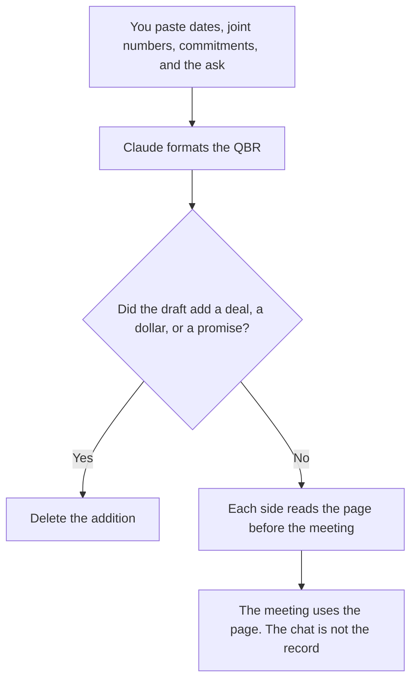

**A partner QBR written with AI is a quarterly review of the joint work you and a partner already measured: pipeline you both recognize, enablement you completed, and commitments each side made.** The model may format the sections. It may not invent revenue, a deal, or a promise. A customer QBR is a different meeting. This one has two companies in the room.

The customer version is [how to write a QBR deck with AI](/blog/how-to-write-a-qbr-deck-with-ai-2026/). What each side agreed to do, before the quarter, is [how to write a partner brief with AI](/blog/how-to-write-a-partner-brief-with-ai-2026/). What the partner is allowed to say in market is [how to write a partner enablement kit with AI](/blog/how-to-write-a-partner-enablement-kit-with-ai-2026/).

Prices are US list prices excluding tax from directory pages checked October 16, 2026. Published October 24, 2026. We did not score partnerships. The model does not forecast.

## The lines that have to be real

| Line | Who owns it | The model may |
|---|---|---|
| Period | The quarter you named | Copy the dates |
| Joint pipeline | Deals both sides already list, with your stage names | Format the table. It may not add a deal |
| Number | A figure from your system, pasted | Copy it. It may not round up |
| Enablement | Sessions or assets you finished | List them. It may not claim a certification you did not record |
| Commitments | What each side owed, and whether you marked it done | Keep a miss as a miss |
| Ask | The one request you will make next quarter | Use your words. It may not add a second ask |

A QBR that "finds" pipeline the CRM does not have is a script, not a review. If the two companies disagree on a number, write both figures and the source. Do not average them in the model and call it alignment.

## Where the page is written

**The draft.** [Claude](/tools/claude/) Pro is $20 a month, or $17 billed annually, when the partner brief and the quarter's exports should sit in a Project. Free can format one short QBR from a paste. The review is [Claude review](/blog/claude-review-2026/).

**The record.** [Notion AI](/tools/notion-ai/) Business is $20 a seat a month if the QBR archive lives in Notion. Last quarter's page stays. The new page does not overwrite the old commitments.

**The slides, after the page.** [Gamma](/tools/gamma/) Plus is $9 a seat a month if you need a deck from a page you already locked. The slides do not get a new number. The sales-deck comparison, for a different room, is [Gamma vs Beautiful.ai for sales decks](/blog/gamma-vs-beautiful-ai-for-sales-decks-2026/).

**The meeting.** [Granola](/tools/granola/) Business is $14 a user a month if you want notes without a bot. The decision in the room is a note a person files. It does not rewrite the quarter's numbers.

A prompt that holds the line:

"Format a partner QBR from the dates, joint pipeline, enablement, commitments, and ask I pasted. Do not add a deal or a dollar. Do not mark a commitment done unless I did. If a number is missing, write Missing. Do not write a forecast."

## What not to delegate

Do not ask the model who is at fault for a missed number. Do not let it propose a new commercial term. Terms are a contract conversation, not a formatting pass. Do not turn the QBR into a customer success plan for one account. That plan is [how to write a customer success plan with AI](/blog/how-to-write-a-customer-success-plan-with-ai-2026/).

## FAQ

### Is a partner QBR the same as a customer QBR?

No. A customer QBR is about one account's outcomes. A partner QBR is about the joint motion: sourced work, enablement, and commitments between two companies. Use the customer article for the account. Use this one when a partner is in the title.

### Can AI forecast next quarter?

It can leave a blank next to a target you type. A target it chose is not a forecast. If you do not have a number, write Missing and decide it in the room.

### What if the partner's number and ours differ?

Show both, with the source and the date. The model must not pick the larger one. Reconciliation is the meeting, or a data owner, not a sentence that says "approximately."

### Can the deck go out before both sides read it?

No. A QBR that surprises the partner with a dollar they have not seen is how the meeting becomes an argument about the slide. Send the page first. Slides come after the page is stable.

## Last verified

October 16, 2026 for Claude, Notion AI, Gamma, and Granola. Published October 24, 2026.

**Sources:** [Claude pricing](https://claude.com/pricing), [Notion pricing](https://www.notion.com/pricing), [Gamma](https://gamma.app), [Granola](https://www.granola.ai).

*Published by Andrew for [AI Tools Optimizer](https://aitoolsoptimizer.com).*

[Gamma](/tools/gamma/) is in the [presentations directory](/tools/category/presentations/). Directory pages may use affiliate links. A purchase through them may earn us a commission at no extra cost to you.
