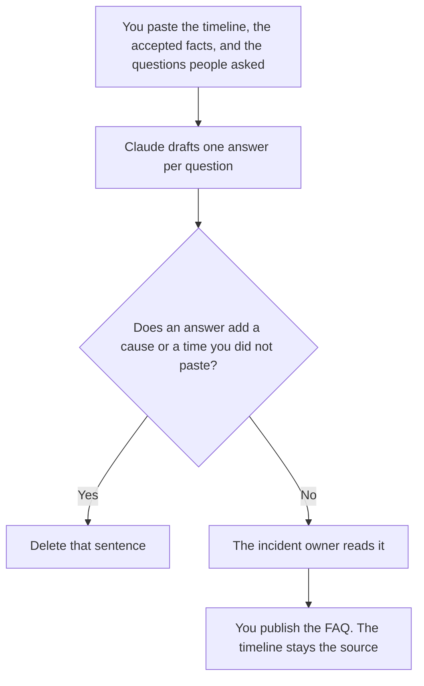

**A post-incident FAQ written with AI is a list of questions customers or coworkers will ask, answered only from the timeline and the facts a person already accepted.** The model may turn those facts into short answers. It may not add a cause, a blame line, or a promise about the next outage. The ordered times are [how to write an incident timeline with AI](/blog/how-to-write-an-incident-timeline-with-ai-2026/). Who hears what while the fix is still moving is [how to create a hotfix comms plan with AI](/blog/how-to-create-a-hotfix-comms-plan-with-ai-2026/). The longer write-up after the FAQ is [how to write a postmortem with AI](/blog/how-to-write-a-postmortem-with-ai-2026/).

Prices are US list prices excluding tax from directory pages checked October 16, 2026. A live fetch of vendor pricing pages on October 24, 2026 returned HTTP 401, so this page stays on the directory record. Published October 24, 2026. We did not score incidents.

## What belongs in the FAQ

| Row | Who owns it | The model may |
|---|---|---|
| The question | You, from tickets or the channel you pasted | Phrase it. It may not invent a question nobody asked |
| The answer | The timeline and the accepted facts | Shorten them. It may not add a cause |
| The time bound | The timeline | Copy the start and the end you named. It may not round them |
| The next update | The owner of comms | Copy the date. If there is no date, write Update missing |
| What you will not say | The comms owner | Keep that list out of the answers |

A FAQ that explains "why it really happened" before the postmortem is finished will be wrong in public. If the cause is still unknown, the answer says the cause is not established and points at the next update. That is a complete answer. A guessed root cause is not.

The hotfix plan says who is told during the incident. This FAQ is what you leave up after people can read at their own pace. If the two documents name different end times, one of them is stale. The timeline wins until a person updates both.

## Where it is written

**The draft.** [Claude](/tools/claude/) Pro is $20 a month, or $17 billed annually, when the timeline is long and the FAQ should sit beside it in a Project. Paste only the facts you are allowed to share outside the incident channel. The review is [Claude review](/blog/claude-review-2026/).

**The page support will link.** [Notion AI](/tools/notion-ai/) Business is $20 a seat a month if that is the help center's source, or the internal page the next shift inherits. The invoice is [Notion AI pricing explained](/blog/notion-ai-pricing-explained-2026/).

**The last pass on a customer sentence.** [Grammarly](/tools/grammarly/) Pro is $12 a member a month billed annually, or $30 monthly. If the rewrite deletes a limitation or softens a time, put it back. The invoice is [Grammarly pricing explained](/blog/grammarly-pricing-explained-2026/).

**One answer, from a short card.** [ChatGPT](/tools/chatgpt/) Plus is $20 a month. Free can format a single answer. Discard a version that apologizes for three paragraphs and then speculates. The review is [ChatGPT review](/blog/chatgpt-review-2026/).

A prompt that holds the line:

"Answer only the questions I pasted, using only the timeline facts I pasted. If a question is not covered, write Not established. Do not add a cause. Do not name a person."

## What not to delegate

Do not ask the model who was at fault. Do not publish the FAQ before the incident owner reads it. Do not include a customer's name, a host name that is sensitive, or an internal ticket id in the public version. The public FAQ and the internal timeline are different documents. The moment a bot should stop and a person should take a related case is [what an AI conversation handoff is](/blog/what-is-ai-conversation-handoff-2026/).

## FAQ

### How is this different from the timeline?

The timeline is the ordered times. The FAQ is the questions people ask about those times, in sentences. Every time in the FAQ should appear in the timeline. If you learn a new fact, you update the timeline first, then the answer that cited it.

### How is this different from the postmortem?

The postmortem is the longer account, including what you will change. The FAQ is the short page you can hand someone today. A corrective action that is not decided does not belong in the FAQ as if it were scheduled.

### Can the model draft the questions too?

Only from questions you pasted, from tickets or the channel. A model-invented FAQ answers an incident nobody had. If you want a question added, add it because a person asked it, then draft the answer.

### Who may publish it?

The incident owner, or the comms owner they named. A model does not publish. A page with no owner and no "next update" line is a draft.

## Last verified

October 16, 2026 for Claude, Notion, Grammarly, and ChatGPT. Published October 24, 2026.

**Sources:** [Claude pricing](https://claude.com/pricing), [Notion pricing](https://www.notion.com/pricing), [Grammarly pricing](https://www.grammarly.com/plans), [ChatGPT pricing](https://chatgpt.com/pricing/).

*Published by Andrew for [AI Tools Optimizer](https://aitoolsoptimizer.com).*

[Claude](/tools/claude/) is in the [chatbots and assistants directory](/tools/category/chatbots-assistants/). Directory pages may use affiliate links. A purchase through them may earn us a commission at no extra cost to you.
