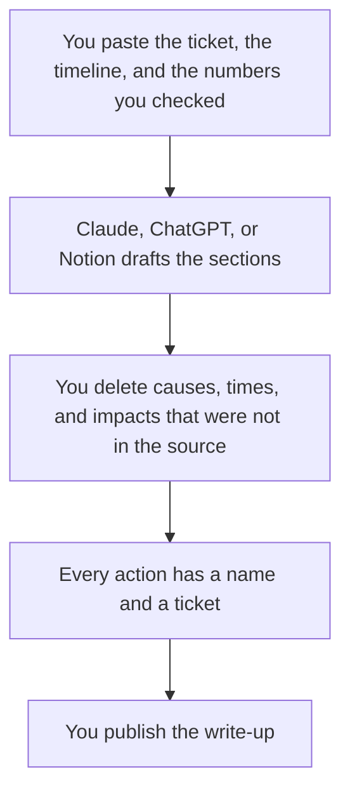

**A postmortem written with AI is your timeline, your impact, and your action items, rewritten so a reader who was not in the incident can follow them.** The model can order sentences. It cannot decide the root cause, the customer impact, or who owns the fix. Paste the ticket and the notes. Delete any cause you cannot point to.

This is not the weekly note. That workflow is [how to write a status update with AI](/blog/how-to-write-a-status-update-with-ai-2026/). A changelog is what shipped on purpose. That workflow is [how to write a changelog with AI](/blog/how-to-write-a-changelog-with-ai-2026/). The people who will reuse this doc are the audience of [best AI tools for SRE teams](/blog/best-ai-tools-for-sre-teams-2026/).

Prices are US list prices excluding tax from directory pages checked October 16, 2026. Published October 24, 2026. We did not score write-ups.

## What the model may touch

| Section | Who owns it | The model may |
|---|---|---|
| Summary | You, in two or three sentences | Shorten it. It may not add drama |
| Impact | You, from the metric or the ticket count you checked | Format it. It may not estimate users affected |
| Timeline | The log, the chat, the ticket | Order the timestamps you pasted. It may not fill gaps |
| What worked | The people who were there | Phrase it. It may not invent a hero |
| What we will change | A named owner and a ticket | Make the owner visible. It may not assign a stranger |
| Root cause | You, if you actually know it | State it plainly. If you do not know, it must say that |

If the notes say "database CPU was high," the model will often upgrade that to "the outage was caused by a missing index." That upgrade is [a hallucination](/blog/what-is-ai-hallucination-2026/) in a document people will trust later. Keep the observation. Put the cause in only when the evidence is in the paste.

## Where the draft happens

**A long incident channel plus a ticket.** [Claude](/tools/claude/) Pro is $20 a month, or $17 billed annually. Put the last postmortem in a Project so the headings stay stable. The container is [Claude Projects vs ChatGPT Projects](/blog/claude-projects-vs-chatgpt-projects-2026/).

**The on-call engineer's default chat.** [ChatGPT](/tools/chatgpt/) Plus is $20. Go at $8 is enough for a short draft. The ladder is [ChatGPT Go vs Plus vs Pro](/blog/chatgpt-go-vs-plus-vs-pro-2026/).

**The page the wiki already uses.** [Notion AI](/tools/notion-ai/) Business is $20 a seat. If the postmortem template lives in Notion, generate there or paste the approved text in. The card is [Notion AI pricing explained](/blog/notion-ai-pricing-explained-2026/). The seat math against a chatbot is [Notion AI vs ChatGPT Plus cost](/blog/notion-ai-vs-chatgpt-plus-cost-2026/).

**The prose, after the facts are frozen.** [Grammarly](/tools/grammarly/) Free covers grammar. Pro is $12 a member a month billed annually. It will not find a missing timestamp. The card is [Grammarly pricing explained](/blog/grammarly-pricing-explained-2026/).

**The bridge call, if you recorded it.** [Fathom](/tools/fathom/) Free includes unlimited recordings and summaries, if a bot was allowed. The summary is not the timeline. You still pull the lines you will stand behind. Team, when the notes must be shared, is $15 a user a month annually with a two-user minimum, from the pricing page read October 24, 2026. The card is [Fathom pricing explained](/blog/fathom-pricing-explained-2026/).

A prompt that holds the line:

"Here is our template: summary, impact, timeline, what worked, action items. Use only the notes below. If the root cause is not stated, write 'Not established' and list the evidence we do have. Do not name a person as at fault. Do not invent times, customer counts, or follow-up tickets."

Blameless means the doc talks about the system and the next change. It does not mean the model should sand the impact down. A real outage stays a real outage. The fact pass is [how to fact-check AI writing](/blog/how-to-fact-check-ai-writing-2026/). The person who publishes is [what human-in-the-loop AI is](/blog/what-is-human-in-the-loop-ai-2026/).

## After it is published

Link the action items to tickets. A postmortem with no owners is a diary. The pipeline change those tickets imply is a different shelf: [best AI tools for DevOps teams](/blog/best-ai-tools-for-devops-teams-2026/). The habit of keeping the same checks next time is [what an AI eval harness is](/blog/what-is-ai-eval-harness-2026/), if the failure was in a model, and a normal test suite if it was not.

Do not let an agent file the postmortem into the ticket system unattended. The ticket is the record. The distinction is [what a system of record for AI is](/blog/what-is-a-system-of-record-for-ai-2026/).

## FAQ

### Can AI write the postmortem from Slack alone?

It can misread jokes, guesses, and reverted theories as facts. Paste a timeline a human already cleaned, or be ready to delete most of the draft. The channel is evidence. The doc is a decision about which lines were true.

### How long should it be?

Long enough to show impact, timeline, and owners. A one-page version for executives can be a second draft from the same notes. Do not let the short version invent a cleaner cause than the long one.

### What if we do not know the root cause yet?

Say so. Ship the timeline and the next investigation step. A false cause is worse than a gap, because the next incident will quote it.

### Should customers see this doc?

Only a version you wrote for them, with internal names and guesses removed. Generate that version from the approved internal doc, not from the raw channel.

## Last verified

October 16, 2026 for Claude, ChatGPT, Notion, and Grammarly. October 24, 2026 for Fathom Team's annual price. Published October 24, 2026.

**Sources:** [Claude pricing](https://claude.com/pricing), [ChatGPT pricing](https://chatgpt.com/pricing), [Notion pricing](https://www.notion.com/pricing).

*Published by Andrew for [AI Tools Optimizer](https://aitoolsoptimizer.com).*

[Claude](/tools/claude/) is in the [chatbots and assistants directory](/tools/category/chatbots-assistants/). Directory pages may use affiliate links. A purchase through them may earn us a commission at no extra cost to you.
