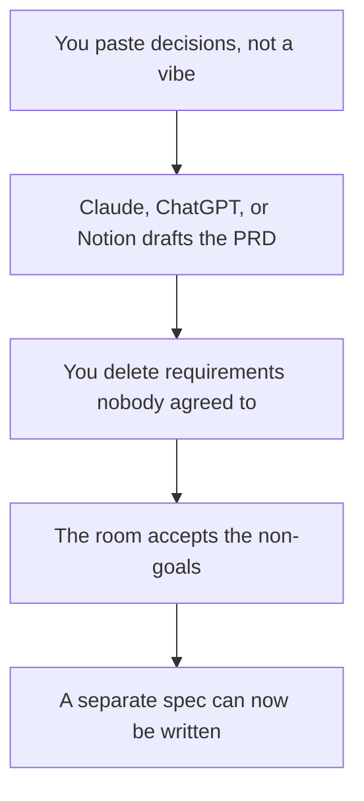

**A PRD written with AI is the agreement the room already made: the user, the problem, the requirements in priority order, the non-goals, and how you will know it worked.** The model can turn those notes into headings. It cannot add a feature because the paragraph looked thin. The build document, which is how engineering will implement a decision, is [how to draft a product spec with AI](/blog/how-to-draft-a-product-spec-with-ai-2026/). This page stops at the agreement.

The stack around the person who usually owns this doc is [best AI tools for product managers](/blog/best-ai-tools-for-product-managers-2026/). Notes from research that should feed the problem statement are [how to use AI for user interview notes](/blog/how-to-use-ai-for-user-interview-notes-2026/).

Prices are US list prices excluding tax from directory pages checked October 16, 2026. Published October 24, 2026. We did not score PRDs.

## What the model may touch

| Section | Who owns the substance | The model may |
|---|---|---|
| Problem and user | You, from interviews or tickets you cite | Shorten it. It may not invent a persona |
| Requirements, in order | The room that cut scope | Number the list you pasted. It may not add a row |
| Non-goals | You, in writing | Make them visible. It may not soften them into "later" |
| Success metric | A number you already collect | Format it. It may not propose a vanity metric |
| Rollout | The flag or the ship plan you have | State the audience. It may not promise a date you did not give |
| Open questions | The list you have not answered | Keep them open. It may not answer them |

A requirement the model invented is [a hallucination](/blog/what-is-ai-hallucination-2026/) with a roadmap attached. The fact pass is [how to fact-check AI writing](/blog/how-to-fact-check-ai-writing-2026/).

## Where the draft happens

**A long brief plus a standing template.** [Claude](/tools/claude/) Pro is $20 a month, or $17 billed annually. Put the template in a Project. The container is [Claude Projects vs ChatGPT Projects](/blog/claude-projects-vs-chatgpt-projects-2026/).

**The chat the PM already has.** [ChatGPT](/tools/chatgpt/) Plus is $20. Go at $8 is enough for a short problem statement. The ladder is [ChatGPT Go vs Plus vs Pro](/blog/chatgpt-go-vs-plus-vs-pro-2026/).

**The page the team comments on.** [Notion AI](/tools/notion-ai/) Business is $20 a seat. If the PRD lives in Notion, generate there or paste the approved text in. Plus at $10 is not the full AI tier. The card is [Notion AI pricing explained](/blog/notion-ai-pricing-explained-2026/).

**The meeting that produced the cut.** [Granola](/tools/granola/) Business is $14 a user a month and does not put a bot on the call. Basic is free with 30 days of history. The transcript is not the PRD. You still choose which lines were decisions. The notes workflow is [Claude vs ChatGPT for meeting notes](/blog/claude-vs-chatgpt-for-meetings-notes-2026/).

**The prose, after the requirements are frozen.** [Grammarly](/tools/grammarly/) Pro is $12 a member a month billed annually. It will not notice a missing non-goal.

A prompt that holds the line:

"Here are our decisions and the template: problem, user, requirements in order, non-goals, success metric, rollout, open questions. Use only the notes. If a requirement is not in the notes, do not add it. If a metric is missing, write Not set. Do not invent customer quotes or dates."

The wording of that prompt, if you reuse it, should have a version. That habit is [what prompt versioning is](/blog/what-is-prompt-versioning-2026/). The person who circulates the doc is [what human-in-the-loop AI is](/blog/what-is-human-in-the-loop-ai-2026/).

## After the room says yes

Ship the PRD to the people who will build, sell, and support it. The sales one-pager is a different audience and a shorter file: [how to write a sales one-pager with AI](/blog/how-to-write-a-sales-one-pager-with-ai-2026/). The engineering spec comes after the non-goals are stable, not before.

If the rollout is a model feature, the switch that limits who sees it is [what AI feature flags are](/blog/what-is-ai-feature-flags-2026/). Write the flag name into the rollout section only when the flag exists.

## FAQ

### Is a PRD the same as a spec?

On this site, the PRD is the agreement. The spec is the build document. One model session should not write both from a blank page. Link them. Do not merge them to save a meeting.

### How long should it be?

Short enough that a skeptical reader can find the non-goals. A PRD that restates the whole market is a brainstorm. The brainstorm is [ChatGPT vs Claude for brainstorming](/blog/chatgpt-vs-claude-for-brainstorming-2026/). Cut before you circulate.

### Can AI prioritize the requirements?

It can reorder a list you numbered. It should not invent the order. Priority is the decision. Prose is the record.

### What if we do not have a metric yet?

Write Not set, and name who will propose one. A model-supplied metric will become the goal because it was in the doc. Leave the blank.

## Last verified

October 16, 2026 for Claude, ChatGPT, Notion, Granola, and Grammarly prices named above. Published October 24, 2026.

**Sources:** [Claude pricing](https://claude.com/pricing), [ChatGPT pricing](https://chatgpt.com/pricing), [Notion AI](https://www.notion.com/product/ai).

*Published by Andrew for [AI Tools Optimizer](https://aitoolsoptimizer.com).*

[Claude](/tools/claude/) is in the [chatbots and assistants directory](/tools/category/chatbots-assistants/). Directory pages may use affiliate links. A purchase through them may earn us a commission at no extra cost to you.
