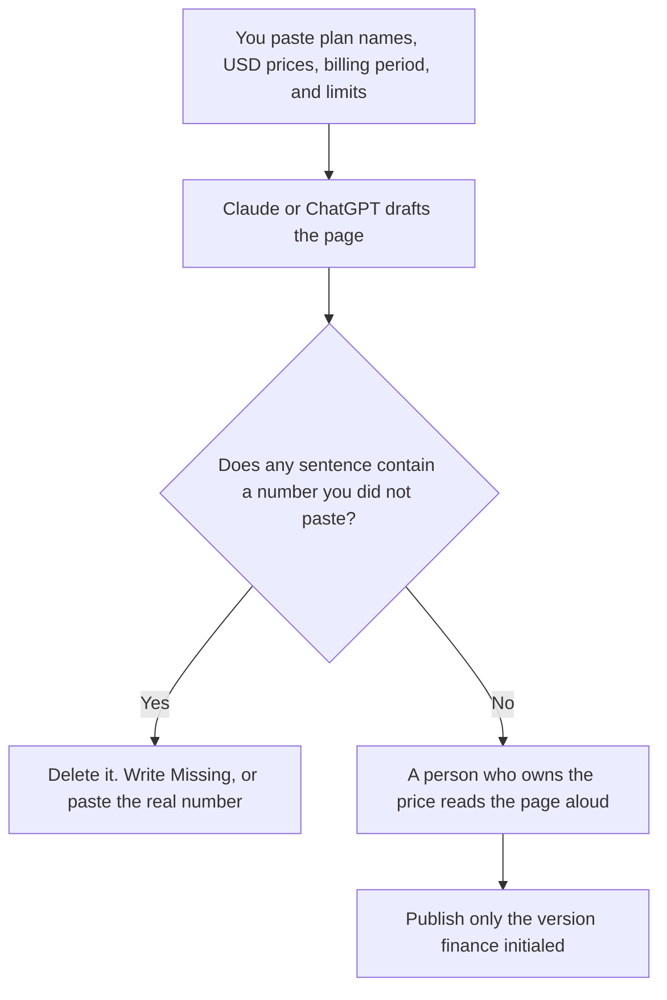

**A pricing page written with AI is a clear list of the plans, prices, and limits you already approved, plus the questions buyers actually ask.** The model can order the sentences and cut jargon. It cannot invent a price, a free trial, an annual discount, or a feature that is not in the paste. If a number is missing, the draft says "Missing" and stops. A fluent tier you did not mean to sell is a contract.

A one-page leave-behind for a deal is a different file: [how to write a sales one-pager with AI](/blog/how-to-write-a-sales-one-pager-with-ai-2026/). The deck that presents the same offer is [how to write a sales enablement deck with AI](/blog/how-to-write-a-sales-enablement-deck-with-ai-2026/). The check before you publish is [how to fact-check AI writing](/blog/how-to-fact-check-ai-writing-2026/).

Prices for the writing tools below are US list prices excluding tax from directory pages checked October 16, 2026. Published October 24, 2026. We did not score conversion. This page does not set your product's price.

## What the model may touch

| Block | Who owns the fact | The model may |
|---|---|---|
| Plan names | You | Use the names you typed. It may not add "Enterprise" or "Pro" |
| The price | Finance, in the paste, with the currency and the billing period | Repeat it. It may not "round" or convert |
| What is included | The list you pasted per plan | Format it. It may not move a feature onto a cheaper tier |
| What is not included | You, especially limits and overages | State the limit. It may not write "unlimited" |
| Annual versus monthly | The two numbers you pasted, or one number and the word Missing | Show both only if both are in the paste |
| FAQ | Questions you have actually been asked | Answer only from the paste |

A price the model remembered from another company is [a hallucination](/blog/what-is-ai-hallucination-2026/). Your page is not a summary of the market. It is your offer.

## Where the sentences are drafted

**The long draft.** [Claude](/tools/claude/) Pro is $20 a month, or $17 billed annually. Keep the approved numbers in a Project so the next edit does not drift. Free can hold a Project, with usage limits. The review is [Claude review](/blog/claude-review-2026/).

**The default chat, if the brief already lives there.** [ChatGPT](/tools/chatgpt/) Plus is $20 a month and includes projects. Business is $20 a user a month billed annually, minimum two users, when the paste includes an unreleased price. Do not draft a confidential price on a personal free account if policy forbids it. The ladder is [ChatGPT Go vs Plus vs Pro](/blog/chatgpt-go-vs-plus-vs-pro-2026/).

**The line edit.** [Grammarly](/tools/grammarly/) Pro is $12 a member a month billed annually. It will not know whether the annual toggle is real. The invoice is [Grammarly pricing explained](/blog/grammarly-pricing-explained-2026/).

**The source of truth beside the page.** [Notion AI](/tools/notion-ai/) Business is $20 a seat a month. The public page should match the internal note, including the date the price was approved. Plus at $10 is not the full AI tier. The invoice is [Notion AI pricing explained](/blog/notion-ai-pricing-explained-2026/).

A prompt that holds the line:

"Draft a pricing page from these plans only. Repeat each USD price and billing period exactly. If a feature is not listed under a plan, do not put it there. If I did not provide a price, write Missing. Do not mention competitors. Do not invent a free trial, a discount, or a money-back promise. Keep the FAQ to questions I pasted."

The person who publishes is [what human-in-the-loop AI is](/blog/what-is-human-in-the-loop-ai-2026/). The record of the approved number is [what a system of record for AI is](/blog/what-is-a-system-of-record-for-ai-2026/).

## A page that stays true after launch

Put the currency on the page. This site's own pricing articles say when a figure is a US list price and when checkout can differ. Yours should say the same if tax, region, or seat count changes the charge. A single sticker that is wrong in the buyer's account is a support ticket.

Name the meter in the customer's words: per user, per month, per credit. If overage exists, say the overage you pasted. If it does not exist yet, do not let the model add "fair use." Fair use without a number is a dispute.

Date the internal note. When the price changes, change the page and the note on the same day. A model that "keeps the old draft in the Project" will resurrect the old price if you let it. Replace the paste.

## FAQ

### Can AI suggest what we should charge?

It can brainstorm structures in a private doc. It cannot see your costs, your sales cycle, or your contracts. Do not publish a brainstorm. Publish the number a person approved. Strategy and the page are different meetings.

### Should the page compare us to a competitor?

Not in this workflow. Competitor prices go stale, and a model will invent them. A battlecard, sourced, is [how to create a competitive battlecard with AI](/blog/how-to-create-a-competitive-battlecard-with-ai-2026/). The public pricing page states your offer.

### How many tiers should we show?

The number you sell. If you pasted two plans, the page has two plans. Adding a decoy tier because a template had three is how you end up honoring a price you never operated.

### What if annual billing is not decided?

Write the monthly price you do sell, and leave annual off the page. "Save 20 percent" without a second number is a promise. The model may not compute a discount you did not approve, even if the arithmetic is easy.

## Last verified

October 16, 2026 for Claude, ChatGPT, Grammarly, and Notion AI. Your product's prices are yours. Published October 24, 2026.

**Sources:** [Claude pricing](https://claude.com/pricing), [ChatGPT pricing](https://chatgpt.com/pricing/), [Grammarly Pro cost](https://support.grammarly.com/hc/en-us/articles/115000090011-How-much-does-Grammarly-Pro-cost).

*Published by Andrew for [AI Tools Optimizer](https://aitoolsoptimizer.com).*

[Claude](/tools/claude/) is in the [chatbots and assistants directory](/tools/category/chatbots-assistants/). Directory pages may use affiliate links. A purchase through them may earn us a commission at no extra cost to you.
