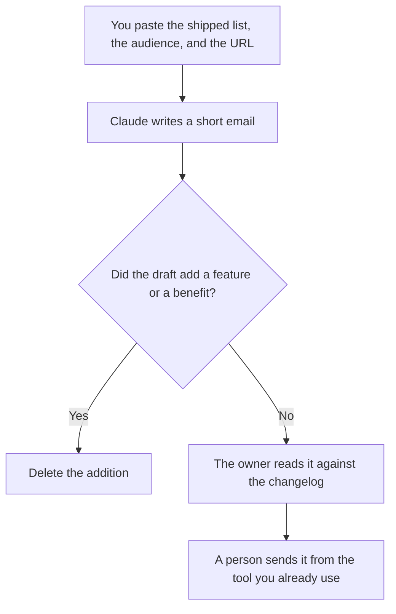

**A product changelog email written with AI is a short note that points at changes you already shipped, for readers you already chose.** The model may tighten the sentences and order the list you pasted. It may not add a feature, a date, or a benefit you did not write down. The email is not the changelog. The changelog is the record. The email is the pointer.

The record itself is [how to write a changelog with AI](/blog/how-to-write-a-changelog-with-ai-2026/). The longer customer-facing notes are [how to write release notes with AI](/blog/how-to-write-release-notes-with-ai-2026/). One feature, announced on its own, is [how to create a feature announce email with AI](/blog/how-to-create-a-feature-announce-email-with-ai-2026/).

Prices are US list prices excluding tax from directory pages checked October 16, 2026. Published October 24, 2026. We did not score open rates. The model does not send the email.

## The lines that have to be real

| Line | Who owns it | The model may |
|---|---|---|
| What shipped | The list from the changelog, with versions or dates you pasted | Order it. It may not add an item |
| Who it is for | The segment you named | Copy it. It may not widen the audience |
| What changed for them | One sentence you can defend per item | Shorten it. It may not add a benefit |
| What did not ship | The items you marked out | Keep them out of the body, or in a "not in this note" line if you asked |
| Link | The changelog URL you pasted | Paste it. It may not invent a URL |
| Ask | None, or the single ask you wrote | Leave the ask out if you wrote none |

If the email needs a feature that is not on the changelog, the changelog is wrong or the email is early. Fix the record first. A launch checklist, when this note is part of a larger release, is [how to create a product launch checklist with AI](/blog/how-to-create-a-product-launch-checklist-with-ai-2026/).

## Where the note is written

**The draft.** [Claude](/tools/claude/) Pro is $20 a month, or $17 billed annually, when the changelog page should sit in a Project so the model cannot wander. Free can tighten one email from a paste. The review is [Claude review](/blog/claude-review-2026/).

**A second wording.** [ChatGPT](/tools/chatgpt/) Plus at $20 can offer a shorter subject line from the same list. Keep the items. Discard a clever subject that names a feature you did not ship. The review is [ChatGPT review](/blog/chatgpt-review-2026/).

**The archive.** [Notion AI](/tools/notion-ai/) Business is $20 a seat a month if the sent note should live next to the changelog. The sent file is the record of what you told customers. A chat draft is not.

This page does not name an email-tool price. If you send from a product whose directory page we have not priced here, read that page. The drafting seat is the cost this article stands behind. A person still presses send.

A prompt that holds the line:

"Write a changelog email from the shipped items, the audience, and the URL I pasted. One short paragraph, then a list. Do not add a feature. Do not invent a benefit or a link. If an item has no user-facing effect in my notes, say Fixed, with my words. Do not write a subject line that mentions anything outside the list."

## What not to delegate

Do not ask the model what shipped. Do not let it apologize for an incident that belongs in a different mail. A postmortem is [how to write a postmortem with AI](/blog/how-to-write-a-postmortem-with-ai-2026/). Do not turn the email into a newsletter. A newsletter has a different job: [how to create a newsletter with AI](/blog/how-to-create-a-newsletter-with-ai-2026/).

## FAQ

### Is the changelog email the release notes?

Release notes are the longer explanation. The changelog is the list. This email points at the list for a segment you named. If you only shipped one feature and you need a story, use the feature-announce article instead.

### Can AI choose the segment?

No. You name who receives it. A model that "includes all users so nobody misses out" is how a breaking API note lands in a consumer inbox. Segment is a field you fill.

### What if the list is only bug fixes?

Say that. A subject line that implies a new product, on a mail full of fixes, is the draft to delete. Readers can tolerate a short fix note. They remember a feature that was not there.

### Can the model send it?

No. Sending is a person, in the tool your company already uses, after the changelog URL loads and the list matches. A workflow that sends without that read is not this article.

## Last verified

October 16, 2026 for Claude, ChatGPT, and Notion AI. Published October 24, 2026.

**Sources:** [Claude pricing](https://claude.com/pricing), [ChatGPT pricing](https://chatgpt.com/pricing/), [Notion pricing](https://www.notion.com/pricing).

*Published by Andrew for [AI Tools Optimizer](https://aitoolsoptimizer.com).*

[Claude](/tools/claude/) is in the [chatbots and assistants directory](/tools/category/chatbots-assistants/). Directory pages may use affiliate links. A purchase through them may earn us a commission at no extra cost to you.
