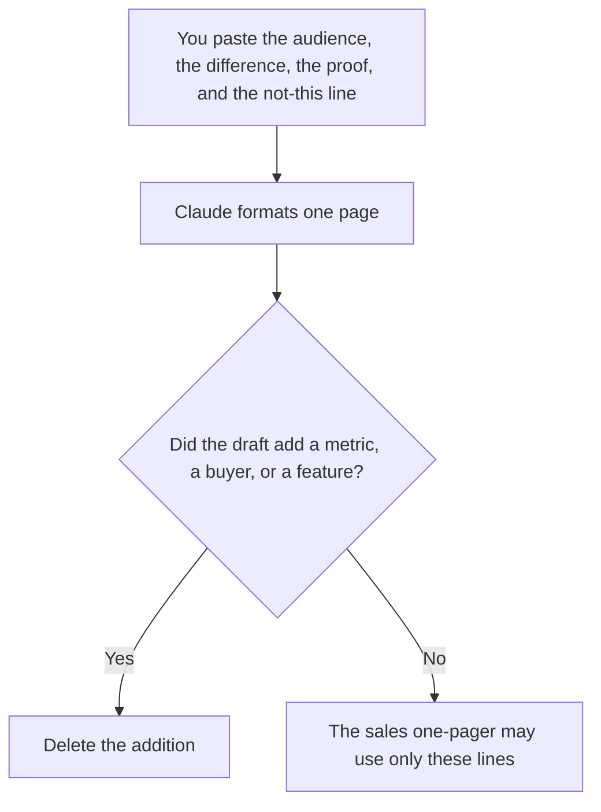

**A product one-pager written with AI is a single internal page that says who the product is for, the problem you claim, the difference you can source, and the proof you already have.** The model may compress notes you paste. It may not invent a customer, a percent, or a competitor's weakness. The leave-behind a seller hands a buyer, with an offer and a next step, is [how to write a sales one-pager with AI](/blog/how-to-write-a-sales-one-pager-with-ai-2026/). This page is the positioning sheet those sentences should match. If the two pages disagree, the sales page is wrong, or this one is, and a person decides which.

The launch narrative that should exist before a task list is [how to write a go-to-market brief with AI](/blog/how-to-write-a-go-to-market-brief-with-ai-2026/). The internal statement of who you are against an alternative is [how to write a competitive positioning brief with AI](/blog/how-to-write-a-competitive-positioning-brief-with-ai-2026/).

Prices are US list prices excluding tax from directory pages checked October 16, 2026. Published October 24, 2026. We did not score positioning. The model does not pick a target market.

## What fits on the page

| Block | Who owns it | The model may |
|---|---|---|
| Audience | The person you named, in words you use with the team | Copy it. It may not widen it to "everyone" |
| Problem | The problem you wrote, not a category slogan | Shorten it. It may not add a pain you did not list |
| Difference | The difference you can point at in the product | Phrase it. It may not add a feature that is not shipped |
| Proof | A number, a quote, or a screenshot you supplied | Place it. It may not round it or anonymize it into a fake quote |
| Not this | The buyers and jobs you are declining | Keep the line. It may not soften it into "also great for" |
| Owner | A person who can change the page | Copy the name. It may not write "product" |

A page that fits everyone is a page that cannot guide a roadmap or a campaign. The not-this line is the part teams skip and the part that makes the page useful. If you cannot name who it is not for, the audience line is still a draft.

## Where the page is written

**The draft.** [Claude](/tools/claude/) Pro is $20 a month, or $17 billed annually, when the standing notes live in a Project and you are revising the page, not inventing a company. Free can format one paste. The review is [Claude review](/blog/claude-review-2026/).

**The record.** [Notion AI](/tools/notion-ai/) Business is $20 a seat a month if this page is the one the team opens. Plus at $10 is not the full AI seat. The page needs an owner either way. The wiki decision is [Notion AI vs ChatGPT for wikis](/blog/notion-ai-vs-chatgpt-for-wikis-2026/).

**A second pass on wording.** [ChatGPT](/tools/chatgpt/) Plus at $20 a month can tighten sentences. Discard a new audience it added because the page "felt narrow." Narrow is the point.

**The line edit.** [Grammarly](/tools/grammarly/) Pro is $12 a member a month billed annually, or $30 monthly. It will not notice a fabricated proof point. You will.

A prompt that holds the line:

"Format a product one-pager from the audience, problem, difference, proof, and not-this line I pasted. One page. Do not add a buyer, a feature, a metric, or a quote. If proof is missing, write Proof missing. Do not write a call to action."

## What not to delegate

Do not ask the model who the market is. Do not turn this page into a sales one-pager by adding a discount. Do not publish it to customers. It is an internal alignment page. Customers see the sales page, the changelog, or the feature note, after a person has checked that those words still match this one.

## FAQ

### How is this different from the sales one-pager?

The sales page is what a buyer can read: the offer and the next step, with proof you can show them. This page is who the product is for and what you refuse to claim. Sales may quote it. Sales may not outgrow it. If a rep needs a discount line, that line belongs on the sales page only after someone who can discount has written it.

### Can the model suggest a sharper difference?

It can show you two phrasings of the difference you already wrote. It cannot discover a difference by looking at the category. A sharper sentence that mentions a feature you have not shipped is a worse page. Mark anything you cannot point at in the product as Not shipped.

### What belongs in proof?

A number you computed, a quote you have permission to use, or a fact a customer can see. "Customers love it" is not proof. If you have nothing yet, the block says Proof missing. Shipping the page with a made-up percent is the failure mode.

### Who signs it?

The person named as owner, who can change the audience line. A committee paragraph with no name will be edited by whoever opens the model next. One owner. Everyone else comments.

## Last verified

October 16, 2026 for Claude, Notion AI, ChatGPT, and Grammarly. Published October 24, 2026.

**Sources:** [Claude pricing](https://claude.com/pricing), [Notion pricing](https://www.notion.com/pricing), [ChatGPT pricing](https://chatgpt.com/pricing/), [Grammarly pricing](https://www.grammarly.com/plans).

*Published by Andrew for [AI Tools Optimizer](https://aitoolsoptimizer.com).*

[Claude](/tools/claude/) is in the [writing directory](/tools/category/writing/). Directory pages may use affiliate links. A purchase through them may earn us a commission at no extra cost to you.
