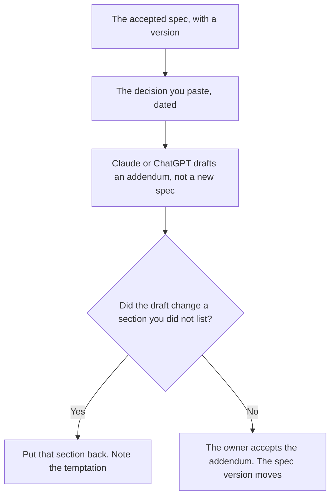

**A product spec addendum written with AI is a short record of what changed after the spec was accepted: the decision, what is now in scope, what is still out, and who agreed.** The model drafts from the original spec and the decision you paste. It does not rewrite the product, reopen settled sections, or invent a requirement the meeting did not make.

The original document's workflow is [how to draft a product spec with AI](/blog/how-to-draft-a-product-spec-with-ai-2026/). The check is [how to fact-check AI writing](/blog/how-to-fact-check-ai-writing-2026/). A bug is not an addendum: [how to write a bug triage note with AI](/blog/how-to-write-a-bug-triage-note-with-ai-2026/). The file that wins when chat and spec disagree is [what a system of record for AI is](/blog/what-is-a-system-of-record-for-ai-2026/).

Prices for the tools below are US list prices excluding tax from directory pages checked October 16, 2026. Published October 24, 2026. We did not score spec quality. This page does not decide your roadmap.

## What the addendum contains

| Block | Who owns the fact | The model may |
|---|---|---|
| The spec it amends | The link and the version you paste | Name that version. It may not amend "the latest" |
| The decision | The sentence from the meeting, with a date | Restate it. It may not widen it |
| What changed | Only the sections you list | Show old and new for those sections |
| What did not change | You | Repeat the out-of-scope line so it survives |
| The tests | The cases you name, if behavior changed | Format them. It may not mark them passed |
| The owner | A person and a date you paste | Leave the name blank if you did not provide one |

An addendum that is longer than the spec has become a new spec. Stop and use the original workflow. The point of this page is the delta.

## Where it is drafted

**The delta.** [Claude](/tools/claude/) Pro is $20 a month, or $17 billed annually. Keep the spec in a Project. Ask for an addendum, and say which headings are frozen. The review is [Claude review](/blog/claude-review-2026/).

**The team chat.** [ChatGPT](/tools/chatgpt/) Plus is $20 a month. Business is $20 a user a month billed annually, minimum two, when the spec is unreleased. The ladder is [ChatGPT Go vs Plus vs Pro](/blog/chatgpt-go-vs-plus-vs-pro-2026/).

**The page people will open.** [Notion AI](/tools/notion-ai/) Business is $20 a seat a month. The addendum lives under the spec, with the version in the title. Plus at $10 is not the full AI tier. A chat transcript is not the version. The invoice is [Notion AI pricing explained](/blog/notion-ai-pricing-explained-2026/).

**The test, if code changed.** [Cursor](/tools/cursor/) Plus is $8 a month, or $80 a year, when someone implements the delta. The test is written and run by a person. That comparison is [Cursor vs GitHub Copilot for tests](/blog/cursor-vs-github-copilot-for-tests-2026/). The addendum does not assert that the test passed.

A prompt that holds the line:

"Draft an addendum to this spec version. Change only the sections I list. For each, show the previous sentence and the new sentence from the decision. Leave every other section untouched and say so. If the decision does not cover a question, write Unspecified. Do not add requirements, dates, or success metrics I did not paste."

The person who accepts the version is [what human-in-the-loop AI is](/blog/what-is-human-in-the-loop-ai-2026/). A requirement the meeting did not make is [what an AI hallucination is](/blog/what-is-ai-hallucination-2026/).

## Who else has to see the delta

Implementation consultants and solutions engineers will build or demo whatever the spec says. If you change scope, they need the addendum, not a Slack paraphrase. The delivery shelf is [best AI tools for implementation consultants](/blog/best-ai-tools-for-implementation-consultants-2026/). The pre-sales shelf is [best AI tools for solutions engineers](/blog/best-ai-tools-for-solutions-engineers-2026/).

If the change is customer-visible, the email is a separate brief: [how to create a feature announce email with AI](/blog/how-to-create-a-feature-announce-email-with-ai-2026/). Do not paste the internal addendum to the list. Do not let the model turn an internal limitation into a launch benefit.

## FAQ

### Can the addendum replace the spec?

No. The spec remains the document. The addendum is the dated change. If you merge them, keep a single version and retire the old one in the same edit. Two "current" specs is how engineering builds the old one.

### What if we disagree with the original spec?

That is a new decision, still written as a delta, or a new spec if almost everything moved. Ask the model to list the conflicts. You resolve them. A model that "harmonizes" a disagreement has chosen a side.

### Should we include mockups?

Only mocks you paste or link. The model may not describe a screen nobody drew and call it agreed. A generated picture is a proposal until design accepts it.

### How small is too small for an addendum?

A typo can be a quiet edit with a changelog line. A behavior change, a limit, or a date gets an addendum even when the paragraph is short. Size is not the test. Whether a builder could miss it is the test.

## Last verified

October 16, 2026 for Claude, ChatGPT, Notion AI, and Cursor. Published October 24, 2026.

**Sources:** [Claude pricing](https://claude.com/pricing), [ChatGPT pricing](https://chatgpt.com/pricing/), [Notion pricing](https://www.notion.com/pricing), [Cursor pricing](https://cursor.com/help/account-and-billing/pricing).

*Published by Andrew for [AI Tools Optimizer](https://aitoolsoptimizer.com).*

[Notion AI](/tools/notion-ai/) is in the [productivity and notes directory](/tools/category/productivity-notes/). Directory pages may use affiliate links. A purchase through them may earn us a commission at no extra cost to you.
