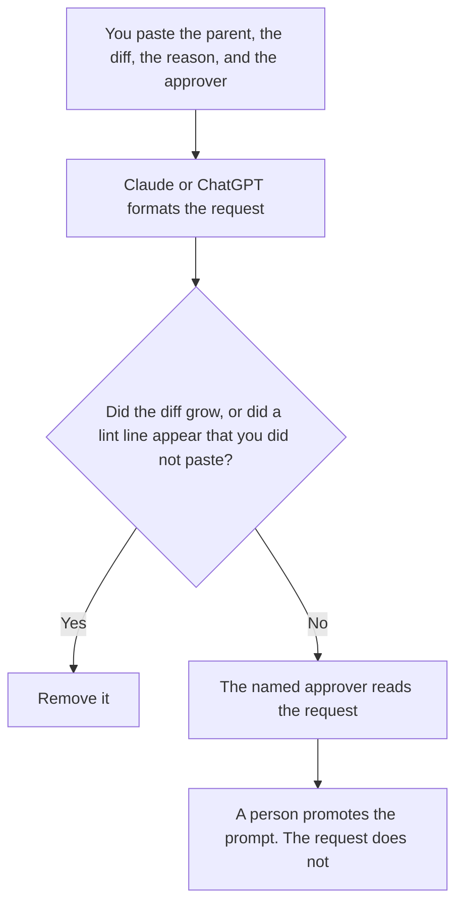

**A prompt change request written with AI names the parent prompt, the child or the diff, the reason, the lint result you already have, and the person who may approve it.** The model may format that request. It may not widen the diff, invent a passing lint result, or approve itself. The comparison of two versions is [what an AI prompt diff is](/blog/what-is-ai-prompt-diff-2026/). The check that runs before a prompt is allowed to run is [what an AI prompt lint rule is](/blog/what-is-ai-prompt-lint-rule-2026/). A named child that is not yet production is [what AI prompt branching is](/blog/what-is-ai-prompt-branching-2026/).

Claude's prices are from claude.com/pricing on October 24, 2026. Notion and Cursor prices are from directory pages checked October 16, 2026. ChatGPT Plus is $20 a month on learn.chatgpt.com/docs/pricing on October 24, 2026. Published October 24, 2026. We did not score prompts.

## What the request contains

| Line | Who owns it | The model may |
|---|---|---|
| Parent name and version | The prompt owner | Copy both. It may not guess the production version |
| The diff, or the child name | The person who made the change | Copy it. It may not add a sentence to the diff |
| The reason, in one line you wrote | You | Keep your reason. It may not upgrade it into a strategy |
| Lint result | The run you already did | Copy pass or fail. A blank stays Lint missing |
| Approver | You | Copy the name. The draft is not an approval |

The eval that should run before a promotion is a field on the request only when you name it. The report from that eval is [how to create a model eval report with AI](/blog/how-to-create-a-model-eval-report-with-ai-2026/). A request that says "eval passed" without an attached result is a claim. Leave the line as Eval missing until the result exists.

## Where it is written

**The draft, when requests share a shape.** [Claude](/tools/claude/) Pro is $17 a month billed annually, $200 up front, or $20 monthly. The Project holds the required lines. The review is [Claude review](/blog/claude-review-2026/).

**The page that stores the request.** [Notion AI](/tools/notion-ai/) Business is $20 a seat a month if the prompt library is in Notion. Plus at $10 is not the full AI tier on the October 16 card. The invoice is [Notion AI pricing explained](/blog/notion-ai-pricing-explained-2026/).

**One request from a short diff.** [ChatGPT](/tools/chatgpt/) Plus is $20 a month. Discard a version that rewrites the prompt "while it is in there." The review is [ChatGPT review](/blog/chatgpt-review-2026/).

**The file, if the prompt is in a repo.** [Cursor](/tools/cursor/) Plus is $8 a month, or $80 a year, on the October 16 card. The change request points at the branch. The editor does not merge it. The ladder is [Cursor pricing explained](/blog/cursor-pricing-explained-2026/).

A prompt that holds the line:

"Write a change request for the prompt parent I named. Include only the diff, the reason, the lint result, and the approver I pasted. If a field is missing, write Missing. Do not expand the diff. Do not mark it approved."

## What not to delegate

Do not let the model promote the child because the request reads cleanly. Do not combine two diffs into one request so the ticket "moves faster." Do not delete the parent text from the request. The approver needs to see what production is today.

## FAQ

### How is this different from a prompt diff?

The diff is the change. The request is the ask: why, who approves, and which parent it applies to. You can have a diff with no request, which means nobody has asked to ship it. You should not have a request with no diff.

### How is this different from a branch?

A branch is the named version you can run. The request is the document that asks a person to make that version the parent. Opening a branch does not file the request. Filing the request does not promote the branch.

### What if lint failed?

The request says lint failed, and it quotes the rule that failed, if you pasted that rule. The model does not flip the result to pass and it does not delete the offending line unless that deletion is the diff you already made.

### Who may approve?

The approver named in the paste. A second chat that says "looks good" is not an approval. The promotion is a person updating production, after the request says yes.

## Last verified

October 24, 2026 for Claude and for ChatGPT Plus. October 16, 2026 for Notion and Cursor. Published October 24, 2026.

**Sources:** [Claude pricing](https://claude.com/pricing), [Notion pricing](https://www.notion.com/pricing), [ChatGPT and Codex pricing](https://learn.chatgpt.com/docs/pricing), [Cursor pricing](https://cursor.com/help/account-and-billing/pricing).

*Published by Andrew for [AI Tools Optimizer](https://aitoolsoptimizer.com).*

[Claude](/tools/claude/) is in the [chatbots and assistants directory](/tools/category/chatbots-assistants/). Directory pages may use affiliate links. A purchase through them may earn us a commission at no extra cost to you.
