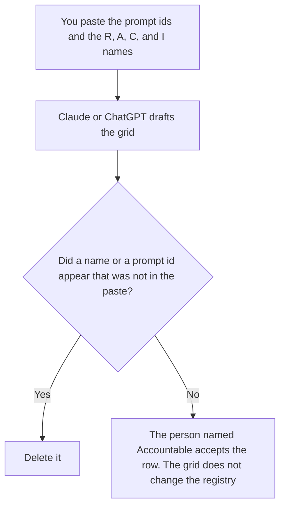

**A prompt ownership RACI written with AI is a draft grid: each prompt id a person listed, and the Responsible, Accountable, Consulted, and Informed names a person already assigned.** The model may lay out the grid. It may not invent a name, assign a team alias with no person, or mark a prompt allowed. A general RACI for a project, which is a different grid, is [how to create a RACI chart with AI](/blog/how-to-create-a-raci-chart-with-ai-2026/). The list of prompts that may run is [what an AI prompt registry is](/blog/what-is-ai-prompt-registry-2026/).

The check that the prompt text has an owner line, before any model runs, is [what an AI prompt unit test is](/blog/what-is-ai-prompt-unit-test-2026/). The grid and the test are not the same file.

Claude's prices are from claude.com/pricing on October 24, 2026. Notion and Grammarly prices are from directory pages checked October 16, 2026. ChatGPT's Plus price is from learn.chatgpt.com/docs/pricing on October 24. Published October 24, 2026. We did not score prompts.

## What the grid is allowed to contain

| Cell | Who owns it | The model may |
|---|---|---|
| Prompt id and version | You | Copy the id. It may not merge two prompts that share a nickname |
| Accountable | You, one person | Copy the name. If it is missing, write Accountable not set |
| Responsible | You | Copy the names. It may not fill the cell with the accountable person unless you did |
| Consulted and informed | You | Copy them. An empty cell stays empty until you say nobody |

One Accountable per prompt. Two Accountable names mean the row is not done. Responsible can be several people. Consulted is not Accountable. A shared Slack channel is not a name. If the only "owner" is a team inbox, the cell says Accountable not set.

## Where it is drafted

**The draft.** [Claude](/tools/claude/) Pro is $17 a month billed annually, $200 up front, or $20 monthly. Keep the letter definitions in a Project so a later grid uses the same words. The review is [Claude review](/blog/claude-review-2026/).

**The grid the company keeps.** [Notion AI](/tools/notion-ai/) Business is $20 a seat a month. One database, prompt id to person. The registry, if you have one, stays the permission. This grid is the people. The invoice is [Notion AI pricing explained](/blog/notion-ai-pricing-explained-2026/).

**One grid from a short paste.** [ChatGPT](/tools/chatgpt/) Plus is $20 a month. Discard a version that adds a steward. The ladder is [ChatGPT pricing explained](/blog/chatgpt-pricing-explained-2026/).

**A clarity pass on the definitions, not on the names.** [Grammarly](/tools/grammarly/) Pro is $12 a member a month billed annually, or $30 monthly, on the October 16 card. It must not "fix" a name into a different person. The invoice is [Grammarly pricing explained](/blog/grammarly-pricing-explained-2026/).

A prompt that holds the line:

"Draft the prompt ownership RACI from the ids and the names I pasted. If Accountable is missing, write Accountable not set. Do not add a person. Do not mark a prompt allowed. Do not merge two ids."

## What not to delegate

Do not ask who should own a prompt. Do not paste a personnel file so the grid "has context." Do not update the registry because the grid looks complete. The Accountable person accepts the row. A blank Accountable stays blank.

## FAQ

### How is this different from a general RACI?

That chart is for a project: tasks and roles. This grid is for prompts: which person is Accountable for which prompt id. A project RACI can name a workstream. It does not name the prompt that workstream runs. If the prompt id is missing, you are not done with this page.

### How is this different from the registry?

The registry says which version may run, where, and the owner on that permission row. This RACI says who is Responsible, Accountable, Consulted, and Informed. The Accountable name and the registry owner should be the same person, or you should write down why they differ. The grid does not flip a status to allowed.

### How is this different from a prompt unit test?

The unit test checks the text: version, owner line, a required clause, a forbidden phrase. The RACI checks the people. A prompt can pass the text test and still have Accountable not set on the grid. Do not skip the grid because the file looked complete.

### Who may change Accountable?

The current Accountable person, or the role your process names when that person leaves. A model must not move the letter because someone else edited the prompt recently. If the person leaves, set Accountable not set until a new person is named. Do not leave the old name on a live prompt.

## Last verified

October 24, 2026 for Claude and for ChatGPT's plan page. October 16, 2026 for Notion and Grammarly. Published October 24, 2026.

**Sources:** [Claude pricing](https://claude.com/pricing), [Notion pricing](https://www.notion.com/pricing), [ChatGPT and Codex pricing](https://learn.chatgpt.com/docs/pricing), [Grammarly pricing](https://www.grammarly.com/plans).

*Published by Andrew for [AI Tools Optimizer](https://aitoolsoptimizer.com).*

[Notion AI](/tools/notion-ai/) is in the [productivity and notes directory](/tools/category/productivity-notes/). Directory pages may use affiliate links. A purchase through them may earn us a commission at no extra cost to you.
