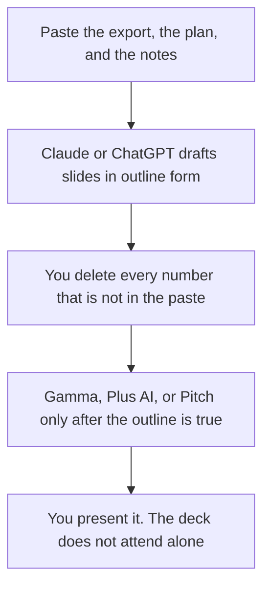

**A QBR deck written with AI is a quarterly review a customer can recognize: the outcomes you agreed, the numbers from your system, what slipped, and the next quarter's plan.** The model can order notes you paste. It cannot invent net retention, a usage chart, or a quote from the champion. If a number is not in the paste, the slide says the owner will bring it, or the slide stays out.

The team shelf is [best AI tools for customer success](/blog/best-ai-tools-for-customer-success-2026/). A shorter internal note is [how to write a status update with AI](/blog/how-to-write-a-status-update-with-ai-2026/). The leave-behind when they asked for one page instead of a meeting is [how to write a sales one-pager with AI](/blog/how-to-write-a-sales-one-pager-with-ai-2026/).

Prices are US list prices excluding tax from directory pages checked October 16, 2026. Published October 24, 2026. We did not score decks.

## What belongs in the meeting

| Slide | Who owns the fact | The model may |
|---|---|---|
| Goals from last quarter | The success plan you both signed | Restate them. It may not upgrade a goal you missed into a goal you hit |
| Usage or outcome numbers | An export you paste, with the date | Place the figure. It may not round it into a win |
| What slipped | Your notes, in the customer's language | Shorten them. It may not blame a person who is not in the notes |
| Proof | A quote you have permission to show | Place it. It may not write a new one |
| Next quarter | The plan you are willing to resource | Draft it. It may not add a feature that is not on the roadmap |
| The ask | The meeting, the renewal, or the introduction you actually want | One line |

A chart titled "adoption up" with no series is [a hallucination](/blog/what-is-ai-hallucination-2026/) in a renewal meeting. The check is [how to fact-check AI writing](/blog/how-to-fact-check-ai-writing-2026/).

## Where the outline and the file happen

**The long account history.** [Claude](/tools/claude/) Pro is $20 a month, or $17 billed annually. Put the success plan in a Project so the next quarter cannot drift the goals. The container is [Claude Projects vs ChatGPT Projects](/blog/claude-projects-vs-chatgpt-projects-2026/).

**The CSM's default chat.** [ChatGPT](/tools/chatgpt/) Plus is $20. Business is $20 a user a month billed annually, for two or more users, when the account notes are confidential. The ladder is [ChatGPT Go vs Plus vs Pro](/blog/chatgpt-go-vs-plus-vs-pro-2026/).

**A link the customer can open.** [Gamma](/tools/gamma/) Plus is $9 a seat a month after the words are frozen. The invoice is [Gamma pricing explained](/blog/gamma-pricing-explained-2026/).

**A file they will mark up in PowerPoint or Slides.** [Plus AI](/tools/plus-ai/) Basic is $10 a user a month billed annually. The format choice is [Plus AI vs Gamma](/blog/plus-ai-vs-gamma-2026/).

**A call you are allowed to cite.** [Fathom](/tools/fathom/) Premium is $16 a month billed annually. Business is $25 a user a month billed annually when you need CRM fields. Free lists unlimited recordings. Confirm the customer allowed the bot. The sales-call pair, if this meeting is actually a sales cycle, is [Otter vs Fathom for sales calls](/blog/otter-vs-fathom-for-sales-calls-2026/).

A prompt that holds the line:

"Draft a QBR outline for this customer. Sections: last quarter's goals, numbers from my export only, what slipped, proof I pasted, next quarter, the ask. If a metric or a quote is missing, write Missing. Do not invent usage, revenue, or testimonials. Keep speaker notes under 40 words a slide."

The person in the room is [what human-in-the-loop AI is](/blog/what-is-human-in-the-loop-ai-2026/).

## What this deck is not

It is not a pitch for a logo you do not have. A new-logo story is [how to create a pitch deck with AI](/blog/how-to-create-a-pitch-deck-with-ai-2026/). It is not an enablement deck for your own reps. That workflow is [how to write a sales enablement deck with AI](/blog/how-to-write-a-sales-enablement-deck-with-ai-2026/). It is not a case study. That needs the customer's permission, and the workflow is [how to write a case study with AI](/blog/how-to-write-a-case-study-with-ai-2026/).

## FAQ

### How many slides should a QBR be?

Enough to cover the six rows in the table, usually well under twenty. A model that fills forty slides is hiding a missing number. Cut to the export.

### Can AI pull the metrics from the CRM?

Only through a path your admin has approved, and a person still checks the figure against the export. A stale field will present as confidence. The CRM remains the record.

### Should the renewal price be on a slide?

Only if your notes say you are allowed to show it. Otherwise the ask is a meeting, not a generated discount.

### What if the quarter went badly?

Say so, from the notes. A deck that turns a missed goal into a "learning journey" without the customer's words is a different meeting than the one they booked.

## Last verified

October 16, 2026 for Claude, ChatGPT, Gamma, Plus AI, and Fathom. Published October 24, 2026.

**Sources:** [Claude pricing](https://claude.com/pricing), [Gamma pricing](https://gamma.app/pricing), [Fathom pricing](https://www.fathom.ai/pricing).

*Published by Andrew for [AI Tools Optimizer](https://aitoolsoptimizer.com).*

[Gamma](/tools/gamma/) is in the [presentations directory](/tools/category/presentations/). Directory pages may use affiliate links. A purchase through them may earn us a commission at no extra cost to you.
